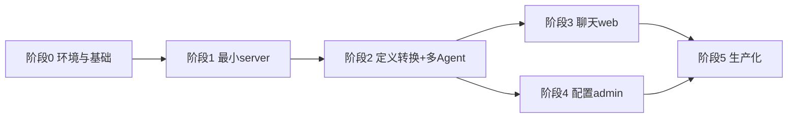

# Parlant 生产级 Agent 搭建计划（总纲）

> 本文档是体系的**主计划**：原始诉求 → 已完成的资料沉淀 → 关键结论 → 待办路线。
> 详细技术参考见 `docs/`，分阶段实施计划见 `plan/`。最后更新：2026-09-20。

---

## 一、目标（原始诉求，已确认）

体系化掌握 Parlant（v3.3.1），并落地三个可交付项目：

| 项目 | 定位 |
|---|---|
| **parlant-agent-admin** | Agent 管理前端：配置 Agent 及全部上下文工程组件（用 `frontend-design`/`ui-ux-pro-max` 设计） |
| **parlant-agent-server** | 后端调度服务：`p.Server()` 启动 Parlant，动态加载多 Agent 执行业务 |
| **parlant-agent-web** | 聊天问答窗口：选定 Agent + 传入客户实体信息实施问答 |

贯穿约束：
- 以 **`agent-definition.json`** 作为 Agent 配置 schema；
- 用 **langfuse**（或兼容 OTLP 的工具）展示 Parlant 整体执行链路。

---

## 二、已完成进展 ✅（本次操作记录）

### 2.1 概念与语法文档（`docs/`，共 25 个文件）
以**本地源码 v3.3.1 自带官方文档**为翻译依据（比抓官网可靠、且与源码严格一致）：

- `docs/01-quickstart/`：安装、快速入门示例、设计动机（3 篇）
- `docs/02-concepts/`：会话、Agent、客户 + 指南/工具/检索器/旅程/关系/术语表/变量/预设话术（11 篇）
- `docs/03-production/`：Agentic 方法论、输入审核、人工转交、API 增强、官方前端参考、可观测性、FastAPI 扩展（7 篇）
- `docs/README.md`：技术参考入口（推荐阅读路线 + 全索引 + 中英术语对照表）

> 补充：`observability`、`extending-api` 两篇为官网最新内容、本地仓库未收录，已从官网抓取翻译补齐。

### 2.2 业务执行链路分析（`docs/04-execution-chain/`，3 篇）
基于 `/Users/zhaoshan/workspace/parlant` 源码实际阅读整理：
- `01-业务执行链路总览.md`：一次提问的完整流程 + 时序图/协作图（mermaid）
- `02-核心模块源码地图.md`：组件 → 源码文件 → 类/函数 对照
- `03-可观测性与追踪对接.md`：trace_id/span 如何对接 langfuse

### 2.3 分阶段实施计划（`plan/`，共 7 个文件）
`plan/README.md` 总纲（架构图/技术选型/依赖组件清单）+ 阶段 0~5：
> 0 环境基础 → 1 最小 server → **2 定义转换+多 Agent 调度（枢纽）** → 3 聊天 web → 4 配置 admin → 5 生产化

---

## 三、关键结论与决策（沉淀）

### 3.1 执行链路核心结论
一次提问：`API create_event → _add_customer_message(trigger_processing) → app.sessions.process() → AlphaEngine._do_process`
- **准备迭代循环**：匹配 Guidelines+Journeys（9 步，LLM 分 batch 评估 condition，含 initial/reevaluation）→ 关系消解 → 工具/检索器执行 → **工具结果触发再匹配**（反馈闭环）→ 判定 prepared 或达 `max_engine_iterations`
- **生成阶段**：`_build_prompt` 拼接 identity+guidelines+变量+术语+能力+工具结果+shots，LLM 带 revision 自我修订生成
- **可追溯**：每个事件带 `trace_id`，对应 OTel span（process/guideline_matcher/tool_caller/message_generation），langfuse 纯环境变量接入

### 3.2 架构决策
- **配置与运行分离**：`agent-definition.json`（定义层，MongoDB 存）为单一事实源；server 内置**加载器**将其转换为 Parlant 实体并装载进运行中的 `p.Server()`，支持版本化/热更新/回滚。
- 管理 API 用 `configure_api` 扩展；鉴权/CORS 用 `configure_container` + 自定义 `AuthorizationPolicy`；观测用 `OTEL_*` 环境变量。

### 3.3 过程修正（相对原始诉求）
- 原始 URL 两处笔误已修正：`tools` → `/customization/tools`；`retriveres` → `retrievers`。
- `.venv` **尚未安装 parlant**（阶段 0 处理）。
- 技术栈建议：React+Vite+Tailwind(+shadcn/ui)、MongoDB、Qdrant、langfuse、OpenAI 兼容 LLM。

---

## 四、待办路线（未开始，详见 `plan/`）



**近期下一步（择一启动）**：
1. 按 `plan/阶段0-环境搭建与Parlant初体验.md` 装环境（装 parlant、起 langfuse/mongo/qdrant、跑通 quickstart）。
2. 初始化 `parlant-agent-server` 项目骨架（`plan/阶段1-runtime最小可用-单Agent对话与追踪.md`）。
3. 用 `frontend-design`/`ui-ux-pro-max` 先出 `parlant-agent-admin` 的页面设计（`plan/阶段4-web配置管理模块.md`）。

---

## 五、参考资源

- 技术参考入口：`docs/README.md`
- 实施总纲：`plan/README.md`
- Parlant 源码：`/Users/zhaoshan/workspace/parlant`（v3.3.1，核心引擎 `src/parlant/core/engines/alpha/engine.py`）
- Agent schema 样例：`agent-definition.json`（"提前结清"贷款 agent）

---

## 附录：原始需求记录（留档）

<details>
<summary>点击查看 2026-09-20 原始诉求原文（含两处 URL 笔误，已在 §3.3 修正）</summary>

```
1.体系化梳理 parlant 框架的所有概念和语法（installation/examples/sessions/agents/customers/guidelines/tools/retrievers/journeys/relationships/glossary/variables/canned-responses），整理成中文技术文档放 docs/，作为开发 Agent 的参考指南；
2.产品设计开发指南（agentic-design/input-moderation/human-handoff/api-hardening/custom-frontend/observability/extending-api）；
3.参考源码 /Users/zhaoshan/workspace/parlant，分析业务执行链路（用户提问→上下文工程组件协作→可控可追溯返回），画流程图，梳理到 docs/；
4.依据资料，为 parlant-agent-admin / parlant-agent-server / parlant-agent-web / langfuse 追踪 拆分可实现的阶段性计划（含数据库/向量库等依赖），放 plan/；可补充未提及的必要能力，随时沟通。
```
</details>
