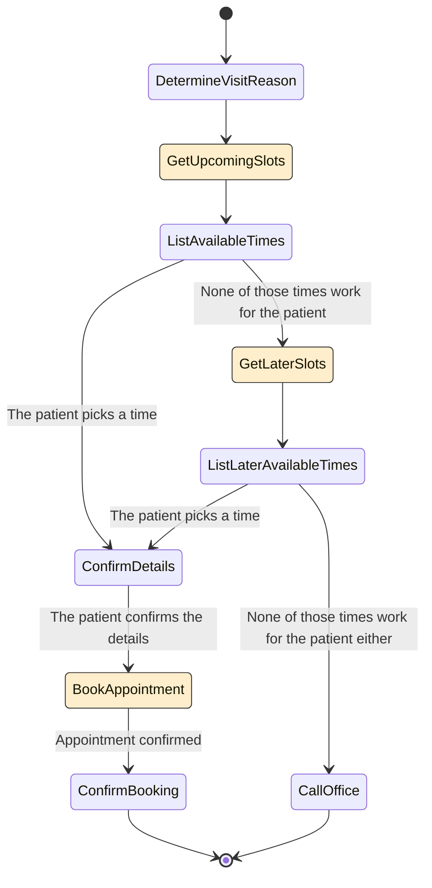

> 来源：docs/quickstart/examples.md，Parlant v3.3.1 官方英文文档中文翻译。

# 医疗保健智能体示例（Healthcare Agent Example）

本页将带你使用 Parlant 设计并构建一个拥有两条客户旅程的医疗保健智能体。
1. **预约问诊（Schedule an appointment）**：智能体帮助患者找到合适的预约时间。
1. **化验结果（Lab results）**：智能体检索患者的化验结果并进行解释。


你将学到如何：
- 让智能体与基础领域知识对齐。
- 使用**状态（states）**和**转移（transitions）**定义**旅程（journeys）**。
- 使用**指南（guidelines）**在对话的边缘情况中控制智能体的行为。
- 使用**工具（tools）**将智能体连接到真实的动作和数据。
- 消解模糊的用户查询（disambiguate）。

虽然本节绝非对 Parlant 特性的全面指南，但它会让你对其基础内容有一个扎实的认识，并了解如何使用 Parlant 构思想要构建的智能体。让我们开始吧！

> **信息：行为建模的艺术（The Art of Behavior Modeling）**
>
> 构建复杂而可靠的面向客户的 AI 智能体是一项具有挑战性的任务。别让炒作机器告诉你并非如此。
>
> 这不仅仅是拥有合适的框架。当我们自动化对话时，我们实际上是在自动化人类对话的复杂语义。从非常现实的意义上说，这意味着我们需要精心设计我们的指令和行为模型。它们需要清晰，并处于恰当的粒度层级，以确保智能体真正如我们所期望的那样行事。
>
> 虽然 Parlant 为你提供了表达和执行指令的工具，但*设计*这些指令本身是一门艺术，需要练习才能做好。然而一旦你掌握了，你就能构建出不仅功能强大、稳定可靠，而且引人入胜、卓有成效的智能体。

## 准备环境（Preparing the Environment）
开始之前，请确保你已
1. [安装](https://parlant.io/docs/quickstart/installation) Parlant 并搭建好 Python 环境。
1. 选定 NLP 提供商并将其连接到你的服务器（同样在[安装页面](https://parlant.io/docs/quickstart/installation)上）。

> **提示：下载代码**
>
> 这个完整示例的可运行代码可以在 [Parlant 的 GitHub 仓库](https://github.com/emcie-co/parlant)的 `examples/` 文件夹中找到。

## 概述（Overview）

我们将按以下步骤实现该智能体：

1. 用一段简单的智能体描述创建基线程序。
1. 添加**预约问诊（scheduling）**旅程，包含状态、转移和工具。
1. 以类似方式添加**化验结果（lab results）**旅程。

## 入门（Getting Started）
我们将把整个程序实现在单个文件 `healthcare.py` 中，但在实际用例中，你可能希望将其拆分为多个文件以便更好地组织。在这些情况下，一个好方法是为每条旅程（journey）单独设立一个文件。

但现在，让我们开始创建我们的初始智能体。

```python
# healthcare.py

import parlant.sdk as p
import asyncio

async def add_domain_glossary(agent: p.Agent) -> None:
  await agent.create_term(
    name="Office Phone Number",
    description="The phone number of our office, at +1-234-567-8900",
  )

  await agent.create_term(
    name="Office Hours",
    description="Office hours are Monday to Friday, 9 AM to 5 PM",
  )

  await agent.create_term(
    name="Charles Xavier",
    synonyms=["Professor X"],
    description="The renowned doctor who specializes in neurology",
  )

  # Add other specific terms and definitions here, as needed...

async def main() -> None:
    async with p.Server() as server:
        agent = await server.create_agent(
            name="Healthcare Agent",
            description="Is empathetic and calming to the patient.",
        )

        await add_domain_glossary(agent)


if __name__ == "__main__":
    asyncio.run(main())
```

## 创建预约问诊旅程（Creating the Scheduling Journey）
要了解旅程（journeys）在 Parlant 中的运作方式，请参阅 [Journeys 文档](https://parlant.io/docs/concepts/customization/journeys)。这里我们将直接进入主题，但建议你先查阅相关文档。

### 添加工具（Adding Tools）
首先，添加我们支持这条旅程所需的工具。

```python
from datetime import datetime

@p.tool
async def get_upcoming_slots(context: p.ToolContext) -> p.ToolResult:
  # Simulate fetching available times from a database or API
  return p.ToolResult(data=["Monday 10 AM", "Tuesday 2 PM", "Wednesday 1 PM"])

@p.tool
async def get_later_slots(context: p.ToolContext) -> p.ToolResult:
  # Simulate fetching later available times
  return p.ToolResult(data=["November 3, 11:30 AM", "November 12, 3 PM"])

@p.tool
async def schedule_appointment(context: p.ToolContext, datetime: datetime) -> p.ToolResult:
  # Simulate scheduling the appointment
  return p.ToolResult(data=f"Appointment scheduled for {datetime}")
```

> **提示：Parlant 中的工具（Tools in Parlant）**
>
> Parlant 拥有比大多数智能体框架更为精巧的工具系统，因为它针对对话式、敏感的面向客户用例进行了优化。我们强烈建议你仔细阅读 [Tools 一节](https://parlant.io/docs/concepts/customization/tools)中的文档，以了解其强大之处。

### 构建旅程（Building the Journey）
现在，我们将按照下图创建这条旅程：



```python
# <<Add this function>>
async def create_scheduling_journey(server: p.Server, agent: p.Agent) -> p.Journey:
  # Create the journey
  journey = await agent.create_journey(
    title="Schedule an Appointment",
    description="Helps the patient find a time for their appointment.",
    conditions=["The patient wants to schedule an appointment"],
  )

  # First, determine the reason for the appointment
  t0 = await journey.initial_state.transition_to(chat_state="Determine the reason for the visit")

  # Load upcoming appointment slots into context
  t1 = await t0.target.transition_to(tool_state=get_upcoming_slots)

  # Ask which one works for them
  # We will transition conditionally from here based on the patient's response
  t2 = await t1.target.transition_to(chat_state="List available times and ask which ones works for them")

  # We'll start with the happy path where the patient picks a time
  t3 = await t2.target.transition_to(
    chat_state="Confirm the details with the patient before scheduling",
    condition="The patient picks a time",
  )

  t4 = await t3.target.transition_to(
    tool_state=schedule_appointment,
    condition="The patient confirms the details",
  )
  t5 = await t4.target.transition_to(chat_state="Confirm the appointment has been scheduled")
  await t5.target.transition_to(state=p.END_JOURNEY)

  # Otherwise, if they say none of the times work, ask for later slots
  t6 = await t2.target.transition_to(
    tool_state=get_later_slots,
    condition="None of those times work for the patient",
  )
  t7 = await t6.target.transition_to(chat_state="List later times and ask if any of them works")

  # Transition back to our happy-path if they pick a time
  await t7.target.transition_to(state=t3.target, condition="The patient picks a time")

  # Otherwise, ask them to call the office
  t8 = await t7.target.transition_to(
    chat_state="Ask the patient to call the office to schedule an appointment",
    condition="None of those times work for the patient either",
  )
  await t8.target.transition_to(state=p.END_JOURNEY)

  return journey
```

然后，在你的 `main` 函数中调用此函数，以将这条旅程添加到你的智能体：

```python
async def main() -> None:
  async with p.Server() as server:
    agent = await server.create_agent(
      name="Healthcare Agent",
      description="Is empathetic and calming to the patient.",
    )

    # <<Add this line>>
    scheduling_journey = await create_scheduling_journey(server, agent)
```

### 处理边缘情况（Handling Edge Cases）
在现实场景中，患者并不总是遵循你旅程中的既定路径。他们可能会提问、表达顾虑，或给出其他意想不到的回应。

对于 Parlant 智能体而言，这正是它们的拿手好戏！尽管它们仍然能够对患者作出情境化的回应，你可能仍希望引导并改进它们在你所观察到的特定场景中*如何*回应。

为此，你可以为智能体添加**指南（guidelines）**。指南就像情境规则，告诉智能体在特定情况下如何回应。你可以将它们限定到特定的旅程，这样它们仅在该智能体处于那条旅程时生效。

让我们为智能体添加几条指南，以处理预约问诊旅程中的一些常见边缘情况。

```python
async def create_scheduling_journey(server: p.Server, agent: p.Agent) -> p.Journey:
  # ... continued

  # <<Add this to the end of the create_scheduling_journey function>>

  await journey.create_guideline(
    condition="The patient says their visit is urgent",
    action="Tell them to call the office immediately",
  )

  # Add more edge case guidelines as needed...

  return journey
```

### 运行程序（Running the Program）
当你运行程序时，你应该首先看到 Parlant 评估你配置的语义属性。它这样做是为了优化你的指南和旅程在幕后被检索、处理与遵循的方式。


服务器就绪后，打开浏览器并导航到 [http://localhost:8800](http://localhost:8800)，与你的智能体交互。


> **警告：处理不支持的查询（Handling Unsupported Queries）**
>
> 你可能会注意到，此时你的智能体很乐意尝试帮助客户，同时完全越过了它自身知识和能力的边界。虽然这在 LLM 中很常见，但在许多现实用例中这是不可容忍的。
>
> Parlant 提供了多种结构化方式来实现对你智能体（不当）行为的绝对控制。这个示例仅仅是个开始；请放心，随着你对 Parlant 了解得更多，它能帮助你部署一个你真正可以信任的智能体。


## 创建化验结果旅程（Creating the Lab Results Journey）
我们将快速跳过这条旅程，因为它的结构与其他旅程（以及你可能构建的任何其他旅程）非常相似。

### 添加工具（Adding Tools）

```python
@p.tool
async def get_lab_results(context: p.ToolContext) -> p.ToolResult:
  # Simulate fetching lab results from a database or API,
  # using the customer ID from the context.
  lab_results = await MY_DB.get_lab_results(context.customer_id)

  if lab_results is None:
    return p.ToolResult(data="No lab results found for this patient.")

  return p.ToolResult(data={
    "report": lab_results.report,
    "prognosis": lab_results.prognosis,
  })
```

### 构建旅程（Building the Journey）
```python
async def create_lab_results_journey(server: p.Server, agent: p.Agent) -> p.Journey:
  # Create the journey
  journey = await agent.create_journey(
    title="Lab Results",
    description="Retrieves the patient's lab results and explains them.",
    conditions=["The patient wants to see their lab results"],
  )

  t0 = await journey.initial_state.transition_to(tool_state=get_lab_results)

  await t0.target.transition_to(
    chat_state="Tell the patient that the results are not available yet, and to try again later",
    condition="The lab results could not be found",
  )

  await t0.target.transition_to(
    chat_state="Explain the lab results to the patient - that they are normal",
    condition="The lab results are good - i.e., nothing to worry about",
  )

  await t0.target.transition_to(
    chat_state="Present the results and ask them to call the office "
     "for clarifications on the results as you are not a doctor",
    condition="The lab results are not good - i.e., there's an issue with the patient's health",
  )

  # Handle edge cases with guidelines...

  await agent.create_guideline(
    condition="The patient presses you for more conclusions about the lab results",
    action="Assertively tell them that you cannot help and they should call the office"
  )

  return journey
```

最后，在你的 `main` 函数中调用该函数，以将这条旅程添加到你的智能体：

```python
async def main() -> None:
  async with p.Server() as server:
    agent = await server.create_agent(
      name="Healthcare Agent",
      description="Is empathetic and calming to the patient.",
    )

    scheduling_journey = await create_scheduling_journey(server, agent)
    # <<Add this line>>
    lab_results_journey = await create_lab_results_journey(server, agent)
```

重启程序，打开浏览器并导航到 [http://localhost:8800](http://localhost:8800)，与你的智能体交互。试着说点诸如 _"Did my lab results come in?"_（我的化验结果出来了吗？）或 _"I want to schedule an appointment"_（我想预约一次问诊）之类的话。

## 消解患者意图的歧义（Disambiguating Patient Intent）
在某些情况下，患者所说的话可能有多种解读方式，从而导致不知道该执行哪个动作，或不清楚他们想达成什么目标。

处理这个问题的一个简单方法是使用**消歧（disambiguation）**。当可能有多个动作可执行时，这会使智能体要求患者澄清其意图。你可以这样做：

```python
async def main() -> None:
  async with p.Server() as server:
    agent = await server.create_agent(
      name="Healthcare Agent",
      description="Is empathetic and calming to the patient.",
    )

    scheduling_journey = await create_scheduling_journey(server, agent)
    lab_results_journey = await create_lab_results_journey(server, agent)

    # <<Add the following lines>>

    # First, create an observation of an ambiguous situation
    status_inquiry = await agent.create_observation(
      "The patient asks to follow up on their visit, but it's not clear in which way",
    )

    # Use this observation to disambiguate between the two journeys
    await status_inquiry.disambiguate([scheduling_journey, lab_results_journey])
```

现在，如果患者以模糊的方式询问后续跟进，智能体将要求他们澄清是想预约问诊，还是想查看化验结果。

重启程序，打开浏览器并导航到 [http://localhost:8800](http://localhost:8800)，与你的智能体交互。试着说点诸如 _"I need to follow up on my last visit"_（我需要跟进我上次就诊）之类的话，看看智能体会如何回应。

## 全局指南（Global Guidelines）
通常会有一些你可能希望应用于智能体所有旅程的指南，而不仅仅是某一条旅程（或者，即便患者并非处于某条旅程中途也同样适用）。例如，你可能希望对保险提供商进行有理有据的介绍。

要实现这一点，你只需将指南添加到智能体本身，而非添加到某条特定旅程上。

```python
await agent.create_guideline(
  condition="The patient asks about insurance",
  action="List the insurance providers we accept, and tell them to call the office for more details",
  tools=[get_insurance_providers],
)

await agent.create_guideline(
  condition="The patient asks to talk to a human agent",
  action="Ask them to call the office, providing the phone number",
)

await agent.create_guideline(
  condition="The patient inquires about something that has nothing to do with our healthcare",
  action="Kindly tell them you cannot assist with off-topic inquiries - do not engage with their request.",
)
```

## 后续步骤（Next Steps）
1. 下载并试用此示例的可运行代码文件：[healthcare.py](https://github.com/emcie-co/parlant/blob/develop/examples/healthcare.py)
1. 使用预设话术（canned responses）定制和约束智能体消息的内容与风格：[Canned Responses](https://parlant.io/docs/concepts/customization/canned-responses)
1. 学习如何在[生产环境（production environment）](https://parlant.io/docs/category/production)中部署你的智能体
1. 将 [React 组件](https://github.com/emcie-co/parlant-chat-react)添加到你的网站，与智能体交互