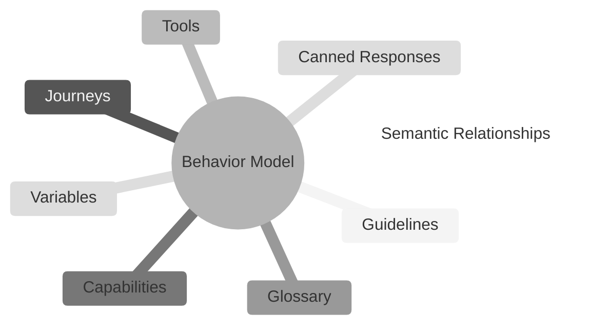
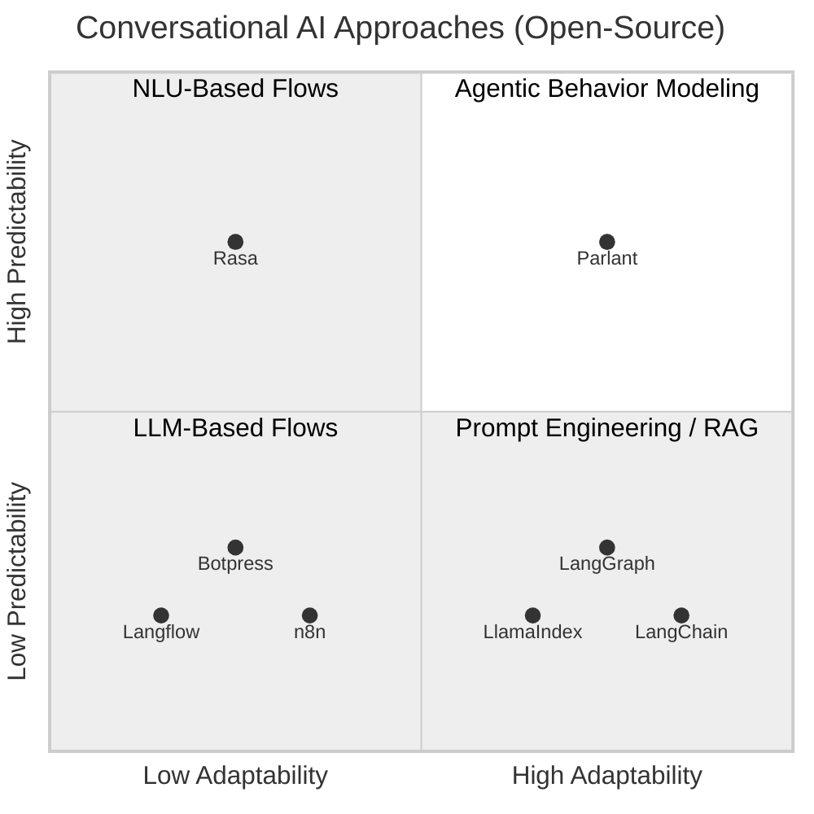

> 来源：docs/quickstart/motivation.md，Parlant v3.3.1 官方英文文档中文翻译。

# 设计动机（Motivation）

假设你下载了某个智能体框架并构建了一个 AI 智能体——这很棒！然而，当你真正测试它时，却发现它无法妥善处理许多客户交互。你的业务专家对它很不满意。你的提示词（prompts）正变得一团糟。你该怎么办？

欢迎进入**智能行为建模（Agentic Behavior Modeling，简称 ABM）**的世界：这是一种全新的强大方法，用于控制你的智能体如何与用户交互。

行为模型（behavior model）是一套结构化的、量身定制的原则、动作、目标和事实基准（ground-truths），它将智能体导向特定的领域或用例。



#### 为什么需要行为建模？（Why Behavior Modeling?）

让 LLM 智能体说出并做到*你*想要它说和做的事，是一个非常困难的问题，几乎所有构建面向客户智能体的人都经历过。以下展示了 ABM 与其他解决此问题的方法的对比。

- **流程引擎（Flow engines）**会构建逐步的对话流程图，*强迫*用户按照预定义脚本进行交互。这种僵化的方法往往导致用户参与度和信任度低下。相比之下，**ABM 引擎**在遵循你的业务规则的同时，动态地*适应*用户的自然交互模式。

- **自由形式的提示工程（Free-form prompt engineering）**，无论是基于图的编排还是系统提示，往往导致*不一致且不可靠的行为遵从性*，无法满足要求和期望。相反，**ABM 引擎**利用清晰的语义结构和标注，来促进对业务规则的遵从。



## 什么是 Parlant？（What is Parlant?）

Parlant 是一个开源的**ABM 引擎（ABM Engine）**，面向 LLM 智能体，这意味着你可以使用它在不同场景中精确控制你的 LLM 智能体如何与用户交互。

Parlant 是一个成熟的框架，预置了大量经实践验证的特性，帮助你快速上手面向客户的智能体，并使行为建模过程尽可能轻松。

## 为什么选择 Parlant？（Why Parlant?）

许多对话式 AI 用例在与用户交互时都要求严格遵守业务规则。然而，迄今为止，用 LLM 来实现这一点极为困难——至少在一致性成为关注点时如此。

Parlant 正是为解决这一挑战而构建的。通过采用结构化、对开发者友好的方式来对对话行为进行建模，借助精心设计的规则、实体和关系（Relationship），Parlant 让你能够以简洁优雅的方式定义、执行、追踪（Trace）并推理智能体的决策。

## 行为建模入门：细粒度指南（Behavior Modeling 101: Granular Guidelines）

行为模型中最基础但也最强大的建模实体是**指南（guideline）**。在 Parlant 中，你不是以自由形式定义指南（就像你在系统提示中可能做的那样），而是以**细粒度（granular）**方式定义它们，其中每条指南都添加了一条单独的**澄清（clarification）**，来引导你的 AI 智能体如何处理特定情境。

为确保你的智能体始终保持专注并一致地遵从你的指南，Parlant 会自动在你提供的全部指南中筛选并选择最相关的一组，供其在任何给定情境中应用。它通过同时考察指南的*条件（condition）*（描述其应在何种情况下适用）及其*动作（action）*（描述它应该做什么）来实现这一点。

最后，它会执行强制（enforcement）以确保匹配到的指南确实被遵循，并在每一轮为你提供关于智能体对情境和指南解读的说明。

通过迭代地工作，在发现需要的任何地方添加指南，你就可以让 LLM 智能体按照你确切的需求和期望来处理各种不同的情况。

```python
await agent.create_guideline(
  condition="you have suggested a solution that did not work for the user",
  action="ask if they'd prefer to talk to a human agent, or continue troubleshooting with you",
)`,
```

Parlant 在幕后所做的大量工作是理解某条指南何时应被应用。这比表面上看起来更棘手。例如，Parlant 会自动追踪某条指南是否已在对话中被应用过，以免它不必要地重复自身。它还会区分哪些指南是*始终*适用的，哪些在对话中仅适用*一次*。并且它会在最大限度地降低成本和延迟的前提下做到这些。

> **AI 行为可解释性（AI Behavior Explainability）**
>
> 一旦指南安装完成，你就可以通过检查 Parlant 的日志，获得关于每一轮中它们评估情况的清晰反馈。
>
> 在关于 Parlant 如何实现[强制与可解释性（enforcement & explainability）](https://parlant.io/docs/advanced/explainability)的章节中了解更多。

## 理解痛点（Understanding the Pain Point）

到目前为止，虽然大多数构建 AI 智能体的人都知道幻觉（hallucinations）是一个重要挑战，但仍有太少的人意识到构建有效的对话式 LLM 智能体所面临的实际对齐挑战。

事情是这样的。[LLM](https://en.wikipedia.org/wiki/Large_language_model) 就像是一个陌生人，对每种可能情境的各种处理方法拥有百科全书般的知识。尽管它极其强大，**但这种极端的通用性与固有的上下文缺失相结合，恰恰就是它很少如我们所期望的那样行事的原因**——因为有太多可行的选项供它选择。

这就是为什么，在没有一套清晰而全面的[指南（guidelines）](https://parlant.io/docs/concepts/customization/guidelines)的情况下，LLM 会总是试图从其庞大但未经筛选的训练观察（Observation）中乐观地取材。它很容易最终使用与客户或情境脱节的语气，做出不相关的提议，陷入循环，或者干脆失去焦点而离题。


行为建模是一种目标在于简化 LLM 智能体引导的方法。每当你发现智能体偏离目标时，你就把它收敛为行为模型中的一处必要改动，并通过调整它来快速解决。你主要使用[指南（guidelines）](https://parlant.io/docs/concepts/customization/guidelines.mdx)以及 Parlant 所支持的其他建模元素来完成这件事。

为此，Parlant 从底层设计上就允许你**在遇到意外行为**或收到客户与业务专家的反馈时，**快速调整智能体的行为**。其结果是一个有效、可控且增量式的改进循环。


Parlant 背后的重要前提是，[缺乏良好引导的 AI 智能体是死路一条](https://parlant.io/about#the-intrinsic-need-for-guidance)。没有引导，AI 智能体必然会遇到大量歧义，并最终尝试使用许多错误甚至有问题的方法来解决它们。**只有你才能权威地教会你的智能体如何为你做出正确的选择**——因此你应该能够轻松、快速且可靠地做到这一点。

与其让智能体绕圈子、漫无边际、提供不相干的解决方案或答案，**Parlant 帮你构建一个受引导、专注且设计精良的智能体**——一个你的客户真正会用起来的智能体。


所以，收拾好行囊，准备去建模一些令人赞叹的 AI 对话吧。现在掌控权在你手中。让我们开始吧！