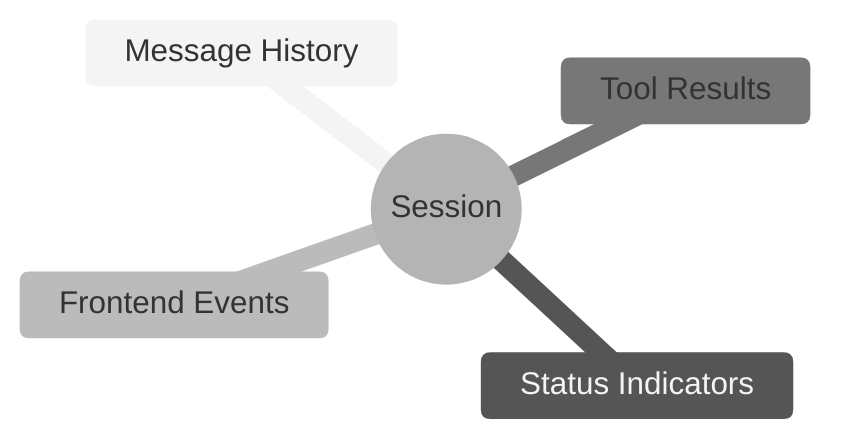
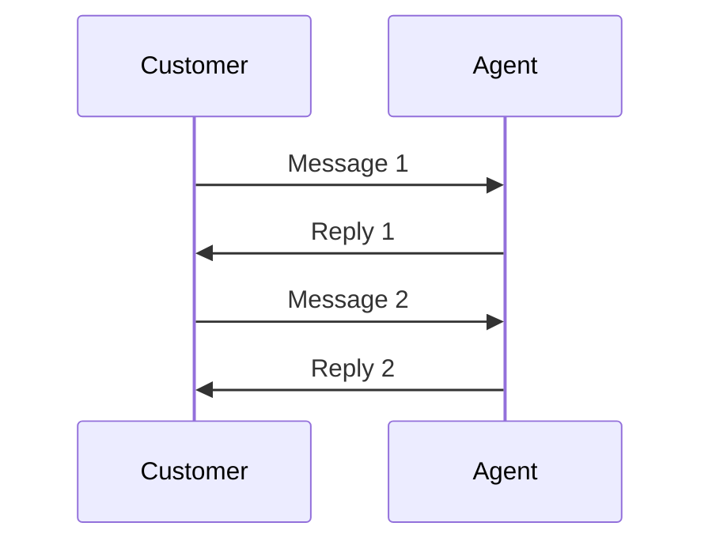
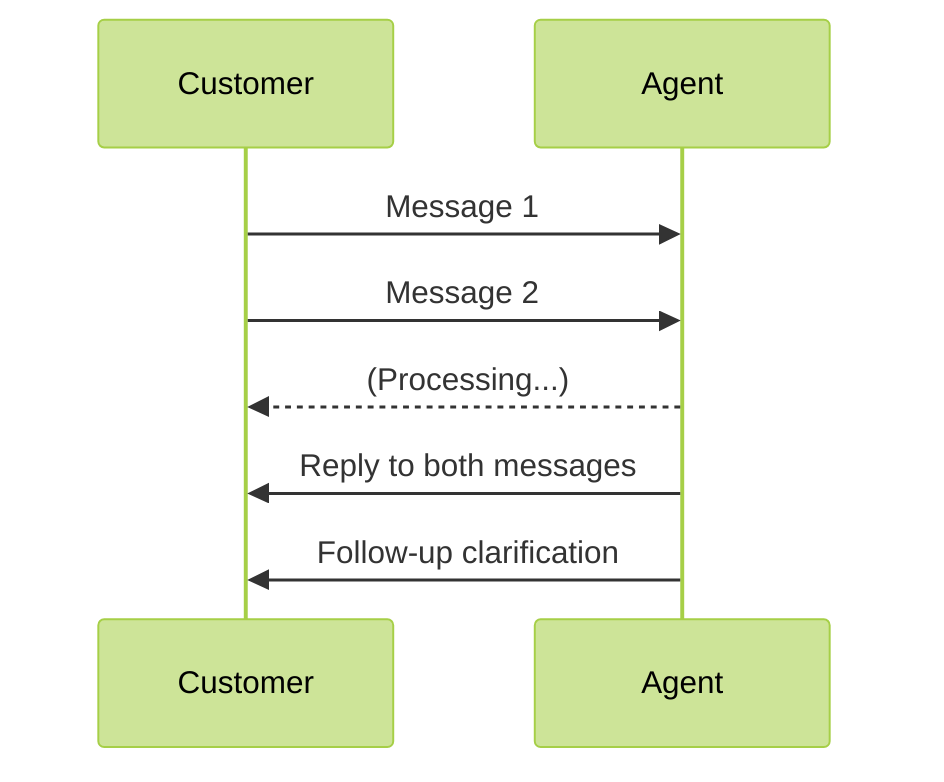
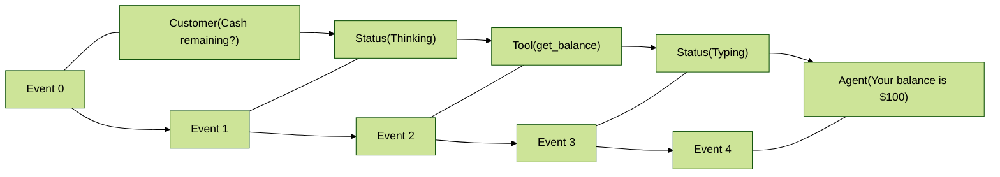

> 来源：docs/concepts/sessions.md，Parlant v3.3.1 官方英文文档中文翻译。

> **⚠️ 官网更新注记（2026-09-30 核对，以 https://www.parlant.io/docs/concepts/sessions 为准）**
> 本译文为本地 parlant 仓库 docs/ 的 v3.3.1 快照，官网已更新；经 parlant 源码溯源，
> 下述差异多数为「v3.3.1 代码已支持、仅文档过时」，已按官网回改正文：
> - 回改项：新增 主动消息（Proactive Messages，agent.utter()）/ 标签（Labels，指南/旅程/状态标签自动传播到会话，`client.sessions.list(labels=[...])` AND 逻辑）/ 更新会话属性（Updating Session Properties，`p.Session.current.update(mode=manual / agent=... / title=...)`）/ 会话元数据（metadata.set/get/delete）/ 会话标签（labels.add/remove）/ MongoDB 需 `pip install "parlant[mongo]"`；「与智能体交互」整节（ParlantChatbox / Python·TS SDK / 事件 JSON）官网已迁移到 custom-frontend 页，正文改为链接指向该页
> - 官网新增、未全文重写项：触发式响应（Triggered Responses）独立页，`agent.utter()` 完整用法见官网对应页
> - 源码未确认项：Session 对象 metadata.get/delete 与 labels.add/remove（以官网为准，源码待核）

# 会话 (Session)

会话 (Session) 代表一个[智能体 (Agent)](https://parlant.io/docs/concepts/entities/agents)与一个[客户 (Customer)](https://parlant.io/docs/concepts/entities/customers)之间持续的交互。

会话是你的对话模型的舞台，让智能体能够以结构化且持久的方式与客户互动。它封装了智能体与客户之间发生的所有交互，包括消息、状态更新、前端事件以及工具调用结果。



> **智能体记忆？**
>
> 有些框架所称的"记忆"，在 Parlant 中已经内建到会话里了。智能体持续感知会话中发生的一切，并利用这些信息来应用正确的指令、生成恰当的回复。

## 现代交互模型

Parlant 看待交互会话的方式，与大多数对话式人工智能 (Conversational AI) 框架不同。

在过去几十年里，几乎所有形式的对话式 AI 都假设交互是逐轮进行的：客户发送一条消息，智能体对其做出回复。

然而这并非真实对话的运作方式。人们常常接连发送多条消息来表达自己的想法。此外，智能体可能先说点什么，让客户稍候片刻，然后再带着后续消息回到对话中。

**刚性交互模型**



**现代交互模型**



由于真实对话就是这样运作的，Parlant 从底层架构开始就为此提供了内建支持。

> **多参与者会话**
>
> 这是 Parlant 开发路线图上的一项请求功能，它将让你能够拥有多个与客户互动的智能体，或者让智能体彼此互动。该功能的另一个用例，是把客户转接给另一个 AI 智能体。

## 主动消息（Proactive Messages）

智能体还可以在无需等待客户输入的情况下发送消息——例如，在后台操作完成后跟进，或在客户闲置时主动询问。

参见[触发式响应（Triggered Responses）](https://www.parlant.io/docs/advanced/triggered-responses)了解更多。

## 标签（Labels）

标签（Labels）是字符串标签，帮助你跨对话进行分类、筛选和追踪所发生的事情。

你在创建[指南](/docs/concepts/customization/guidelines)、[旅程](/docs/concepts/customization/journeys)和旅程状态时设置标签。当这些实体在对话中匹配时，它们的标签会自动传播到会话。随着时间推移，会话会累积标签，为你提供一份"什么被激活过、何时被激活"的记录。

### 标签为何重要

在生产环境中，你需要回答这类问题："哪些对话触发了追加销售尝试？"、"多少会话以人工接管告终？"、"客户最常到达哪些旅程状态？"

标签让这些问题变得容易回答：

* **分析与优化**：哪些指南触发得最频繁？客户对追加销售尝试的反应如何？
* **路由（Routing）**：根据累积的标签，将会话路由给专门的智能体或人工团队
* **筛选（Filtering）**：列出所有涉及某个主题或触发过某个流程的会话

### 设置标签

你在创建指南、旅程或旅程状态时设置标签：

```python
await agent.create_guideline(
    condition="The customer is interested in renewing their plan",
    action="Suggest the new premium plan and explain its benefits",
    labels=["upsell_attempt"],
)
```

```python
await agent.create_guideline(
    condition="The customer is frustrated and wants to speak to a human",
    action="Transfer the conversation to a human agent",
    tools=[human_handoff],
    labels=["human_handoff"],
)
```

旅程上的标签以同样的方式工作：

```python
journey = await agent.create_journey(
    title="Technical Support",
    description="Handles technical issues",
    conditions=["Customer reports a technical problem"],
    labels=["support", "technical"],
)
```

旅程状态上也是：

```python
step = await state.transition_to(
    chat_state="Collect payment details",
    labels=["payment", "sensitive"],
)
```

### 按标签查询会话

按标签查询已内建于客户端 SDK 中。当你传入多个标签时，筛选使用 **AND 逻辑**——只返回携带*所有*指定标签的会话。

```python
from parlant.client import ParlantClient

client = ParlantClient(base_url="http://localhost:8800")

# 拉取所有发生过追加销售尝试的会话
upsell_sessions = client.sessions.list(labels=["upsell_attempt"])

# 找到同时发生追加销售和人工接管的会话
escalated_upsells = client.sessions.list(
    labels=["upsell_attempt", "human_handoff"],
)
```

## 更新会话属性（Updating Session Properties）

在[工具](/docs/concepts/customization/tools)内部，你可以使用 `Session` 对象直接更新会话属性：

```python
session = p.Session.current

# 更新会话模式（例如用于人工接管）
await session.update(mode="manual")

# 转接到另一个智能体
billing_agent = await p.Server.current.get_agent(id="billing_specialist")
await session.update(agent=billing_agent)

# 设置会话标题
await session.update(title="Billing inquiry - account upgrade")
```

### 元数据（Metadata）

会话元数据（metadata）让你可以从工具内部为会话附加任意的键值数据。这是存储特定于会话的笔记、状态和记忆的好地方，你的工具或指南可能在对话后期需要这些信息：

```python
session = p.Session.current

await session.metadata.set("topic", "billing")
await session.metadata.set("priority", "high")

topic = await session.metadata.get("topic")

await session.metadata.delete("priority")
```

### 标签（Labels）

除了从指南和旅程[自动传播的标签](#标签)之外，你还可以直接从工具内部添加或移除标签：

```python
session = p.Session.current

await session.labels.add("escalated")
await session.labels.remove("escalated")
```

## 配置会话存储

你可以选择会话的存储位置。

默认情况下，Parlant 不会持久化会话，也就是说它们存储在内存中，服务器重启后就会丢失。这便于测试和开发。

如果你希望持久化会话，可以配置 Parlant 使用你选择的数据库。对于本地持久化，我们推荐使用集成的 JSON 文件存储，因为它无需任何设置。对于生产环境，你可以使用内置的 MongoDB，或者其它数据库。

### 持久化到本地存储
这会把会话保存到 `$PARLANT_HOME/sessions.json` 下。

```python
import asyncio
import parlant.sdk as p

async def main():
    async with p.Server(session_store="local") as server:
        # ...

asyncio.run(main())
```

### 持久化到 MongoDB
启动服务器时指定你 MongoDB 数据库的连接字符串即可：

```python
import asyncio
import parlant.sdk as p

async def main():
    async with p.Server(session_store="mongodb://path.to.your.host:27017") as server:
        # ...

asyncio.run(main())
```

安装 MongoDB 附加组件：

```bash
pip install "parlant[mongo]"
```

## 事件驱动通信

把 Parlant 中的会话想象成对话中发生的一切所构成的时间线。

这条时间线上的每一个时刻——无论是某人讲话、一次状态更新，还是一次工具调用结果——都被捕获为一个事件。这些事件一个接一个排列，每个都有自己的位置编号（称为其 *offset*，即偏移量），从 0 开始。

当对话展开时，会生成一系列事件。客户可能以一句 *"Hello"* 开启会话——那是事件 0。接着系统记录下智能体已确认该消息并正在准备回复，输出一个状态事件——那是事件 1。智能体的 *"Hi there!"* 成为事件 2，以此类推。每个事件，无论是消息往来、智能体正在输入，还是发生了错误，都在这条有序序列中占据自己的位置。



这个序列中的每个事件都携带着重要信息：它是什么类型的事件（如消息或状态更新）、实际发生了什么（数据），以及何时发生。这构成了对话的完整记录，帮助我们准确理解事情的来龙去脉，便于在需要时追踪和回顾对话的状态。

每个事件还与一个 **trace ID（追踪 ID）** 相关联。这个 ID 主要用于追踪 AI 生成的消息与产生这些消息的引擎触发 (engine trigger) 之间的对应关系，包括可能为其提供信息的所有已生成的工具事件。这让我们能够轻松获取并理解每一次生成的消息所依赖的数据。例如，让你的前端客户端去检查某条消息已追踪的工具事件，你就能在该消息下方以"脚注"的形式展示相关信息。

### 事件类型

Parlant 定义了几种可供你使用的事件类型：

1. `"message"`：表示对话中某一参与者发送的一条消息。
2. `"status"`：表示 AI 智能体的状态更新，例如 "thinking..."，或 "typing..."。
3. `"tool"`：表示 AI 智能体进行的一次工具调用的结果。
4. `"custom"`：表示由你的应用定义的自定义事件。这对于向智能体输入自定义状态更新很有用，例如让它知晓客户在你前端应用中的导航状态。

### 事件来源

Parlant 中的事件可以来自不同的来源。下面是可能来源的快速概览：

1. `"customer"`：事件的数据由客户创建。目前，这总是一条消息。
2. `"customer_ui"`：事件由客户的用户界面创建，用于向智能体输入相关状态。
3. `"ai_agent"`：事件由 AI 智能体生成，例如一条消息或一次状态更新。
4. `"human_agent"`：事件由人工手动创建，通常出现在人工接管 (human-handoff) 场景中。
5. `"human_agent_on_behalf_of_ai_agent"`：与上面类似，事件由人工客服创建，但在客户看来就像来自 AI 智能体。当你不一定想让客户知道有人工介入的真相时，这有助于维持一致的体验。
6. `"system"`：事件由系统生成，例如一次工具调用结果。

### 状态事件

状态事件表示 AI 智能体状态的一次更新，目前它的来源总是 `"ai_agent"`。

在与客户的聊天过程中，状态事件非常适合用来显示对话进展。例如，你可以让你的前端在智能体思考或输入时给出提示。你可以使用 6 种状态事件：

1. `"acknowledged"`：智能体已确认客户的消息，并开始处理回复
1. `"cancelled"`：智能体在过程中取消了回复，通常是因为有新的数据被加入了会话
1. `"processing"`：智能体正在评估会话，为生成恰当的回复做准备
1. `"typing"`：智能体已完成对会话的评估，当前正在生成消息
1. `"ready"`：智能体处于空闲状态，准备接收新事件
1. `"error"`：智能体在尝试生成回复时遇到了错误

> 完整的事件 schema（消息 / 状态 / 工具事件的 JSON 结构）与前端集成细节，参见[自定义前端集成（Custom Frontend Integration）](https://www.parlant.io/docs/production/custom-frontend)。

## 与智能体交互

一旦 Parlant 服务器启动并运行，你就可以与它托管的智能体进行交互。

完整的交互与集成方式——使用官方 React 组件（ParlantChatbox）、使用官方 Python 或 TypeScript 客户端 SDK 构建自定义前端，以及直接使用 [REST API](https://parlant.io/docs/api/create-session)——官网已从本页迁移到[自定义前端集成（Custom Frontend Integration）](https://www.parlant.io/docs/production/custom-frontend)页面，请前往该页获取最新说明。
