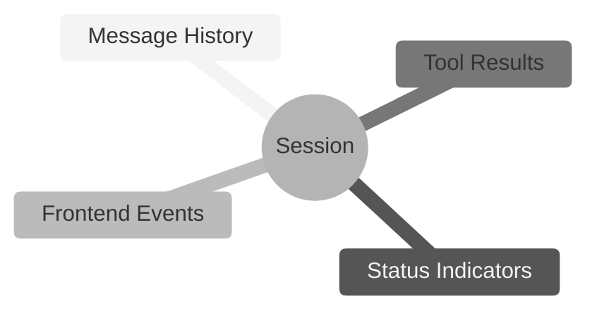
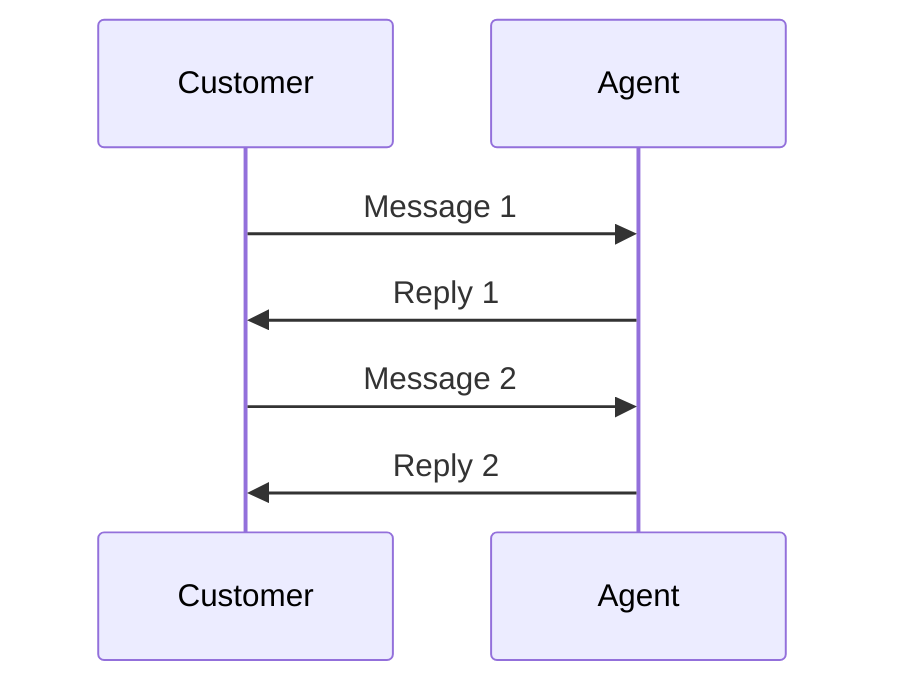
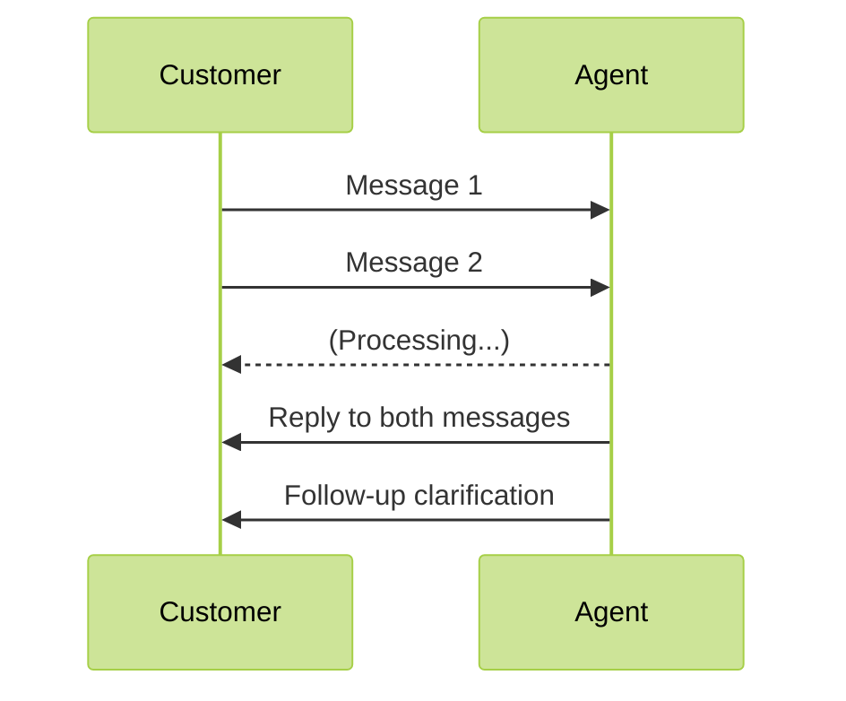
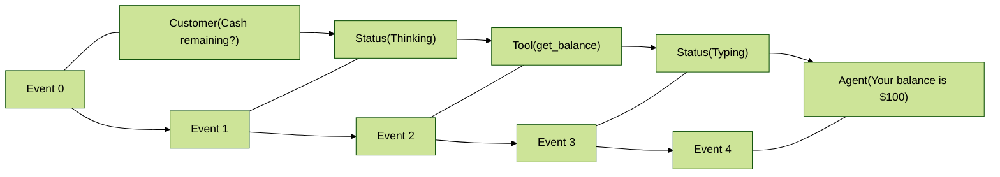
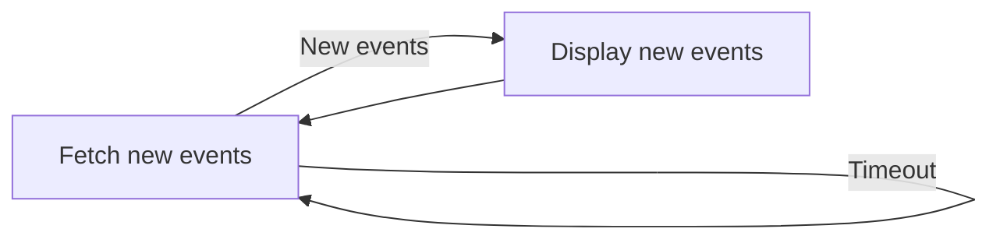

> 来源：docs/concepts/sessions.md，Parlant v3.3.1 官方英文文档中文翻译。

# 会话 (Session)

会话 (Session) 代表一个[智能体 (Agent)](https://parlant.io/docs/concepts/entities/agents)与一个[客户 (Customer)](https://parlant.io/docs/concepts/entities/customers)之间持续的交互。

会话是你的对话模型的舞台，让智能体能够以结构化且持久的方式与客户互动。它封装了智能体与客户之间发生的所有交互，包括消息、状态更新、前端事件以及工具调用结果。



> **智能体记忆？**
>
> 有些框架所称的"记忆"，在 Parlant 中已经内建到会话里了。智能体持续感知会话中发生的一切，并利用这些信息来应用正确的指令、生成恰当的回复。

## 现代交互模型

Parlant 看待交互会话的方式，与大多数对话式人工智能 (Conversational AI) 框架不同。

在过去几十年里，几乎所有形式的对话式 AI 都假设交互是逐轮进行的：客户发送一条消息，智能体对其做出回复。

然而这并非真实对话的运作方式。人们常常接连发送多条消息来表达自己的想法。此外，智能体可能先说点什么，让客户稍候片刻，然后再带着后续消息回到对话中。

**刚性交互模型**



**现代交互模型**



由于真实对话就是这样运作的，Parlant 从底层架构开始就为此提供了内建支持。

> **多参与者会话**
>
> 这是 Parlant 开发路线图上的一项请求功能，它将让你能够拥有多个与客户互动的智能体，或者让智能体彼此互动。该功能的另一个用例，是把客户转接给另一个 AI 智能体。

## 配置会话存储

你可以选择会话的存储位置。

默认情况下，Parlant 不会持久化会话，也就是说它们存储在内存中，服务器重启后就会丢失。这便于测试和开发。

如果你希望持久化会话，可以配置 Parlant 使用你选择的数据库。对于本地持久化，我们推荐使用集成的 JSON 文件存储，因为它无需任何设置。对于生产环境，你可以使用内置的 MongoDB，或者其它数据库。

### 持久化到本地存储
这会把会话保存到 `$PARLANT_HOME/sessions.json` 下。

```python
import asyncio
import parlant.sdk as p

async def main():
    async with p.Server(session_store="local") as server:
        # ...

asyncio.run(main())
```

### 持久化到 MongoDB
启动服务器时指定你 MongoDB 数据库的连接字符串即可：

```python
import asyncio
import parlant.sdk as p

async def main():
    async with p.Server(session_store="mongodb://path.to.your.host:27017") as server:
        # ...

asyncio.run(main())
```

## 事件驱动通信

把 Parlant 中的会话想象成对话中发生的一切所构成的时间线。

这条时间线上的每一个时刻——无论是某人讲话、一次状态更新，还是一次工具调用结果——都被捕获为一个事件。这些事件一个接一个排列，每个都有自己的位置编号（称为其 *offset*，即偏移量），从 0 开始。

当对话展开时，会生成一系列事件。客户可能以一句 *"Hello"* 开启会话——那是事件 0。接着系统记录下智能体已确认该消息并正在准备回复，输出一个状态事件——那是事件 1。智能体的 *"Hi there!"* 成为事件 2，以此类推。每个事件，无论是消息往来、智能体正在输入，还是发生了错误，都在这条有序序列中占据自己的位置。



这个序列中的每个事件都携带着重要信息：它是什么类型的事件（如消息或状态更新）、实际发生了什么（数据），以及何时发生。这构成了对话的完整记录，帮助我们准确理解事情的来龙去脉，便于在需要时追踪和回顾对话的状态。

每个事件还与一个 **trace ID（追踪 ID）** 相关联。这个 ID 主要用于追踪 AI 生成的消息与产生这些消息的引擎触发 (engine trigger) 之间的对应关系，包括可能为其提供信息的所有已生成的工具事件。这让我们能够轻松获取并理解每一次生成的消息所依赖的数据。例如，让你的前端客户端去检查某条消息已追踪的工具事件，你就能在该消息下方以"脚注"的形式展示相关信息。

## 与智能体交互

一旦 Parlant 服务器启动并运行，你就可以通过 [REST API](https://parlant.io/docs/api/create-session) 与其托管的智能体进行交互。

你有三种选择：
1. 使用官方 React 组件，快速轻松地与服务器集成
2. 使用官方的 Python 或 TypeScript 客户端 SDK 来构建自定义前端应用
3. 直接使用 [REST API](https://parlant.io/docs/api/create-session)，用你选择的语言向服务器发起 HTTP 请求

### 使用官方 React 组件

如果你的前端项目是用 React 构建的，最快、最简单的起步方式就是使用官方 Parlant React 组件与服务器集成。

下面是一个基础代码示例：

```jsx
import React from 'react';
import ParlantChatbox from 'parlant-chat-react';

function App() {
  return (
    <div>
      <h1>My Application</h1>
      <ParlantChatbox
        server="PARLANT_SERVER_URL"
        agentId="AGENT_ID"
      />
    </div>
  );
}

export default App;
```

如需更多文档和自定义选项，请参阅 **GitHub 仓库：** https://github.com/emcie-co/parlant-chat-react。

```bash
npm install parlant-chat-react
```

### 构建自定义前端

如果你使用 Python 或 TypeScript 编码，可以使用官方原生的客户端 SDK，获得完全类型化的体验。

**Python**
```bash
pip install parlant-client
```

**TypeScript**
```bash
npm install parlant-client
```

现在，我们来介绍一些基本用例。示例将以 Python 编写，但其它 SDK 的 API 几乎完全相同，你可以轻松地将它们适配到你偏好的语言。

#### 初始化客户端
```python
from parlant.client import AsyncParlantClient

# Change localhost to your server's address
client = AsyncParlantClient(base_url="http://localhost:8800")
```

> **异步客户端？**
>
> 这里的示例使用的是异步客户端，它是与 Parlant 交互的推荐方式。这让你能够实时处理事件而不会阻塞应用，通常也更适合生产环境。
>
> 不过，如果你更喜欢同步客户端——例如你只是在做测试——你可以使用 `ParlantClient` 而不是 `AsyncParlantClient`。API 保持不变，但你无需在异步事件循环中运行。

#### 创建会话
```python
await client.sessions.create(
    agent_id=AGENT_ID,  # The ID of the agent to interact with
    # Optional parameters
    customer_id=CUSTOMER_ID,  # Optional: defaults to the guest customer's ID
    title=SESSION_TITLE,  # Optional: session can be untitled
)
```

#### 向智能体发送客户消息
你可以通过在会话中创建一条新的消息事件来向智能体发送消息。这就是你发起对话或延续已有对话的方式。

```python
event = await client.sessions.create_event(
    session_id=SESSION_ID,
    kind="message",  # The event is of type 'message'
    source="customer",  # The message is from the customer
    message="Hello, I need help with my order.",
)
```

#### 从智能体接收消息

如前所述，与 LLM API 发送一个提示词后等待直接回复不同，Parlant 智能体根据自己的时间线、依据触发条件来运作，更像真实的对话伙伴。

就像人类客服一样，它们处理信息，并根据自己对上下文的理解来决定何时以及如何回复。这让你能够构建更加灵活、可感知环境的智能体体验，从而主动地与客户互动。

然而，这也意味着我们需要以不同的方式与它们通信。你可以这样做：

```python
new_events = await client.sessions.list_events(
    session_id=SESSION_ID,
    min_offset=EVENT_OFFSET,  # The offset of the last event you received (or created yourself)
    wait_for_data=60,  # Wait for up to 60 seconds for new events, before timing out
)
```

通常，你会把这种轮询放进一个循环里。这样，你就可以不断检查会话中的新事件，从而在智能体消息到达时（无论出于何种原因）异步地接收它们。



### 显示消息

请参考下面的消息事件结构，了解如何在前端应用中显示消息。

这里有一个简单示例：

```python
agent_message = next((m for m in new_events if m.kind == "message" and m.source == "ai_agent"), None)

if agent_message:
    print(f"Agent: {agent_message.data['message']}")
```

### 事件

如果你决定构建自定义前端，这里有一份 Parlant 事件结构的快速概览。

#### 事件类型
Parlant 定义了几种可供你使用的事件类型：

1. `"message"`：表示对话中某一参与者发送的一条消息。
2. `"status"`：表示 AI 智能体的状态更新，例如 "thinking..."，或 "typing..."。
3. `"tool"`：表示 AI 智能体进行的一次工具调用的结果。
4. `"custom"`：表示由你的应用定义的自定义事件。这对于向智能体输入自定义状态更新很有用，例如让它知晓客户在你前端应用中的导航状态。

#### 事件偏移量
如上所述，事件按偏移量排序，偏移量是一个数字，表示它们在会话中发生的先后顺序。会话中的第一个事件偏移量为 0，第二个为 1，以此类推。

这很有用，因为当你在列出事件时，可以指定一个最小偏移量，从而只接收在某个时间点之后发生的事件。这让你无需重新获取所有先前事件，就能轮询新事件。

#### 事件追踪 ID
每个事件都有一个 trace ID（追踪 ID），它是一个唯一标识符，帮助你追踪相关事件及其日志。

举一个例子：当 AI 智能体生成一条消息时，它也可能生成工具事件，这些工具事件为这条消息提供了额外的上下文或数据。trace ID 让你能够把这些事件关联起来，从而更容易理解信息的流动，以及智能体在会话中的处理过程。

#### 事件来源
Parlant 中的事件可以来自不同的来源。下面是可能来源的快速概览：

1. `"customer"`：事件的数据由客户创建。目前，这总是一条消息。
2. `"customer_ui"`：事件由客户的用户界面创建，用于向智能体输入相关状态。
3. `"ai_agent"`：事件由 AI 智能体生成，例如一条消息或一次状态更新。
4. `"human_agent"`：事件由人工手动创建，通常出现在人工接管 (human-handoff) 场景中。
5. `"human_agent_on_behalf_of_ai_agent"`：与上面类似，事件由人工客服创建，但在客户看来就像来自 AI 智能体。当你不一定想让客户知道有人工介入的真相时，这有助于维持一致的体验。
6. `"system"`：事件由系统生成，例如一次工具调用结果。

#### 消息事件
消息事件，顾名思义，表示某人所写的一条消息。

```json
{
    id: EVENT_ID,
    kind: "message",
    source: EVENT_SOURCE,
    offset: N,
    trace_id: TRACE_ID,
    data: {
        message: MESSAGE,
        participant={
            id: PARTICIPANT_ID,
            display_name: PARTICIPANT_DISPLAY_NAME
        },
        draft: OPTIONAL_DRAFT,  // Optional: if the message is a canned response
    }
}
```

#### 状态事件
状态事件表示 AI 智能体状态的一次更新，目前它的来源总是 `"ai_agent"`。

在与客户的聊天过程中，状态事件非常适合用来显示对话进展。例如，你可以让你的前端在智能体思考或输入时给出提示。你可以使用 6 种状态事件：

1. `"acknowledged"`：智能体已确认客户的消息，并开始处理回复
1. `"cancelled"`：智能体在过程中取消了回复，通常是因为有新的数据被加入了会话
1. `"processing"`：智能体正在评估会话，为生成恰当的回复做准备
1. `"typing"`：智能体已完成对会话的评估，当前正在生成消息
1. `"ready"`：智能体处于空闲状态，准备接收新事件
1. `"error"`：智能体在尝试生成回复时遇到了错误

```json
{
    id: EVENT_ID,
    kind: "status",
    source: "ai_agent",
    offset: N,
    trace_id: TRACE_ID,
    data: {
        status: STATUS_KIND,
        data: OPTIONAL_DATA
    }
}
```

#### 工具事件
工具事件表示 AI 智能体进行的一次工具调用的结果。它包含工具调用的结果，可用于为智能体的下一条消息提供信息。

每次调用的 `result` 对象直接来自工具调用返回的 [ToolResult](https://parlant.io/docs/concepts/customization/tools#tool-result) 对象。

```json
{
    id: EVENT_ID,
    kind: "tool",
    source: "system",
    offset: N,
    trace_id: TRACE_ID,
    data: {
        tool_calls: [
            {
                tool_id: TOOL_ID,
                arguments: {
                    NAME: VALUE,
                    ...
                },
                result: {
                    data: TOOL_RESULT_DATA,  // The result of the tool call
                    metadata: TOOL_RESULT_METADATA,  // Optional metadata about the tool result
                    ... // Other available fields
                }
            },
            ...
        ]
    }
}
```