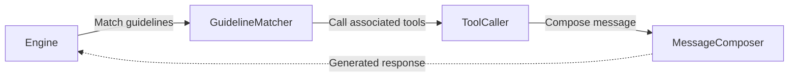
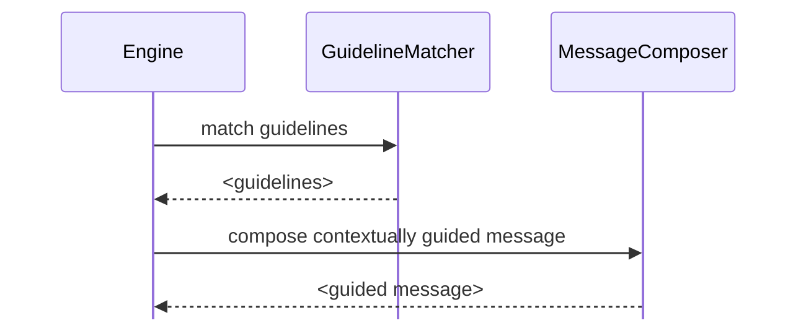

> 来源：docs/concepts/customization/guidelines.md，Parlant v3.3.1 官方英文文档中文翻译。

> **⚠️ 官网更新注记（2026-09-30 核对，以 https://www.parlant.io/docs/concepts/customization/guidelines 为准）**
> 本译文为本地 parlant 仓库 docs/ 的 v3.3.1 快照，官网已更新；经 parlant 源码溯源，
> 下述差异多数为「v3.3.1 代码已支持、仅文档过时」，已按官网回改正文：
> - 回改项：核心框架按官网重写为「观察（Observation）是最基础原语，由自然语言 condition 或自定义代码 matcher 触发；**指南（Guideline）= 带动作的观察（+ 可选 description）**」；新增 create_observation（condition= 或 matcher=）/ 自定义代码匹配器（GuidelineMatchingContext→GuidelineMatch）/ MATCH_ALWAYS 常开指南 / 指南持续时间（One-Off·Persistent·Continuous）与 track 参数 / description 字段（含对匹配与延迟的影响）/ criticality（HIGH·MEDIUM·LOW）/ tags（server.create_tag）/ 匹配处理器（on_match / on_message）/ 链式条件与蕴含（guideline.entail()）/ 条件必须可观察（Conditions Must Be Observable）/ 预测性条件（Predictive Conditions）/ 观察用于门控与排除（depend_on / exclude）
> - 官网新增、未全文重写项：动态上下文投递与注意力问题研究（Curse of Instructions / Attention Dilution / Lost in the Middle / Mechanism of Bias 等引用），完整见官网对应页
> - 源码未确认项：guideline/observation 的 on_match/on_message 钩子（以官网为准，源码待核）

# 指南（Guidelines）

指南（Guidelines）是一项强大的定制特性。尽管它们原则上相当简单，但关于它们仍有许多内容值得探讨。

LLM 应用面临一个根本性的张力：给智能体太少上下文，它就缺乏依据、不可预测；给得太多，又反而会引发同样的问题。Parlant 正是为解决这个问题而构建的，它采用**动态上下文投递（dynamic context delivery）**：不是一份又大又静态的提示词，而是为交互的每一轮动态装配"恰到好处的提示词"——由相关规则提供依据，却不受无关噪音稀释，也不被过时的系统级偏见锚定。

**注意力问题（The Attention Problem）**

即便对最先进的模型，随着指令和上下文不断累积，性能也会急剧下降。研究表明，面对 10 条客观可验证的指令时，GPT-4o 这类模型的成功率可能低至 **15%**（见 [Curse of Instructions](https://openreview.net/forum?id=R6q67CDBCH)）；[Attention Dilution](https://arxiv.org/abs/2310.00785) 显示，当提示词被无关信息塞满时，准确率最多下降 **85%**；[Lost in the Middle](https://arxiv.org/abs/2307.03172) 效应甚至表明，当关键细节被埋在长提示词中间时，模型的表现可能比*完全没有上下文*还要差。此外，静态系统提示词还常常引发意外的**范围蔓延（scope creep）**和对话漂移。

这就是为什么 Parlant 只把相关指南动态装入上下文——这正是本页其余部分要展开的内容。

### 核心原语：观察（Observations）

Parlant 中最基础的构建块是**观察（Observation）**。观察由一条自然语言**条件（condition）**——在对话中检测到的特定状态或意图——或[自定义代码匹配器（custom code matcher）](#自定义代码匹配器custom-code-matchers)触发。

观察充当智能体上下文投递系统的"传感器"。它们本身并不规定行为；它们只是监视对话，并在其条件满足时触发，从而让你能把特定信息送入智能体的上下文，或在信息不相关时将其排除在外。

它们是让你精确控制哪些信息在何时进入智能体上下文的基本构件。

```python
# 基于 NLP：引擎会针对对话评估这条条件
customer_wants_deals = await agent.create_observation(
    condition="Customer expresses interest in special deals or discounts"
)
```

```python
# 基于代码：使用自定义匹配器函数进行确定性控制
business_hours = await agent.create_observation(
    matcher=check_business_hours,
)
```

当观察与[关系（relationships）](/docs/concepts/customization/relationships)结合时，它们会变得强大。你可以用它们通过依赖（dependencies）门控其它指南，或排除那些即使自身条件匹配也不应在某些上下文中触发的指南：

```python
# 其它指南可以依赖这条观察
await offer_deals_guideline.depend_on(customer_wants_deals)

# 只要这条观察匹配，它就明确取消另一条指南的匹配资格
await customer_wants_deals.exclude(offer_premium_products_guideline)
```

观察让你控制进入智能体上下文的内容：指南、[检索器](/docs/concepts/customization/retrievers)、[旅程](/docs/concepts/customization/journeys)或[工具](/docs/concepts/customization/tools)。当观察触发时，你还可以通过[匹配处理器（match handlers）](#匹配处理器match-handlers)运行自定义代码。

> **提示**
>
> 通过把*检测*与*响应*分离，你可以构建复杂的逻辑：一条观察触发工具、排除其它规则，或作为更高级行为的前置依赖。

### 指南：带动作的观察（Guidelines: Observations with Actions）

观察只负责检测，而**指南（guideline）**负责行动。指南是一条附带**动作（action）**的观察——还可以选择附带一条**描述（description）**，在动作含义需要更多上下文时对其加以阐述。

```python
await agent.create_guideline(
    condition="The customer wants to buy a laptop",
    action="First, determine whether they prefer Mac or Windows",
    # 可选：当动作需要更多上下文时的描述
    description="Mac vs. Windows customers tend to have very different profiles "
        "and are interested in completely different sets of additional products. "
        "Narrowing this down first helps us understand the customer's profile "
        "right from the start.",
)
```

**条件（condition）**规定了指南应当*何时*适用。引擎会针对当前对话上下文对其进行评估（审视整个对话）以确定相关性。你还可以用[自定义匹配器](#自定义代码匹配器custom-code-matchers)替换它。

**动作（action）**规定了智能体应当*做什么*。当条件匹配时，它会被注入智能体的上下文。引擎还会用动作来[追踪指南是否已被应用](#用-track-控制重复应用controlling-reapplication-with-track)，在不再需要时将其停用，以防止在整个对话期间产生不必要的上下文污染。

指南允许我们在两种关键场景下塑造[智能体](https://parlant.io/docs/concepts/entities/agents)的行为：
1. 当某些开箱即用的响应不满足我们的预期时
1. 当我们只是想确保所有交互中的行为一致时

> **指南 vs. 旅程**
>
> 旅程（Journeys）是提供结构化、逐步交互流程的理想方式，而指南更多是对智能体行为提供情境化的微调。对于需要多个步骤的复杂交互，使用旅程；对于更简单、特定于上下文的调整——以及未必属于任何特定旅程的简单、通用工具调用触发器——使用指南。

#### 示例

假设我们有一个帮助客户订购产品的智能体。默认情况下，该智能体的行为可能如下：

> **用户：** 我想订购一台新笔记本电脑。
>
> **智能体：** 好的，请问您有哪些偏好？（例如，预算、操作系统、屏幕尺寸、使用场景？）

但是假设我们希望让智能体更加贴心，让它首先简单地询问客户想要 Mac 还是 Windows。我们可以添加一条指南来确保这一行为一致地发生，如下所示：

```python
await agent.create_guideline(
    condition="The customer wants to buy a laptop",
    action="First, determine whether they prefer Mac or Windows"
)
```

从而得到如下对话：

> **用户：** 我想订购一台新笔记本电脑。
>
> **智能体：** 好的。您更倾向于 Mac 还是 Windows？

> **小心你的期望**
>
> 指示一个 LLM 与指示一个人非常相似，区别在于默认情况下它对"是谁在指示它"以及"该指示是在什么语境下给出的"毫无概念。因此，当我们提供指南时，必须尽可能清晰、明确地表达，以便智能体能够无歧义地遵循。本页稍后会进一步探讨这一点。

> **请记住**
>
> 指南在智能体撰写响应*之前*被评估。这意味着像"做完 Y 之后立刻做 X"这样的指南可能不会如你所预期的那样生效——智能体基于评估时点的对话状态来决定要做什么。

### 指南的持续时间（Guideline Durations）

要把一条指南正确投递进智能体的上下文，需要[追踪（tracking）](#用-track-控制重复应用controlling-reapplication-with-track)。你的措辞方式决定了引擎如何追踪和应用这条指南。

根据措辞，存在三种有效的指南持续时间，引擎会自动从你的表述中推断出正确的一种：

#### 一次性动作（One-Off Actions）

> **"当 X 发生时，做 Y。"**

智能体执行一次该动作便认为完成——即使客户没有回应。一旦完成，该指南在后续交互中停用（除非上下文变化到足以重新触发它，例如客户开始了一笔新订单）。

```python
await agent.create_guideline(
    condition="The customer orders a dish containing a known allergen",
    action="Warn them that the dish contains that allergen",
)
```

智能体会警告客户一次。如果客户忽略警告并继续，智能体便继续推进。

#### 持续性动作（Persistent Actions）

> **"当 X 发生时，做 Y，直到 W 发生。"**

智能体在多个轮次中持续推进该动作，直到达成解决。指南保持激活，直到客户明确处理了它。

```python
await agent.create_guideline(
    condition="The customer orders a dish containing a known allergen",
    action="Confirm with them that they're okay with the allergen before proceeding",
)
```

与一次性版本不同，在客户真正确认或更改订单之前，智能体不会认为该动作已完成。如果客户忽略问题并询问其它事情，智能体会绕回来。

#### 常续动作（Continuous Actions）

> **"只要 X，就做 Y"**，或 **"当 X 时，总是做 Y"**。

只要条件成立，该动作就在整个交互中持续适用。这些是持续的行为约束，而非需要完成的任务。

```python
await agent.create_guideline(
    condition="The customer has indicated they are vegetarian",
    action="Only ever suggest vegetarian dishes",
)
```

```python
await agent.create_guideline(
    condition="The customer hasn't completed payment yet",
    action="See if there's anything else they want to add to their order",
)
```

常续指南只要其条件保持为真就保持激活。一旦条件不再成立（例如支付完成），指南即停用。

## 指南如何运作

要理解指南如何运作，我们需要简要了解一下 Parlant 的响应处理流水线。

当智能体收到一条消息时，它会经过一条响应处理流水线，该流水线包含若干步骤，以确保响应与指南和预期保持一致。



如上图所示，指南在智能体撰写响应*之前*就被评估和匹配。

> **请记住**
>
> 这意味着智能体需要在生成响应*之前*，根据交互的上下文来评估和应用指令及工具调用。换句话说，诸如"做完 Y 之后立刻做 X"这样的指南可能不会如你所预期的那样生效。

### Parlant 如何使用指南

LLM 是一项了不起的创造，它建立在文本中[统计注意力（statistical attention）](https://arxiv.org/abs/1706.03762)的原理之上；然而，它们的注意力跨度却极其有限。在遵循指令方面，它们需要帮助。

在幕后，Parlant 通过动态管理 LLM 的上下文，使其在每个时点仅包含相关指南，从而确保智能体响应与预期保持一致。



在每次响应之前，Parlant 只加载与对话当前状态相关的指南。这种动态管理使 LLM 的"认知负荷"降至最低，最大化其注意力，从而最大程度地使每次响应与预期行为保持一致。

> Parlant 用来确保对齐的另一个重要能力是：在智能体的输出到达[客户](https://parlant.io/docs/concepts/entities/customers)之前对其进行监督，以最大程度确保指南被正确遵守。为实现这一点，Parlant 的 NLP 研究人员设计了一种创新的提示技术，称为**专注推理查询（Attentive Reasoning Queries，ARQs）**。你可以在 [arxiv.org 上查阅这篇研究论文：Attentive Reasoning Queries: A Systematic Method for Optimizing Instruction-Following in Large Language Models](https://arxiv.org/abs/2503.03669#:~:text=We%20present%20Attentive%20Reasoning%20Queries%20%28ARQs%29%2C%20a%20novel,in%20Large%20Language%20Models%20through%20domain-specialized%20reasoning%20blueprints.)。

## 制定有效的指南（Writing Effective Guidelines）

可以把 LLM 想象成一个刚走进你公司的、知识渊博的陌生人。他们可能有多年的通用经验，但并不知道你的具体背景、偏好或做事方式。然而，这位陌生人急于帮忙，并且总是会尝试帮忙——即使并不确定。

这正是指南发挥作用的地方。指南是你将这种无穷的热情和广博的知识引导为专注、恰当响应的方式。

但制定有效的指南是一门艺术——就像与人打交道一样。

#### 具体，而非含糊（Be Specific, Not Vague）

考虑一个客户服务场景。作为一个非常朴素的例子，我们可能会倾向于这样写：

**不要这样做**
> * **条件：** 客户不高兴了
> * **动作：** 让他们感觉好些

尽管出发点是好的，但这是一条过于含糊的指南示例。LLM 可能以无数种方式解读它，从提供它实际上无法提供的折扣，到开可能与你的品牌形象不符的玩笑。相反，请考虑：

**应当这样做**
> * **条件：** 客户对我们的服务表达了不满
> * **动作：** 具体地认可他们的不满情绪，表达真诚的同理心，并询问他们经历的细节，以便我们妥善处理。

请注意这条指南既具体又有边界。智能体知道*认可什么*、*如何回应*。

**不要这样做**
> * **条件：** 客户询问产品
> * **动作：** 推荐一些他们可能喜欢的东西

**应当这样做**
> * **条件：** 客户在未指明偏好的情况下请求产品推荐
> * **动作：** 在做出推荐之前，询问他们的具体需求、对类似产品的过往经验，以及他们特别关注的功能

#### 找到恰当的平衡（Find the Right Balance）

原则上，我们要寻找的是"恰到好处"的指南——既不规定过度，也不规定不足。请考虑为技术支持智能体设计的以下迭代：

**不要这样做**

过于含糊：
> * **条件：** 客户遇到技术问题
> * **动作：** 帮他们修复

**不要这样做**

过于死板：
> * **条件：** 客户报告了一条错误消息
> * **动作：** 先询问他们的操作系统版本，再询问浏览器版本，最后询问最近一次系统更新的日期

**应当这样做**

恰到好处：
> * **条件：** 客户报告难以访问我们的平台
> * **动作：** 认可他们的访问问题并帮助他们排查
> * **描述：** 表达对他们处境的理解。询问他们环境设置的关键细节（操作系统和浏览器），并确认他们是否已尝试过清缓存或换浏览器等基本排查步骤。

请注意，这里你也可以利用 `description` 字段来提供额外上下文，同时保持动作简洁。

请记住，LLM 通常会相当字面地理解你的引导。如果你告诉智能体"总是推荐高级功能"，它可能即使在面对抱怨定价的客户时也这么做。制定指南时，务必始终考虑更广泛的上下文和潜在的边缘情况。这将使你在日后减少变更和故障排查，物有所值。

**如有疑问，宁可在含糊一边犯错。** 智能体行为建模（Agentic Behavior Modeling）的目标并不是为每一种可能的交互编写脚本，而是提供清晰、情境化的引导，将 LLM 的自然泛化能力塑造成针对你的特定用例可靠、恰当的响应。

#### 保持动作简短，用描述来阐述（Keep Actions Short, Use Descriptions to Elaborate）

把你的动作写成一条简短的指令——就像对已经理解上下文的人说话。然后用 `description` 字段来提供背后的细节。

这不仅仅是风格偏好。Parlant 引擎会在其基于 [ARQ](/docs/advanced/explainability) 的合规检查中使用指南的条件和动作文本，它们会出现在补全 token（completion tokens）中。更长的条件和动作会直接增加响应延迟。相比之下，描述只有在指南匹配时才会被加载进上下文——它不影响匹配本身。

**不要这样做**
```
await agent.create_guideline(
    condition="The customer mentions a competitor product",
    action="Acknowledge their experience with the competitor respectfully, "
        "never disparage them directly, and highlight our key differentiators "
        "such as 24/7 support, flexible pricing, and our satisfaction guarantee, "
        "while focusing on what makes us uniquely valuable for their use case",
)
```

**应当这样做**
```
await agent.create_guideline(
    condition="The customer mentions a competitor product",
    action="Acknowledge their experience and highlight our differentiators",
    description="Be respectful of competitor products (BrandX, ABC Corp, etc.). "
        "Never disparage them directly. Focus on our key differentiators: "
        "24/7 support, flexible pricing, and satisfaction guarantee.",
)
```

动作告诉智能体*做什么*；描述告诉它*怎么做*。

## 条件如何被评估（How Conditions Are Evaluated）

### 条件必须可观察（Conditions Must Be Observable）

智能体只能基于对它而言显而易见的东西来评估条件——对话历史、[客户元数据](/docs/concepts/entities/customers#metadata)和[变量](/docs/concepts/customization/variables)。像"客户是素食者"这样的条件，如果这条信息来自已保存的变量或客户标签，就能生效；但如果仅仅依赖从对话本身推断，则不会可靠地匹配。

### 预测性条件（Predictive Conditions）

当条件涉及智能体自身的意图时——例如"你即将推荐一款产品"或"你需要以表格形式呈现数据"——Parlant 会在*可能性*的层面进行评估。它会尝试评估智能体接下来*可能*做什么，这自然意味着它不总是如你所料地匹配（漏报，false negative），有时也会在你不期望时匹配（误报，false positive）。

这是预测智能体将作何决定的固有局限。如果你发现某条预测性条件不可靠，可以考虑改写它，改为引用关于对话的可观察事实，或使用[自定义匹配器](#自定义代码匹配器custom-code-matchers)进行确定性控制。

### 链式条件与蕴含（Chained Conditions and Entailment）

一个相关挑战出现在：一条指南的条件依赖于另一条指南的动作。考虑：

> * **指南 A：** 当客户询问退货时，解释退货政策
> * **指南 B：** 当解释退货政策时，同时提及 30 天保修

指南 B 的条件（"当解释退货政策时"）是关于智能体*即将要做*的事情——但在评估时点，它还没做。Parlant 在撰写响应*之前*评估这两条指南，所以即使 A 会促使智能体解释退货政策，B 的条件也可能不匹配。

解决方案是**蕴含（entailment）关系**：明确告诉 Parlant，每当 A 被激活时，B 也应该被激活：

```python
await guideline_a.entail(guideline_b)
```

这保证了只要 A 触发，B 也会触发，而不依赖预测性条件匹配。

### 常见陷阱（Common Pitfalls）

**把持续性需求措辞成一次性动作。** 你写了"警告他们过敏原"，但实际需要的是智能体*确认*客户是否接受。于是智能体警告一次就继续推进，留下安全隐患。如果某个动作需要客户的回应，就那样措辞："确认他们是否接受"，而不是"警告他们"。

**把一次性动作措辞成常续。** 你写了"总是提醒客户我们的退货政策"，但你只需要提到一次。于是智能体反复提起它，令人厌烦。如果是一段一次性信息，就措辞为一次性："提及我们的退货政策"。

你的措辞方式会直接影响引擎如何匹配、追踪和应用这些指南。当行为与预期不符时，检查你措辞所隐含的持续时间是否与你真正想要的行为一致。

## 特性（Features）

### 扩展描述（Expanded Descriptions）

正如[保持动作简短](#保持动作简短用描述来阐述keep-actions-short-use-descriptions-to-elaborate)一节所述，`description` 字段让你可以在不膨胀动作文本的情况下阐述指南的意图。描述只在指南匹配时才被加载进智能体的上下文，它既有助于更准确的匹配，也有助于智能体正确遵循指南。

描述对于迭代式精炼也很有用——当试错发现智能体没有按预期解读某条指南时，你可以在不改变条件和动作的情况下调整描述：

```python
await agent.create_guideline(
    condition="The customer asks about delivery times",
    action="Provide estimated delivery windows",
    description="Standard shipping is 5-7 business days, express is 2-3. "
        "For international orders, add 3-5 days. If the customer's order "
        "includes backordered items, mention the delay upfront rather than "
        "giving an optimistic estimate.",
)
```

### 关键性（Criticality）

有些指令不容许出错——合规披露、操作确认、安全检查。另一些则是温和的推动——风格偏好、对话性提示。**关键性（criticality）**级别让你告诉智能体在匹配一条指南或观察时该投入多少注意力：

| 级别 | 描述 | 何时使用 |
| --- | --- | --- |
| `LOW` | 智能体会做出努力，但不会投入大量资源去符合。 | "锦上添花"的指南，希望降低死板程度。 |
| `MEDIUM` | 智能体会更努力，同时保留一定灵活性。**这是默认值。** | 恰当上下文中的"应该"指南。 |
| `HIGH` | 智能体会尽最大努力，甚至可能到迂腐的程度。Parlant 会使用更多资源来确保符合。 | 关键时刻的绝对"必须"指南。 |

```python
# HIGH - Detect a critical question
await agent.create_observation(
    condition="Customer asks about cancellation fees",
    criticality=p.Criticality.HIGH
)

# MEDIUM - Standard business logic
await agent.create_guideline(
    condition="Customer wants to return an item",
    action="Suggest store credit as an alternative to a refund",
    criticality=p.Criticality.MEDIUM
)

# LOW - Style preference / gentle nudge
await agent.create_guideline(
    condition="The conversation has just started",
    action="Inquire if they want to hear about on-sale items",
    criticality=p.Criticality.LOW
)
```

**实用建议：**

* 默认使用 `MEDIUM`，再根据观察到的行为调整
* 把 `HIGH` 保留给：合规要求、法律义务、安全检查、安全攸关的指令
* 对风格偏好和非关键的引导性提示使用 `LOW`（该级别还有助于降低延迟和成本）

### 工具关联（Tool Association）

大多数 LLM 最突出的问题之一是其偏向"误报"（false-positive）的倾向。简单来说，它们总是想讨好，因此倾向于对大多数问题给出肯定回答。

当我们想要确保智能体只有在拥有正确上下文或信息时才执行某些动作时，这就成了一个大问题。

出于这些原因，Parlant 允许我们将[工具](/docs/concepts/customization/tools)（实质上是函数）与指南关联起来，这样智能体只有在交互的当前上下文中满足指南所要求的条件时，才会考虑调用某个工具。

同样重要的是，它还允许你指定在特定条件成立时，你希望*如何*以及*为何*调用某个特定工具的情境信息。以下是一个示例：

```python
@p.tool
async def find_products_in_stock(context: p.ToolContext, query: str) -> p.ToolResult:
  ...

await agent.create_guideline(
    condition="The customer asks about the newest laptops",
    action="First recommend the latest Mac laptops",
    # The guideline's action will ensure the following tool is
    # called with the right query (e.g., "Latest Mac laptops")
    tools=[find_products_in_stock],
)
```

这能防止智能体急切地或脱离上下文地调用工具——这是 LLM 在决定是否采取行动时的一个常见问题，它们倾向于误报。

### 标签（Tags）

你可以在创建时给指南打标签（tags），以便将它们组织成组：

```python
compliance = await server.create_tag("compliance")

await agent.create_guideline(
    condition="The customer is discussing topics outside the realm of flight booking",
    action="Avoid the topic and only ask if you can help with flight-related topics",
    tags=[compliance],
)
```

当标签与[关系（relationships）](/docs/concepts/customization/relationships#applying-relationships-to-groups)结合时会变得强大——它们让你可以对*整组*指南一次性地应用关系，而不必一条一条地接线。

### 用 `track` 控制重复应用（Controlling Reapplication with `track`）

默认情况下，Parlant 会追踪某条指南的动作是否已被应用，并在已经应用后将其停用，以防止重复。这通常正是你想要的——你不会希望智能体在同一个对话里把退货政策解释五遍。

但有些指南是持续性的行为提示（语气调整、同理心回应、合规提醒），只要条件满足就应当*每次*应用。如果你找不到能让某条指南保持常续的措辞，可以显式设置 `track=False`，通过设计强制其重复应用，而不是依赖语义评估：

```python
# 默认：受追踪，每个上下文应用一次
await agent.create_guideline(
    condition="Customer asks about pricing",
    action="Provide current pricing",
    track=True,  # default
)

# 不受追踪：每次条件匹配时重新应用
await agent.create_guideline(
    condition="Customer expresses frustration",
    action="Acknowledge their frustration and offer help",
    track=False,
)
```

## 自定义代码匹配器（Custom Code Matchers）

默认情况下，Parlant 使用基于 LLM 的匹配来确定哪些指南适用。**自定义匹配器（custom matchers）**让你用自己的逻辑覆盖它，例如正则、嵌入、外部数据库查询或简单的布尔检查：

```python
async def my_matcher(
    ctx: p.GuidelineMatchingContext,
    guideline: p.Guideline,
) -> p.GuidelineMatch:
    return p.GuidelineMatch(
        id=guideline.id,
        matched=True,  # or False
        rationale="Explanation of why it matched or didn't",
    )

await agent.create_guideline(
    condition=CONDITION,
    action=ACTION,
    matcher=my_matcher,
)
```

### 常开指南（Always-On Guidelines）

对于应当始终处于上下文中的指南，请使用 `p.MATCH_ALWAYS`：

```python
await agent.create_guideline(
    condition="You need to present data which lends itself to tabular form",
    action="Use markdown table formatting",
    matcher=p.MATCH_ALWAYS,
)
```

> **认知负荷**
>
> 请谨慎使用常开指南。上下文中的指南越多，LLM 就越难以一致地遵循它们——这正是动态匹配存在的原因。

## 匹配处理器（Match Handlers）

你可以注册处理器（handlers），在一条指南或观察被匹配时触发。这对于日志记录、分析或外部集成很有用。

**`on_match`** — 在匹配后立即触发，于智能体生成响应之前：

```python
async def my_handler(ctx: p.EngineContext, match: p.GuidelineMatch) -> None:
  ...

await agent.create_guideline(
    condition=CONDITION,
    action=ACTION,
    on_match=my_handler,
)

# 观察同样支持
await agent.create_observation(condition=CONDITION, on_match=my_handler)
```

**`on_message`** — 在智能体生成并发送消息后触发（此时该指南仍处于激活状态）：

```python
await agent.create_guideline(
    condition=CONDITION,
    action=ACTION,
    on_message=my_handler,
)
```
