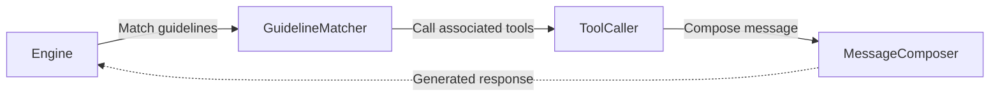
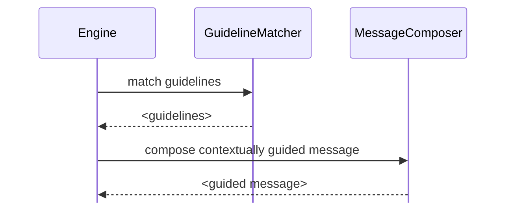

> 来源：docs/concepts/customization/guidelines.md，Parlant v3.3.1 官方英文文档中文翻译。

# 指南（Guidelines）

指南（Guidelines）是一项强大的定制特性。尽管它们原则上相当简单，但关于它们仍有许多内容值得探讨。

### 什么是指南？

指南是 Parlant 中以情境化且有针对性的方式微调[智能体（Agent）](https://parlant.io/docs/concepts/entities/agents)行为的主要途径。

它们允许我们指示智能体在特定情形下应如何响应，覆盖其默认行为，从而确保其行为符合我们的预期与业务需求。

指南允许我们在两种关键场景下塑造[智能体](https://parlant.io/docs/concepts/entities/agents)的行为：
1. 当某些开箱即用的响应不满足我们的预期时
1. 当我们只是想确保所有交互中的行为一致时

> **指南 vs. 旅程**
>
> 旅程（Journeys）是提供结构化、逐步交互流程的理想方式，而指南更多是对智能体行为提供情境化的微调。对于需要多个步骤的复杂交互，使用旅程；对于更简单、特定于上下文的调整——以及未必属于任何特定旅程的简单、通用工具调用触发器——使用指南。

#### 示例

假设我们有一个帮助客户订购产品的智能体。默认情况下，该智能体的行为可能如下：

> **用户：** 我想订购一台新笔记本电脑。
>
> **智能体：** 好的，请问您有哪些偏好？（例如，预算、操作系统、屏幕尺寸、使用场景？）

但是假设我们希望让智能体更加贴心，让它首先简单地询问客户想要 Mac 还是 Windows。我们可以添加一条指南来确保这一行为一致地发生，如下所示：

```python
await agent.create_guideline(
    condition="The customer wants to buy a laptop",
    action="First, determine whether they prefer Mac or Windows"
)
```

从而得到如下对话：

> **用户：** 我想订购一台新笔记本电脑。
>
> **智能体：** 好的。您更倾向于 Mac 还是 Windows？

> **小心你的期望**
>
> 指示一个 LLM 与指示一个人非常相似，区别在于默认情况下它对"是谁在指示它"以及"该指示是在什么语境下给出的"毫无概念。因此，当我们提供指南时，必须尽可能清晰、明确地表达，以便智能体能够无歧义地遵循。本页稍后会进一步探讨这一点。

### 指南的结构

在 Parlant 中，每条指南由两部分组成：**条件（condition）** 和 **动作（action）**。

1. **动作** 部分描述了指南应当达成什么。例如，"提供折扣"。
1. **条件** 是指定*动作应当何时发生*的部分。例如，"今天是节假日"。

```python
await agent.create_guideline(
    condition="It is a holiday",
    action="Offer a discount on the order"
)
```

在非正式讨论指南时，我们常以"当/则"形式来描述它们：当 <条件> 时，则 <动作>，就本例而言，即"当是节假日时，则提供折扣"。

> **指南追踪**
>
> 一旦某个动作在会话（session）中完成，Parlant 就会停用该指南——除非它有理由认为由于情境变化（例如，在上面的例子中，客户开始了另一笔订单），该动作应当重新适用。

### 使用工具

大多数 LLM 最突出的问题之一是其偏向"误报"（false-positive）的倾向。简单来说，它们总是想讨好，因此倾向于对大多数问题给出肯定回答。

当我们想要确保智能体只有在拥有正确上下文或信息时才执行某些动作时，这就成了一个大问题。

出于这些原因，Parlant 允许我们将[工具](https://parlant.io/docs/concepts/customization/tools)（实质上是函数）与指南关联起来，这样智能体只有在交互的当前上下文中满足指南所要求的条件时，才会考虑调用某个工具。

同样重要的是，它还允许你指定在特定条件成立时，你希望*如何*以及*为何*调用某个特定工具的情境信息。以下是一个示例：

```python
@p.tool
async def find_products_in_stock(context: p.ToolContext, query: str) -> p.ToolResult:
  ...

await agent.create_guideline(
    condition="The customer asks about the newest laptops",
    action="First recommend the latest Mac laptops",
    # The guideline's action will ensure the following tool is
    # called with the right query (e.g., "Latest Mac laptops")
    tools=[find_products_in_stock],
)
```

## 指南如何运作

要理解指南如何运作，我们需要简要了解一下 Parlant 的响应处理流水线。

当智能体收到一条消息时，它会经过一条响应处理流水线，该流水线包含若干步骤，以确保响应与指南和预期保持一致。



如上图所示，指南在智能体撰写响应*之前*就被评估和匹配。

> **请记住**
>
> 这意味着智能体需要在生成响应*之前*，根据交互的上下文来评估和应用指令及工具调用。换句话说，诸如"做完 Y 之后立刻做 X"这样的指南可能不会如你所预期的那样生效。

### Parlant 如何使用指南

LLM 是一项了不起的创造，它建立在文本中[统计注意力（statistical attention）](https://arxiv.org/abs/1706.03762)的原理之上；然而，它们的注意力跨度却极其有限。在遵循指令方面，它们需要帮助。

在幕后，Parlant 通过动态管理 LLM 的上下文，使其在每个时点仅包含相关指南，从而确保智能体响应与预期保持一致。



在每次响应之前，Parlant 只加载与对话当前状态相关的指南。这种动态管理使 LLM 的"认知负荷"降至最低，最大化其注意力，从而最大程度地使每次响应与预期行为保持一致。

> Parlant 用来确保对齐的另一个重要能力是：在智能体的输出到达[客户](https://parlant.io/docs/concepts/entities/customers)之前对其进行监督，以最大程度确保指南被正确遵守。为实现这一点，Parlant 的 NLP 研究人员设计了一种创新的提示技术，称为**专注推理查询（Attentive Reasoning Queries，ARQs）**。你可以在 [arxiv.org 上查阅这篇研究论文：Attentive Reasoning Queries: A Systematic Method for Optimizing Instruction-Following in Large Language Models](https://arxiv.org/abs/2503.03669#:~:text=We%20present%20Attentive%20Reasoning%20Queries%20%28ARQs%29%2C%20a%20novel,in%20Large%20Language%20Models%20through%20domain-specialized%20reasoning%20blueprints.)。

### 管理指南

Parlant 旨在让指南管理尽可能简单。

通常，当业务专家要求改变智能体的行为时，就会添加指南。开发者可以使用 Parlant 来做出这些变更，以配合其业务专家的节奏，快速且可靠地迭代。

以下是一个实际示例。当销售团队提出要求："智能体应当先询问客户的需求和痛点，再讨论我们的解决方案"，只需添加以下内容，一分钟即可实现这一反馈：

```python
await agent.create_guideline(
  condition="The customer has yet to specify their current pain points",
  action="Seek to understand their pain points before talking about our solution"
)
```

一旦添加，Parlant 会处理其余的事情，自动确保这条新指南在所有相关对话中被一致遵循，同时不会降低智能体对其他指南的遵从度。

### 制定指南

可以把 LLM 想象成一个刚走进你公司的、知识渊博的陌生人。他们可能有多年的通用经验，但并不知道你的具体背景、偏好或做事方式。然而，这位陌生人急于帮忙，并且总是会尝试帮忙——即使并不确定。

这正是指南发挥作用的地方。指南是你将这种无穷的热情和广博的知识引导为专注、恰当响应的方式。

但制定有效的指南是一门艺术——就像与人打交道一样。

#### 引导的艺术

考虑一个客户服务场景。作为一个非常朴素的例子，我们可能会倾向于这样写：

**不要这样做**
> * **条件：** 客户不高兴了
> * **动作：** 让他们感觉好些

尽管出发点是好的，但这是一条过于含糊的指南示例。LLM 可能以无数种方式解读它，从提供它实际上无法提供的折扣，到开可能与你的品牌形象不符的玩笑。相反，请考虑：

**应当这样做**
> * **条件：** 客户对我们的服务表达了不满
> * **动作：** 具体地认可他们的不满情绪，表达真诚的同理心，并询问他们经历的细节，以便我们妥善处理。

请注意这条指南既具体又有边界。

**不要这样做**
> * **条件：** 客户询问产品
> * **动作：** 推荐一些他们可能喜欢的东西

**应当这样做**
> * **条件：** 客户在未指明偏好的情况下请求产品推荐
> * **动作：** 在做出推荐之前，询问他们的具体需求、对类似产品的过往经验，以及他们特别关注的功能

#### 找到恰当的平衡

原则上，我们要寻找的是"恰到好处"的指南——既不规定过度，也不规定不足。请考虑为技术支持智能体设计的以下迭代：

**不要这样做**

过于含糊：
> * **条件：** 客户遇到技术问题
> * **动作：** 帮他们修复

**不要这样做**

过于死板：
> * **条件：** 客户报告了一条错误消息
> * **动作：** 先询问他们的操作系统版本，再询问浏览器版本，最后询问最近一次系统更新的日期

**应当这样做**

恰到好处：
> * **条件：** 客户报告难以访问我们的平台
> * **动作：** 对他们的处境表示理解，询问其环境设置的关键细节（操作系统和浏览器），并确认他们是否已尝试过一些具体的故障排查步骤

请记住，LLM 通常会相当字面地理解你的引导。如果你告诉智能体"总是推荐高级功能"，它可能即使在面对抱怨定价的客户时也这么做。制定指南时，务必始终考虑更广泛的上下文和潜在的边缘情况。这将使你在日后减少变更和故障排查，物有所值。

**如有疑问，宁可在含糊一边犯错。** 智能体行为建模（Agentic Behavior Modeling）的目标并不是为每一种可能的交互编写脚本，而是提供清晰、情境化的引导，将 LLM 的自然泛化能力塑造成针对你的特定用例可靠、恰当的响应。