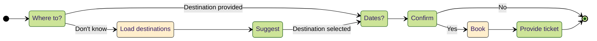
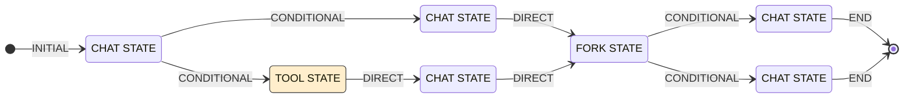
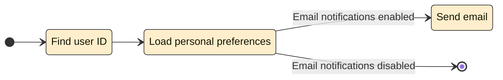
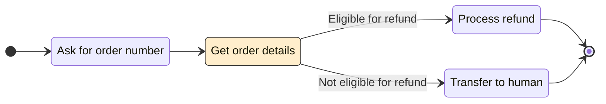
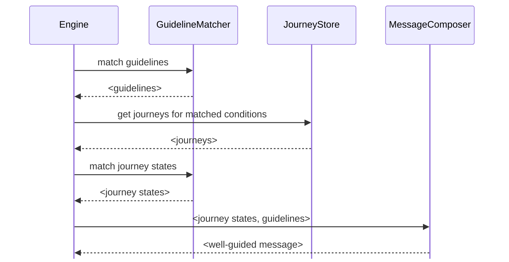

> 来源：concepts/customization/journeys.md，Parlant v3.3.1 官方英文文档中文翻译。
>
> **⚠️ 官网更新注记（2026-09-30 核对，以 https://www.parlant.io/docs/concepts/customization/journeys 为准）**
> 本译文为本地 parlant 仓库 docs/ 的 v3.3.1 快照，官网已更新；经 parlant 源码溯源，
> 下述差异多数为「v3.3.1 代码已支持、仅文档过时」，已按官网回改正文：
> - 回改项：工具状态→工具状态转移（官网：技术上允许、不推荐，非禁止）/ fork 代码形态（fork.target.transition_to）
> - 官网新增、未全文重写项：Journey Activation 激活语义 / State Descriptions / Linking Journeys（p.JourneyTransition）/
>   Match Handlers / Common Patterns（p.END_JOURNEY、分支汇合）/ Best Practices 5 条 / How Journey Matching Works（完整见官网对应页）
> - 源码未确认项：旅程/状态的 on_match、on_message 钩子（以官网为准，源码待核）

# 旅程（Journeys）

有很多使用场景，你希望你的智能体跟随一段特定的对话流程，例如预订旅行、排查某个问题，或以其他方式以预期的方式引导用户完成一个对话流程。

在 Parlant 中，这可以借助**旅程（Journeys）**轻松且可靠地实现。

#### 旅程的结构（Journey Structure）

旅程有 4 个重要组成部分：
1. **标题（Title）：** 一个简短、描述性的名称，用于将旅程与其他旅程区分开来。
1. **条件（Conditions）：** 这些上下文查询（contextual queries）决定了旅程应在何时处于激活状态。
1. **描述（Description）：** 它让你能够描述旅程的性质，在需要时也可以包含一些动机说明或定位说明。
1. **状态与转移（States & Transitions）：** 一个状态图（state diagram），向智能体传达理想的流程是什么。

> **旅程激活（Journey Activation）**
>
> 条件匹配只影响旅程的**初始激活**。一旦旅程处于激活状态，它会一直保持激活，直到下一步选择（next-step selection）过程决定将其停止。旅程处于进行中之后，其条件不会在每一轮被重新评估。

> **在严格性与灵活性之间取得平衡（Balancing Rigidity vs. Flexibility）**
>
> 在传统的对话框架中，流程是被严格定义的，每个状态和转移都必须被逐字逐句地严格遵循。
>
> 虽然这种方式易于理解和实现，但当智能体无法适应客户的交互模式时，往往会导致令人沮丧的用户体验。这种"一刀切"的方法没有考虑到人类对话的细微差别——从而导致用户失去参与感和满意度，最终导致智能体被闲置。
>
> Parlant 实现了一种"汲取经验教训"（lessons learned）的方法，允许智能体以更自然的方式在旅程的状态之间穿行。它们可以选择跳过状态、重新访问先前的状态，甚至以自适应的方式跳转到后续的状态。
>
> 因此，旅程并不旨在被严格遵循，而是作为智能体的指导框架（guiding framework）。智能体将尽可能严格地遵循流程，同时仍然对客户的交互模式保持自适应的方式。

## 一个完整示例（A Worked Example）

考虑以下旅行社智能体中的一个旅程示例：
> * **标题：** 预订航班（Book Flight）
> * **条件：** 客户请求预订航班
> * **描述：** 此旅程引导客户完成航班预订流程。



当客户要求预订航班时，此旅程将被激活。然后，智能体将努力遵循流程，同时以符合客户节奏的自适应方式行进，同时确保收集到所有必要的信息。

#### 实现该旅程（Implementing the Journey）
在我们进一步了解旅程的工作原理之前，先看看如何实现上面的旅程：

```python
async def create_book_flight_journey(agent: p.Agent):
    journey = await agent.create_journey(
        title="Book Flight",
        conditions=["The customer requested to book a flight"],
        description="This journey guides the customer through the flight booking process.",
    )

    t1 = await journey.initial_state.transition_to(chat_state="Ask if they have a destination in mind")

    #  Branch out based on the customer's response
    t2 = await t1.target.transition_to(condition="They do", chat_state="Get dates of travel")

    t3a = await t1.target.transition_to(condition="They don't", tool_state=load_popular_destinations)
    t3b = await t3a.target.transition_to(chat_state="Recommend a destination")

    # Merge back to the main path after choosing a destination.
    # This is done by transitioning into an existing state node.
    await t3b.target.transition_to(state=t2.target, condition="Destination selected")

    t4 = await t2.target.transition_to(chat_state="Confirm details")

    t5a = await t4.target.transition_to(tool_state=book_flight)
    t5b = await t5a.target.transition_to(chat_state="Provide ticket details")
```

## 状态与转移（States and Transitions）
旅程是仿照状态图（state diagram）建模的，状态图是一个有向图（directed graph），其中每个节点代表一个**状态（state）**，每条边代表一个**转移（transition）**（转移可能与一个条件相关联）。



#### 状态（States）
1. **聊天状态（Chat States）：** 处于此状态时，智能体将在该状态动作（action）的指导下与客户聊天。智能体可能在此状态中停留多个轮次，直到它决定转移到另一个状态。
```python
t = await state.transition_to(chat_state=CONVERSATIONAL_INSTRUCTION)
```
2. **工具状态（Tool States）：** 在此状态中，智能体将调用一个外部工具来执行某项动作，并将其结果加载到上下文中。工具状态之后必须紧跟一个聊天状态，聊天状态通常用于向客户展示工具的结果。
```python
t = await state.transition_to(tool_state=TOOL)
```
```python
t = await state.transition_to(tool_state=TOOL, tool_instruction=OPTIONAL_HINT_ON_HOW_TO_USE_TOOL)
```

> **从工具状态转移到聊天状态（Transitioning from Tool to Chat）**
>
> 当从工具状态转移到聊天状态时，智能体会自动将工具的结果加载到上下文中，因此你可以在聊天状态的动作中使用它。
>
> 请注意，虽然**技术上允许**，但我们并不推荐让一个工具状态转移到另一个工具状态；理想情况下，它之后应始终紧跟一个聊天状态，因为在智能体应用（agentic applications）中，工具的使用会带来可感知的延迟。
>
> 与其使用连续的工具状态，不如尝试使用单个工具状态（为此目的配备专用工具）来执行所有必要的动作，然后再紧跟一个聊天状态向客户展示结果。

#### 转移（Transitions）
1. **直接转移（Direct Transitions）：** 这些转移应始终被采用。它们在不产生分支的情况下推动对话向前进行。
2. **条件转移（Conditional Transitions）：** 仅当（且每当）其关联的条件被满足时，这些转移才会被采用。
```python
t = await state.transition_to(chat_state=CONVERSATIONAL_INSTRUCTION, condition=CONDITION)
```
```python
t = await state.transition_to(tool_state=TOOL, condition=CONDITION)
```

在大多数情况下，你会使用接受 `chat_state` 或 `tool_state` 参数的 `transition_to()` 重载，它会自动为你创建转移的目标状态。不过，你也可以使用接受 `state` 参数的 `transition_to()` 重载，它允许你转移到旅程中已存在的状态节点。

```python
t = await state.transition_to(state=EXISTING_STATE)
```
```python
t = await state.transition_to(state=EXISTING_STATE, condition=CONDITION)
```

> **组合使用条件转移与直接转移（Combining Conditional and Direct Transitions）**
>
> 如果一个状态有一条指向其他状态的条件转移，那么它就不能同时再有一条从它出发的直接转移。这是因为当条件满足时，引擎将无法在逻辑上确定应该采用哪条转移。SDK 强制执行这一规则。

#### 分叉状态（Fork States）
旅程还支持一种特殊的状态，称为**分叉状态（fork state）**。

在此状态中，智能体将评估条件，并据此对对话流程进行分支。尽管严格来说，这种分支可以不用分叉状态来建模，但它们有时是一种有用的建模工具，用于保持对话流程清晰、明确且有条理。

```python
fork = await state.fork()

t1 = await fork.target.transition_to(chat_state=CONVERSATIONAL_INSTRUCTION, condition=CONDITION_1)
t2 = await fork.target.transition_to(chat_state=CONVERSATIONAL_INSTRUCTION, condition=CONDITION_2)
t3 = await fork.target.transition_to(tool_state=TOOL, condition=CONDITION_3)
```

> **可视化你的旅程（Visualizing Your Journey）**
>
> 在代码中构建状态图有时可能会让人有些困惑。通常有用的做法是，在构建旅程时将其可视化，以确保流程清晰、合乎逻辑且符合你的意图。做法如下：
>
> 1. 在浏览器中访问 `http://localhost:8800/journeys`。
> 2. 复制你希望可视化的旅程的 ID。
> 3. 在浏览器中访问 `http://localhost:8800/journeys/<JOURNEY_ID>/mermaid`，将 `<JOURNEY_ID>` 替换为你复制的 ID。
> 4. 复制生成的 Mermaid 图代码。
> 5. 将其粘贴到 [Mermaid live editor](https://mermaid.live/) 中以可视化该旅程。

### 状态描述（State Descriptions）

当聊天状态的指令需要更详细的阐述——或者当试错表明智能体未能按你的意图解读它时——你可以提供一个更详尽的 `description`：

```python
t = await state.transition_to(
    chat_state="Confirm the booking details",
    description="""At this point, summarize all collected information: destination,
dates, number of travelers, and selected flight options. Ask the customer
to verify everything is correct before proceeding to payment."""
)
```

当该状态处于激活状态时，此描述会被包含在智能体的上下文中，帮助它更好地理解该动作。

### 连接旅程（Linking Journeys）

你可以通过转移到另一个旅程来将旅程连接在一起。这允许你创建模块化、可复用的旅程，并将它们组合成更大的流程。转移可以是直接转移或条件转移。

```python
t = await state.transition_to(journey=EXISTING_JOURNEY)
```

```python
t = await state.transition_to(condition=CONDITION, journey=EXISTING_JOURNEY)
```

这返回一个 `p.JourneyTransition`，让你可以在子旅程完成后继续构建流程。

## 旅程 vs. 任务自动化（Journey vs. Task Automation）
如果你查看引擎与旅程的协作方式，就会明白旅程不应该被用来指导模型如何自动化执行任务。相反，旅程被智能体用来进行自我定位（self-orientate），并根据你的偏好来引导对话流程。

这是回顾将**业务逻辑（business logic）**与**对话逻辑（conversation logic）**相分离的重要性的好时机。前者最好由自定义的[专用工具（dedicated tools）](https://parlant.io/docs/concepts/customization/tools)来处理（这些工具内部可能使用也可能不使用 LLM），而后者最好由对话引擎来处理。

#### 应该做与不该做的（Do's and Don'ts）

**不该做（DON'T）**

以下是一个***无效***的旅程，因为它代表的不是对话流程，而是一个任务自动化流程。



**应该做（DO）**

以下是一个有效的旅程，因为它代表了一个引导客户完成某个流程的对话协议（conversation protocol）。



## 上下文管理（Context Management）

LLM 是一项了不起的创造，它建立在文本的[统计注意力（statistical attention）](https://arxiv.org/abs/1706.03762)原理之上；然而，它们的注意力范围却痛苦地有限。在遵循指令方面，它们需要帮助。

在幕后，Parlant 通过动态管理 LLM 的上下文，使其在每一点上都只包含相关的旅程，从而确保智能体的回应符合预期。

它是使用 `GuidelineMatcher` 来实现这一点的，本质上是将当前对话上下文与相关旅程的条件进行匹配——而这些条件在幕后基本上就是观察性（非操作性）指南（observational (non-actionable) guidelines）。



在每次回应之前，Parlant 只加载与对话当前状态相关的指南和旅程。这种动态管理将 LLM 的"认知负担（cognitive load）"降至最低，最大化其注意力，从而使每次回应与预期行为的一致性（alignment）达到最大。

> **延迟优化（Latency Optimizations）**
>
> 这种来回（back and forth）的方法被实现为一个最小化响应延迟的优化算法。
>
> 引擎首先尝试基于当前对话上下文预测哪些旅程将被激活。基于这一预测，它尝试与指南匹配并行地匹配相关旅程的状态，从响应延迟中节省数秒钟。
>
> 只有当这一预测失败时（即，当有其他旅程被激活时），它才会产生额外的步骤来匹配这些旅程的状态。

## 旅程作用域的指南（Journey-Scoped Guidelines）

你可以添加旅程作用域的[指南（guidelines）](https://parlant.io/docs/concepts/customization/guidelines)，它们只有在依赖其的旅程也处于激活状态时才会被激活。在所有其他时候，这些指南都会被忽略。

使用旅程作用域的指南，是以深思熟虑的方式处理偏离旅程主流程（digressions）的推荐做法。它还能帮助你维护一个干净、有条理的对话模型，确保某些指南只在其预期上下文中被评估和激活。

> **指令优先级（Instruction Precedence）**
>
> 请注意，一般而言，Parlant 智能体对指南的权重高于对旅程状态的权重，因为指南被视为更具体的行为覆盖（behavioral overrides）。这意味着，如果某条指南被匹配，它往往会优先于处于激活状态的旅程状态。

```python
@p.tool
async def transfer_to_human_agent(context: p.ToolContext) -> p.ToolResult:
    ...

guideline = await journey.create_guideline(
    condition="the customer says they're unable to pay"
    action="connect them with a human agent",
    tools=[transfer_to_human_agent],
),
```

> **了解更多（Learn More）**
>
> 要了解更多关于指南的信息，请查看[指南（Guidelines）](https://parlant.io/docs/concepts/customization/guidelines)页面。

## 匹配处理器（Match Handlers）

> **源码未确认：** 以下旅程/状态的 `on_match` / `on_message` 钩子为官网描述，v3.3.1 源码待核，以官网为准。

你可以在旅程或单个状态上注册处理器，以触发诸如日志记录、分析或外部集成之类的副作用。每一层都支持两个钩子：`on_match`（在回应之前）和 `on_message`（在回应之后）。

#### 旅程级处理器（Journey-Level Handlers）

这些处理器针对整个旅程触发，每次旅程被匹配时都会触发，无论哪个状态处于激活状态：

```python
async def on_journey_activated(ctx: p.EngineContext, match: p.JourneyMatch) -> None:
    await analytics.track("journey_hit", {
        "journey": match.journey_id,
        "customer": ctx.customer.id,
    })

journey = await agent.create_journey(
    title="Book Flight",
    conditions=["The customer requested to book a flight"],
    description="This journey guides the customer through the flight booking process.",
    on_match=on_journey_activated,
)
```

* **`on_match`**：当旅程被激活时触发，在智能体生成回应之前。
* **`on_message`**：当旅程处于激活状态且智能体发送消息之后触发。

#### 状态级处理器（State-Level Handlers）

针对特定状态触发，让你在流程的各个节点上拥有更细粒度的钩子。

**`on_match`**——当智能体转移到某个状态、在生成回应之前被调用：

```python
async def my_handler(ctx: p.EngineContext, match: p.JourneyStateMatch) -> None:
    ...

await state.transition_to(chat_state=CHAT_STATE, on_match=my_handler)
```

**`on_message`**——当智能体在该状态中生成并发送消息之后被调用：

```python
await state.transition_to(chat_state=CHAT_STATE, on_message=my_handler)
```

## 常见模式（Common Patterns）

### 标记终结状态（Marking Terminal States）

你可以通过转移到 `p.END_JOURNEY` 来显式标记旅程的结束：

```python
await state.transition_to(state=p.END_JOURNEY)
```

这标志着旅程在此处已完成。一个旅程可以有多个终点——例如，在成功预订之后结束，*或*在客户取消之后结束：

```python
# 成功路径
t5 = await t4.target.transition_to(chat_state="Confirm the appointment has been scheduled")
await t5.target.transition_to(state=p.END_JOURNEY)

# 取消路径
t8 = await t7.target.transition_to(chat_state="Ask the patient to call the office")
await t8.target.transition_to(state=p.END_JOURNEY)
```

请注意，没有后续转移的状态本质上是终结状态——当无路可走时，旅程即结束。`p.END_JOURNEY` 在以下场景中最有用：某个状态*可能*根据条件继续转移到另一个状态*或*结束旅程，此时它能让意图对引擎和阅读代码的其他开发人员都变得明确。

### 分支与汇合路径（Branching and Merging Paths）

现实世界的旅程常常会分支到备选路径，之后再汇合回共享流程。你可以通过转移到**已存在的状态节点**而非创建新节点来实现这一点：

```python
# 分支：备选路径
t6 = await t2.target.transition_to(tool_state=get_later_slots, condition="None work")
t7 = await t6.target.transition_to(chat_state="List later times")

# 汇合：重新连接回主路径的确认状态
await t7.target.transition_to(state=t3.target, condition="The patient picks a time")
```

这让旅程保持 DRY——确认与排期逻辑只定义一次，被两条路径复用。

## 最佳实践（Best Practices）

#### 1. 转移完整性（Transition Completeness）

当一个状态有多条条件转移时，这些条件应该是**非重叠**且**穷尽**的——它们应无歧义地覆盖所有可能的后续走向。

**不要（DON'T）**

```python
# 不好：条件重叠——"over 21" 是 "over 18" 的子集
t1 = await age_state.transition_to(
    chat_state="Offer standard plan",
    condition="The customer is over 18",
)
t2 = await age_state.transition_to(
    chat_state="Offer premium plan",
    condition="The customer is over 21",
)
```

**应该（DO）**

```python
# 好：非重叠、穷尽的条件
t1 = await age_state.transition_to(
    chat_state="Explain they are not eligible",
    condition="The customer is under 18",
)
t2 = await age_state.transition_to(
    chat_state="Offer standard plan",
    condition="The customer is 18-20",
)
t3 = await age_state.transition_to(
    chat_state="Offer premium plan",
    condition="The customer is 21 or older",
)
```

> **注意：** 这是最佳实践，而非 SDK 强制约束。即使在条件不完美的情况下，引擎也会尽力选择正确的转移，但清晰、非重叠的条件能显著提高可靠性。

#### 2. 尽可能避免使用分叉（Avoid Forks When Possible）

来自聊天状态的条件转移与分叉效果相同，且不那么笨重。在评估期间，分叉状态会被"压扁（squished）"——其条件被折叠进其后续状态的条件中——这会增加评估成本，却不会增加表达能力。只要前一个状态已经是聊天状态，就优先使用来自聊天状态的直接条件转移。

#### 3. 不允许连续分叉（Consecutive Forks Are Not Allowed）

两个连续的分叉状态永远是冗余的——任何背靠背分叉的旅程都可以简化为一个带更多条件的单一分叉。**SDK 强制执行此约束**，如果你尝试这样做，它会抛出错误。

#### 4. 在重要工具调用之前进行确认（Verify Before Important Tool Calls）

在执行重要动作（例如排期、处理支付、下单）的工具状态之前，始终添加一个确认聊天状态。这给了客户在动作执行之前审查和纠正细节的机会——正如医疗保健示例中在 `schedule_appointment` 之前的"确认详情"状态所展示的那样。

#### 5. 尽可能使用旅程作用域的指南（Use Journey-Scoped Guidelines When Possible）

对于仅适用于特定流程内的行为，优先使用旅程作用域的指南而非全局指南。旅程作用域的指南只在其父旅程激活时才被评估，这避免了冗余的指南检查，并减少了每次回应所需的 LLM 调用次数。

## 旅程作用域的预设话术（Journey-Scoped Canned Responses）

> **内容迁移（2026-09-30）：** 官网 journeys 页已删除「旅程作用域预设话术」整节（含状态作用域预设话术的显式/独占考虑两种模式），相关内容已迁至[预设话术（Canned Responses）](https://parlant.io/docs/concepts/customization/canned-responses)页面。
>
> 对应本地译文为《11-预设话术CannedResponses.md》，请到该页面查看 `journey.create_canned_response()`、`transition_to(chat_state=..., canned_responses=[...])` 的详细说明与代码示例。

## 旅程匹配是如何工作的（How Journey Matching Works）

在每次回应之前，Parlant 通过一个多阶段流程来确定哪些旅程和状态是相关的：

1. **旅程条件匹配（Journey condition matching）：** 旅程条件由 `GuidelineMatcher` 评估，将对话上下文与每个旅程的激活条件进行匹配。
2. **状态加载（State loading）：** 对于匹配到的旅程，引擎基于最后执行的状态加载相关的后续状态及其转移。
3. **节点选择（Node selection）：** 引擎确定智能体应处于哪个状态（见下文）。
4. **消息合成（Message composition）：** 所选状态的指令，连同任何匹配到的指南，输入到消息合成器（message composer）。

当一个旅程被匹配时，引擎通过两个并行评估来确定智能体的位置：

1. **回溯检查（Backtrack Check）：** 客户是否改变了之前的决定，或者他们是否想重做旅程的某一部分？如果是，引擎会在图中遍历以找到应返回的正确步骤。
2. **下一步选择（Next Step Selection）：** 当前步骤是否已完成？如果是，应选择哪条转移？这使用**可达后续节点（reachable follow-ups）**——从当前节点预计算的多步路径——因此当客户一次性提供多条信息时，引擎可以在单次评估中快进（fast-forward）多个节点。

如果需要回溯，回溯结果优先，下一步选择的结果被丢弃。否则，下一步选择的结果使旅程向前推进。