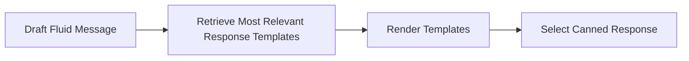

> 来源：concepts/customization/canned-responses.md，Parlant v3.3.1 官方英文文档中文翻译。

# 预设话术（Canned Responses）

预设话术（Canned Responses）让你能够精确控制你的 Parlant 智能体（Agent）的回复。

[预设话术（canned response）的概念](https://en.wikipedia.org/wiki/Canned_response) 源自现实世界中的联络中心，在这些地方，预设话术被广泛用于确保智能体以一种一致、准确且符合品牌的方式与客户沟通。

通过将回复限制在一组预先定义且预先批准的集合中，你可以确保智能体以一致的语调、风格和准确性进行沟通，完美契合你的品牌声音与服务规范，同时**完全消除哪怕是细微的、不受欢迎的或幻觉（hallucinated）输出的风险**。

预设话术（Canned Responses）的运作方式就像一手牌：在你提供给智能体的一组候选中，它会根据对话上下文选择最匹配所需回复的那张"牌"。


## 一个实际例子

#### 不使用预设话术时
使用 LLM 生成（逐 token）的回复。

> **客户（Customer）：** 这款商品有现货吗？
>
> **智能体（Agent）：** 有的，这款商品我们有现货！如果您需要帮助查找，请随时告诉我。

#### 使用预设话术时
```
# Draft message: "Yes, we've got this item in stock! Let me know if you need any help finding it."
#
# Available templates:
# - ...
# - "Hey, {{std.customer.name}}! What help do you need today?"
# - ...
# - "No, sorry, we've just sold the last ones. Would you like to see something similar?"
# - "Yep, we have it. Should I add it to your cart?"
# - ...
```
> **客户（Customer）：** 这款商品有现货吗？
>
> **智能体（Agent）：** 有的，我们有。需要我把它加入您的购物车吗？


## 预设话术的工作原理

在底层，预设话术（Canned Responses）以一个 4 阶段的流程运作：

1. 智能体根据其当前的情境感知（互动、指南（Guideline）、工具（Tool）结果等）起草一条流畅的消息
2. 引擎（Engine）基于草稿消息检索最相关的预设话术模板
3. 引擎（Engine）渲染候选模板，在适用的情况下使用工具提供的字段进行替换
4. 智能体基于草稿消息，从提供的候选中选择最合适的预设话术




## 组合模式（Composition Modes）


Parlant 智能体可以在其回复中使用以下几种**组合模式（composition mode）**之一。这些组合模式对智能体输出的限制程度各不相同，其使用预设话术的方式也有所不同。

| 模式 | 描述 | 使用场景 |
|------|-------------|-----------|
| **Fluid（流畅）** | 智能体在能找到良好匹配时优先从预设话术中选择，否则回退到默认的消息生成方式。 | **(A)** 大部分情况下保持流畅，但在适用时控制特定情境与回复<br/>**(B)** 对智能体进行原型设计，随着进展为额外的话术（Utterance）生成流畅的推荐 |
| **Composited（组合）** | 智能体只会使用预设话术候选来修改已生成的草稿消息，以模仿检索到的候选的风格 | 对品牌敏感、需要保持语调（tone of voice）一致的使用场景 |
| **Strict（严格）** | 智能体只能输出所提供的回复。如果不存在匹配的回复，智能体将发送一条可自定义的无匹配（no-match）消息。 | 无法承受哪怕最细微、最罕见幻觉（hallucination）的高风险场景 |

> **提示（Tip）：**
> 如果你有一个高风险的使用场景，并且对将 GenAI 智能体部署给你的客户感到担忧，我们建议从严格（strict）模式开始。Parlant 非常灵活，当你准备好时，可以轻松过渡到更流畅的模式。在切换组合模式时，你仍然会保持并使用对话模型的所有其他方面。

### 设置智能体的组合模式

你只需在创建智能体时传入正确的 `composition_mode`：

```python
await server.create_agent(
    name="My Agent",
    description="An agent that uses canned responses",
    composition_mode=p.CompositionMode.STRICT,  # or FLUID or COMPOSITED
)
```


## 创建预设话术

下面介绍如何为你的智能体创建预设话术：

```python
await agent.create_canned_response(template=TEXT)
```

#### 旅程作用域内的回复

你还可以添加**旅程（Journey）作用域内**的回复。这些回复只有在特定旅程处于激活状态时才可用。将预设话术限定在旅程（Journey）范围内有助于缩小可供选择的回复集合，从而提高选中所需回复的几率。

为此，只需在特定的旅程实例（而不是智能体）上调用 `create_canned_response` 方法：

```python
await journey.create_canned_response(template=TEXT)
```

#### 开场白回复

Parlant 通过运用[感知性能（perceived performance）](https://en.wikipedia.org/wiki/Perceived_performance#:~:text=Perceived%20performance%2C%20in%20computer%20engineering%2C%20refers%20to%20how%2C%20The%20concept%20applies%20mainly%20to%20user%20acceptance%20aspects.) 原理，采用了多种技术来增强对话的用户体验。其中一种技术就是使用**开场白回复（Preamble response）**。

Parlant 智能体经常发送开场白回复（Preamble response）（例如 _"Got it."_、_"Understood."_ 或 _"Let me look into that"_）来确认客户的输入，同时它正在努力生成一条详细、准确的回复。

通常情况下，这些开场白回复由智能体根据上下文自动生成，但你也可以创建自定义的开场白回复供智能体选择。

要创建一个预设的开场白回复，只需在你的预设话术创建中添加 `preamble()` 标签（tag）：

```python
await agent.create_canned_response(
    template="Sure thing.",
    tags=[p.Tag.preamble()],
)
```

## 模板语法

预设话术（Canned Responses）使用**模板（template）**来定义。模板是可以包含静态文本以及动态字段的字符串，这些动态字段会在回复被选中时替换为实际值。

### 标准字段

使用标准字段（使用 `std.` 前缀）来显示对话上下文中的动态信息：

#### 可用值
1. `std.customer.name`：字符串（String）；客户的姓名（对于未注册的[客户](https://parlant.io/docs/concepts/entities/customers)则为 `Guest`）
2. `std.agent.name`：字符串（String）；智能体的名称
3. `std.variables.NAME`：任意类型（Any）；名为 `NAME` 的变量的内容
4. `std.missing_params`：字符串列表（List of strings）；根据[工具洞察（Tool Insights）](https://parlant.io/docs/concepts/customization/tools#tool-insights-and-parameter-options)，包含缺失的工具参数名称（如果有的话）

#### 示例

```python
await agent.create_canned_response(
  template="Hi {{std.customer.name}}, Yes, this product is available in stock."
)
```

### 生成式字段
如果你引用一个带有 `generative.` 前缀的字段，LLM 会根据该字段的名称及其周围上下文自动推断并替换其值。这是在严格模板中引入受控的、局部化生成的绝佳方式。

#### 示例

```python
await agent.create_canned_response(
    template="Can I ask why you'd like to return {{generative.item_name}}?"
)
```

### 基于工具/检索器的字段

预设话术可以引用来自工具和检索器（Retriever）结果的字段。这些字段必须在 `ToolResult` 或 `RetrieverResult` 的 `canned_response_fields` 属性中指定。

这是最有用的字段类型之一，因为它们可以为你的预设话术引入真正动态的数据。

> **警告（Warning）：字段在避免后果性幻觉（Consequential Hallucination）中的关键作用**
>
> 在你的预设话术中使用基于工具的字段还有另一个很大的好处。在检索候选回复时，引擎（Engine）还会查看 `canned_response_fields` 来确定相关性。
>
> 引用了上下文中不存在的字段的回复永远不会被选中，即使它们与草稿消息相似。这一点非常重要，因为它有助于确保智能体生成的回复建立在实际可用数据的基础之上。
>
> 例如，在使用严格组合模式时，如果 `successful_transaction` 字段不是由一个成功运行的工具调用所提供的，那么你的智能体就永远不会输出引用 `{{successful_transaction.id}}` 的消息。换句话说，如果你正确地协调了你的回复和工具，就可以确保你的智能体永远不会就数据或状态产生误导性的幻觉回复。

#### 示例

```python
@p.tool
def get_account_balance(context: p.ToolContext) -> p.ToolResult:
    balance = 1234.5

    return p.ToolResult(
        # Note that you must still provide the result in the `data` field,
        # as this is what will inform the agent when evaluating guidelines,
        # calling tools, as well as when generating the draft message.
        data={f"Account balance is {balance}"},
        # Here you provide dynamic values specifically for template field substitution
        canned_response_fields={"account_balance": balance},
    )
```

而你的回复模板会这样引用这个字段：

```python
await agent.create_canned_response(template="Your current balance is {{account_balance}}")
```

## 让工具返回完整回复
工具（Tool）也可以返回完整的预设话术以供考虑。当你希望根据工具的输出生成完整回复，而不仅仅是提供用于字段替换的数据时，这一点非常有用。它通常与复杂的问答（Q&A）检索场景特别相关。

```python
@p.tool
def get_answer(context: p.ToolContext, question: str) -> p.ToolResult:
    answer = "The answer to your question is...."

    return p.ToolResult(
        data=answer,
        # Make the answer available as a complete canned response candidate
        canned_responses=[answer],
    )
```

## 优化回复的选择

让我们看看如何确保你的智能体选中正确的预设话术。

#### 控制草稿消息

由于选择过程的运作方式，让正确的回复得到送达的第一步，是确保草稿消息尽可能接近你所期望的回复。你可以使用所有标准的控制机制来实现这一点，例如指南（Guideline）、旅程（Journey）、工具（Tool）、术语表（Glossary）词条以及智能体描述。

这意味着你需要密切关注在回复选择之前生成的草稿是什么。你可以在集成 UI 中检查生成的草稿消息，看看智能体想要说什么。


#### 确保检索到正确的候选

接下来，你需要确保你所期望的回复模板被引擎检索为可供选择的候选。

有时，回复本身与草稿消息足够接近，从而出现在候选列表中。但并非总是如此——尤其是当其模板包含字段替换、从而使语义相似度比较变得更加困难时。

为此，你可以在创建预设话术时使用**信号（signal）**。信号（signal）是一种告诉你的智能体"这个回复与这些草稿很匹配"的方式。每个信号本质上都是一个草稿消息示例。在检索候选回复时，引擎（Engine）也会查看这些信号来确定相关性，因此，如果某个回复带有与草稿消息非常接近的信号，即使该回复本身在形式上差异很大，它也会被作为候选检索出来。

下面介绍如何为你的预设话术添加信号：
```python
await agent.create_canned_response(
    template="Yes, we've got this item in stock! Let me know if you need any help finding it.",
    signals=["We do have it in stock", "We do! Do you need help finding it?"],
)
```

## Jinja2 的灵活性

回复模板与 Jinja2 模板引擎集成，支持更动态的格式化、替换过滤器以及列表处理。你可以在 [Jinja2 文档站点](https://jinja.palletsprojects.com/en/stable/) 上了解更多高级语法。

#### 示例

```python
@p.tool
def get_pizza_toppings(context: p.ToolContext) -> p.ToolResult:
    toppings = ['olives', 'peppers', 'onions']

    return p.ToolResult(
        data={f"Toppings are {toppings}"},
        canned_response_fields={"toppings": toppings},
    )
```

```python
await agent.create_canned_response(
    template="We have the following toppings \n- {{t}}"
)
```

## 无匹配回复

在使用严格组合模式时，如果智能体无法为其草稿找到合适的预设话术，它将发送一条无匹配（no-match）回复。

如果你想自定义这条回复，有两种方式：

1. 自定义静态的无匹配回复
2. 使用自定义的无匹配提供者（no-match provider）根据上下文动态生成回复

#### 静态无匹配回复
这是自定义无匹配回复最简单的方式。你可以设置一条静态的无匹配回复，每当智能体找不到合适的预设话术时就会使用它。

```python
async def initialize_func(c: p.Container) -> None:
    no_match_provider = c[p.BasicNoMatchResponseProvider]
    no_match_provider.template = "My custom no-match response."

async with p.Server(
    initialize_container=initialize_func,
) as server:
        ...
```

#### 自定义无匹配提供者
如果你需要更大的灵活性，你可以创建一个自定义的无匹配回复提供者（no-match response provider）。这使你能够根据对话上下文动态生成无匹配回复。

不过请注意，`p.LoadedContext`（它让你能够访问引擎内部状态）在未来版本中可能会发生变化，所以请记住，你可能需要在某个时候相应地调整你的实现。

```python
class CustomNoMatchResponseProvider(p.NoMatchResponseProvider):
    async def get_template(self, context: p.LoadedContext, draft: str | None) -> str:
        # Generate a custom no-match response based on the provided context,
        # such as the conversation history, draft message, guidelines, tool calls, etc.
        template = "..."

        return template

async def configure_func(c: p.Container) -> p.Container:
    c[p.NoMatchResponseProvider] = CustomNoMatchResponseProvider()

async with p.Server(
    configure_container=configure_func,
) as server:
        ...
```