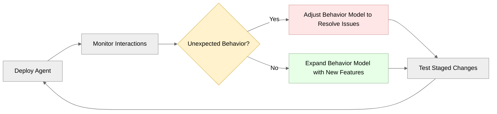

> 来源：docs/production/agentic-design.md，Parlant v3.3.1 官方英文文档中文翻译。

# Agentic 设计方法论（Agentic Design Methodology）

构建 AI 智能体与传统的软件开发相比，需要一种根本性的范式转变。本文探讨了创建有效的、面向客户的智能体所需的独特挑战、方法论和设计原则。

虽然 Parlant 提供了实现可靠智能体行为的工具，但成功取决于掌握语义化设计（semantic design）这门艺术——学会编写能够在大规模下持续稳定工作、同时又保持自然用户交互的指令。

## 理解概率性行为（Understanding Probabilistic Behavior）

AI 智能体的运行方式与传统软件系统不同。在传统开发中，确定性函数对相同的输入会产生一致的输出。然而，AI 智能体构建在统计模型之上，相同的输入可能基于模型学到的模式和概率分布而产生不同的响应。

很自然，当我们构建在这样一个本质上不确定的基础之上时，就需要采用不同的设计与实现方法。这是关于 agentic 设计需要停下来好好领会的第一件重要事情。

### 指令解读的挑战（Instruction Interpretation Challenges）

传统软件执行明确的命令并产生可预测的结果，而 LLM 则根据上下文来解读指令，基于其多样化的训练数据填补细节和假设。它们_不得不_以这种方式工作。

考虑下面这个指南（Guideline）示例：
```python
agent.create_guideline(
    condition="Customer is unhappy",
    action="Make them feel better"
)
```

这个条件和指令都过于模糊，可能导致不良行为：
- 提供未经授权的折扣
- 做出公司无法兑现的承诺
- 使用不恰当的沟通风格

> **警告：解读的变异性（Interpretation Variability）**
>
> 被训练为乐于助人的 LLM，即使在缺乏足够上下文或明确性时，也会试图满足请求。这可能导致模型自认为恰当、但却违反业务规则或预期的响应。

## 完全控制的挑战（The Challenge of Complete Control）

需要理解的是，尽管 Parlant 在 LLM 之上增加了许多合规机制，但 LLM 本身仍然无法被完全约束、避免讨论某些话题，原因有两个根本：

**1. 模式模仿而非推理（Pattern Mimicking, Not Reasoning）**：LLM 实际上并不是在逻辑意义上“推理”。它们产出的一切本质上都是在模仿训练期间观察到的表达模式。可以把 LLM 想象成一匹强大但野性未驯的马——它拥有巨大的能力，但要有效地“驾驭”它，需要技巧和细致入微的把握。

**2. 上下文歧义性（Contextual Ambiguity）**：即便是精心编写条件和动作，在不同的、多样化的交互上下文中也可能变得模棱两可。在一种场景下看起来清晰的内容，在另一种上下文中可能被作出不同的解读。

### 实现合规的策略（Strategies for Compliance）

对于必须满足合规标准和预期的智能体，你需要采用分层的方法：

**最低要求：基于指南的边界（Guidance-Based Boundaries）**
借助指南（Guideline），你可以：
1. 为可接受的行为设定清晰的边界
2. 提供刻意的引导和指令，以预期的方式处理特定场景
```python
await agent.create_guideline(
    condition="Customer asks about topics outside your designated scope",
    action="Politely decline to discuss the topic and redirect to what you can help with"
)
```

```python
await agent.create_guideline(
    condition="The patient wants an analysis of their lab results",
    action="Never provide any interpretation of the results. Instead, tell them to "
        "call our office and ask to speak with their doctor for a detailed analysis",
)
```

**稳健的解决方案：预设话术（Canned Responses）**
对于真正关键的交互——未经授权的沟通可能引发问题——实现[预设话术（canned responses）](https://parlant.io/docs/concepts/customization/canned-responses)，并将智能体的组合模式（composition mode）设置为 `STRICT`：

```python
await agent.create_canned_response(
    template="I can help you with account questions, but I'll need to connect you "
        "with a specialist for policy details. Would you like me to transfer you?"
)
```

预设话术确保在高风险场景下，智能体使用预先批准的措辞和内容，从而杜绝未经授权表述的可能性。是的，这需要更多的工作，但你可以迭代式地添加这些话术。关键在于构建一个你可以信任的、不会制造法律责任的智能体——即便是在百万分之一的交互中也不允许发生一次。

这种“纵深防御（defense in depth）”的方法承认，与 LLM 共事意味着要学会引导、驾驭和约束，而非完全控制。它还意味着，_只要智能体的行为处于可接受的边界之内，_我们就必须允许一定程度的灵活性与响应变异性。

## 工具调用的复杂性（Tool Calling Complexities）

当智能体需要与外部系统交互时，它们会使用工具（Tool，即执行特定动作的函数）。然而，LLM 在调用工具时面临一些传统软件开发中不存在的独特挑战。

### 参数猜测问题（The Parameter Guessing Problem）

LLM 必须依据对话上下文而非明确的规格说明来确定工具参数。这造成了几种常见的失败模式：

1. **信息缺失（Missing Information）**：智能体可能在上下文中缺少所有必需参数的情况下就调用工具，这会促使它们去猜测或编造（hallucinate）数值。
1. **类型混淆（Type Confusion）**：智能体可能在需要用户 ID 的地方传入一个邮箱地址，或在本该传整数的地方传了一个字符串。
1. **上下文误读（Context Misinterpretation）**：当对话上下文中存在多个实体时，智能体可能为某个参数使用了错误的那一个。
1. **误报偏置（False Positive Bias）**：当多个工具看似都适用时，智能体可能调用第一个看起来相关的工具，即便它不是最佳匹配。

考虑用户说：“Schedule a meeting with Sarah for next week.” 智能体必须判断：
- 是哪个 Sarah（如果存在多个）
- “next week”指的是哪一天/什么时间
- 是什么类型的会议
- 会议应该持续多久
- 使用哪个日历系统

每一个歧义都是一个潜在的失败点。因此，Parlant 为你提供了具体的控制手段，用于引导工具的上下文相关性，以及它们精确的参数化预期。

> **提示：工具设计深入剖析（Tool Design Deep Dive）**
>
> 工具调用给智能体带来了独特的挑战，从参数解读到多步编排失败。关于设计对智能体友好的工具（尤其是面向客户的 Parlant 场景）的全面指南，请参阅：
>
> - [工具文档（Tools documentation）](https://parlant.io/docs/concepts/customization/tools) - Parlant 的受引导工具使用（guided tool usage）方法
> - [Agentic API 设计博客文章](https://parlant.io/blog/what-no-one-tells-you-about-agentic-api-design) - 构建可靠的、对智能体友好的 API 的详细策略

## 迭代式开发流程（Iterative Development Process）

现实地讲，语义行为无法像传统软件需求那样在前期就被完全规定清楚。相反，智能体设计遵循一个迭代过程，其中行为的完善最好基于观察到的交互和反馈来进行。

### 阶段 1：基础智能体实现（Phase 1: Basic Agent Implementation）

在起步阶段，专注于尽可能定义并实现智能体的核心功能和主路径（happy-paths）。这意味着定义覆盖最常见场景的基础指南和旅程（Journey）。

先让核心功能正常工作，再去处理边界情况（edge cases）。好消息是，Parlant 的框架允许你从简单开始，再以相当直接的方式逐步构建复杂性。

### 阶段 2：监控与分析（Phase 2: Monitoring and Analysis）

在一个受控环境中部署智能体并监控其交互。意外行为提供了洞察，让我们看到智能体如何以不同于预期的方式解读指令。它还会向你展示用户_实际上_如何与智能体交互——这往往与我们在设计时最初预期的有所不同！

跟踪这些交互模式：
- 智能体偏离预期响应的情况
- 导致不良行为的触发因素
- 用户的困惑、挫败点或独特的交互模式



### 阶段 3：针对性优化（Phase 3: Targeted Refinements）

利用 Parlant 结构化的行为建模方法来处理监控中发现的特定问题。添加针对已观察到问题的[指南（guidelines）](https://parlant.io/docs/concepts/customization/guidelines)：

```python
# Problem: Agent was repeating upsell offers after explicit rejection
await agent.create_guideline(
    condition="Customer has explicitly declined a premium upgrade in this conversation",
    action="Do not mention upgrades again in this session"
)
```
```python
# Problem: Agent gave vague responses when appointments were unavailable
await agent.create_guideline(
    condition="Customer requests a specific appointment time that is not available",
    action="Immediately provide the three closest available time slots as concrete alternatives",
    tools=[get_available_slots],
)
```


### 指南的明确性要求（Guideline Specificity Requirements）
有效的指南会明确规定其生效的时间范围，并提供具体、可执行的指令。

在设计指南时，最好解决这些常见的歧义来源：

**动作的时间范围（Action Temporal Scope）**：指南的效果应该持续多久？
- "...throughout the conversation" - 在当前整个会话（Session）期间一直适用
- "...immediately" - 仅适用于下一条响应
- "...until the customer has..." - 一直适用，直到某个特定条件发生变化

**动作的清晰性（Action Clarity）**：智能体究竟应该做什么？
- 引导响应内容："Tell them that..."
- 指定客观标准："three closest alternatives" 而不是 "some alternatives"

**条件的精确性（Condition Precision）**：这条指南究竟何时适用？
- "Customer has explicitly declined" 比 "Customer is unhappy" 更清晰
- "Customer asks about a specific policy and you don't have the exact answer" 比 "You're unsure" 更精确

## 管理概率性行为（Managing Probabilistic Behavior）

智能体设计需要在灵活性与可预测性之间取得平衡。智能体需要足够的自由度来自然地处理多样化的用户输入，同时保持对业务规则的一贯遵守。

### 实现有边界的灵活性（Implementing Bounded Flexibility）

有效的指南在提供清晰边界的同时允许自然的对话流程：

```python
# Too rigid - feels scripted
await agent.create_guideline(
    condition="Customer asks about pricing",
    action="Say exactly: 'Our premium plan is $99/month'"
)
```
```python
# Too open - unpredictable behavior
await agent.create_guideline(
    condition="Customer asks about pricing",
    action="Help them understand our pricing"
)
```
```python
# Balanced approach - specific but flexible
await agent.create_guideline(
    condition="Customer asks about pricing",
    action="Explain our pricing tiers clearly, emphasize value, "
        "and ask about their specific needs to recommend the best fit"
)
```

### 处理边界情况（Handling Edge Cases）

智能体会遇到意外的输入和边界情况。设计指南以优雅地处理这些情况：

```python
# Immediate escalation for policy questions
await agent.create_guideline(
    condition="Customer asks about a specific policy and you don't have the exact answer",
    action="Tell them you want to ensure they get accurate policy information, "
        "and offer to connect them to human support who can provide the specifics"
)
```
```python
# Redirect competitor questions once per conversation
await agent.create_guideline(
    condition="Customer asks about competitor products or pricing",
    action="Acknowledge their question, explain that you focus on our own products, "
        "and ask specifically what features or capabilities they're looking for "
        "so you can recommend the best option from our lineup"
)
```

## 结构化交互（Structured Interactions）

对于复杂的多步骤流程，仅靠指南可能无法提供足够的结构。[旅程（Journeys）](https://parlant.io/docs/concepts/customization/journeys)为这些场景提供了更好的方法。

### 何时使用旅程（When to Use Journeys）

当智能体难以处理复杂的多步骤交互时，考虑实现旅程：

```python
# Instead of many guidelines trying to handle booking flow, use a structured journey...
booking_journey = await agent.create_journey(
    title="Book Appointment",
    conditions=["Customer wants to schedule an appointment"],
    description="Guide customer through appointment booking process"
)

# Create a clear, flexible flow
t1 = await booking_journey.initial_state.transition_to(
    chat_state="Ask what type of service they need"
)
t2 = await t1.target.transition_to(
    tool_state=check_availability_for_servic_for_servicee,
)
t3 = await t2.target.transition_to(
    chat_state="Offer available time slots"
)
# ... continue building the journey
```

旅程在保持灵活性的同时提供了对话结构，使智能体能够在既定框架内适应不同的交互模式。

## 面向客户智能体的开发哲学（Development Philosophy for Customer-Facing Agents）

构建面向客户的智能体需要在传统软件开发中并不存在的若干相互竞争的优先级之间取得平衡。

### 用户体验 vs. 业务控制（User Experience vs. Business Control）

传统用户界面为用户提供明确的选项——按钮、表单、菜单。用户只能做界面允许的事情。对话式智能体则颠倒了这种关系：用户可以说任何话，而智能体必须决定如何在业务约束内作出响应。

这造成了一种独特的张力。用户期待自然、有帮助的交互，而业务需要可预测、合规的行为。智能体必须既显得具有对话性，又要在既定边界内运作。

### 对话设计原则（Conversational Design Principles）

**上下文保持（Context Preservation）**：与逐步采集数据的 Web 表单不同，对话是非线性的。用户可能打乱顺序地提供信息、改变主意、停顿、重复自己或跑题。智能体必须在允许自然对话流程的同时保持合规。

**渐进式披露（Progressive Disclosure）**：与其一开始就用所有选项压垮用户，智能体可以按上下文逐步揭示其能力。这需要指南能够随着用户需求的浮现而作出响应。

**恢复机制（Recovery Mechanisms）**：当对话偏离正轨时，智能体需要明确的策略来重新引导，同时不令用户感到挫败。这通常需要针对常见偏离的、限定在旅程（Journey）范围内的指南。

### 协议遵守与沟通标准（Protocol Adherence and Communication Standards）

面向客户的智能体必须遵循既定协议，并以符合业务标准的方式进行沟通。主要挑战在于，确保智能体在绝不提供误导性信息的同时，以你所在组织认可的方式（包括品牌指南）来表达内容。

Parlant 提供四个主要工具来维持沟通标准：

1. **指南（Guidelines）**：设定行为边界和响应模式
1. **旅程（Journeys）**：结构化复杂的交互，以确保正确遵守协议
1. **预设话术（Canned Responses）**：为定制化沟通保证精确的措辞
1. **检索器（Retrievers）**：让智能体的响应扎根于准确、最新的信息

这种分层方法确保智能体在保持自然对话流程的同时，准确地遵守协议，绝不说出严重误导性的内容，并且始终以业务认可的方式表达信息。

## 行为建模的艺术（The Art of Behavior Modeling）

agentic 开发中的首要挑战不是技术性的——而是设计有效的交互，然后将这些设计转化为能够大规模可靠工作、并且客户真正愿意参与的指令。

有效的行为建模通常结合了：

**领域知识（Domain Knowledge）**：理解客户需要什么只是其一，还要理解他们如何表达这些需求、什么让他们感到挫败、什么能建立他们的信心。

**对话流程设计（Conversation Flow Design）**：懂得如何构建多轮交互，使其既感觉自然，又能高效地收集必要信息。

**指令设计（Instruction Design）**：编写指南的技巧——既要足够清晰、精确以便让 LLM 一致地解读，又要足够灵活以支持自然对话和适应性。

### 实用的设计策略（Practical Design Strategies）

**从用户故事出发，而非功能（Start with User Stories, Not Features）**：与其说“智能体应该处理退货”，不如设身处地站在客户的立场上，比如“作为一个买错尺码的客户，我希望换货……”

**采用渐进式复杂度（Use Progressive Complexity）**：从能够处理常见情况的最简单行为模型开始。只有当发现特定边界情况时才增加复杂度。Parlant 使这种迭代相当直接。

**将意图与实现分离（Separate Intent from Implementation）**：指南应聚焦于要达到什么明确的结果，而非要使用哪些具体措辞。这使智能体能够调整其方法，同时保持目标一致。

## Agentic 开发的双重挑战（The Twofold Challenge of Agentic Development）

Agentic 开发涉及两个不同但相关的问题：

1. **表述指令（Articulating Instructions）**：设计一个高质量的、能够捕捉你预期行为的行为模型
2. **确保合规（Ensuring Compliance）**：保证智能体在大规模下始终如一地遵循这些指令

Parlant 有效地解决了第二个挑战。一旦你清晰地表述了预期，Parlant 的指南匹配、旅程管理和执行机制就能确保可靠地遵守你的规格说明。该框架处理动态选择相关指南、管理对话上下文以及监督智能体产出（Emission）等复杂任务。

然而，Parlant 无法替你解决第一个挑战。该框架提供了表达对话行为的强大工具，但如何有效地使用这些工具，就是我们作为开发者需要学习的事情。真正的专长就在这里——不仅仅在于理解 Parlant 的 SDK，更在于培养设计对话和表述能够实际奏效的指令的技能。

**框架的角色（The Framework's Role）**：Parlant 确保设计良好的指南能够在成千上万次交互中被可靠遵循。它处理上下文管理、指南选择和行为执行的技术复杂性。

**开发者的角色（The Developer's Role）**：学会编写既不过于模糊也不过于僵化的指南，设计能够容纳真实用户行为的旅程，并培养判断力，知道何时应该增加结构、何时应该允许灵活性。

这种职责的划分意味着，掌握 agentic 开发既需要对 Parlant 能力的技术熟练度，也需要行为建模的专业知识。最成功的实践者认识到，行为建模是一项通过在真实世界测试中持续优化而形成的专业技能。

## 实施指南：总结（Implementation Guidelines: Summary）

有效的 agentic 设计需要理解如何有效地处理概率性行为：

1. **从基础功能开始** - 在处理边界情况之前，先实现核心能力
2. **系统性地监控** - 跟踪智能体行为，以识别改进方向
3. **迭代式优化** - 基于观察到的问题而非臆想的假设来添加指南
4. **平衡灵活性与控制** - 提供清晰边界的同时允许自然交互
5. **结构化复杂流程** - 为多步骤流程使用旅程
6. **保持透明** - 清晰地沟通能力与局限性

首要挑战并非对 Parlant 特性的技术掌握，而是培养行为建模的专业知识，以编排出能够在大规模下可靠工作的指令。Parlant 负责执行——而你的角色是学习清晰的 agentic 设计这门艺术。