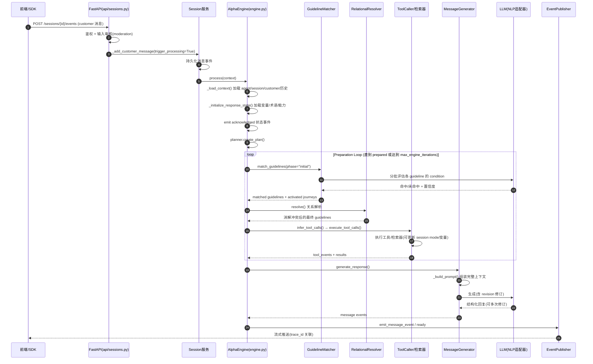
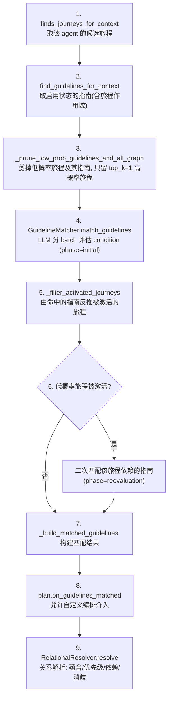
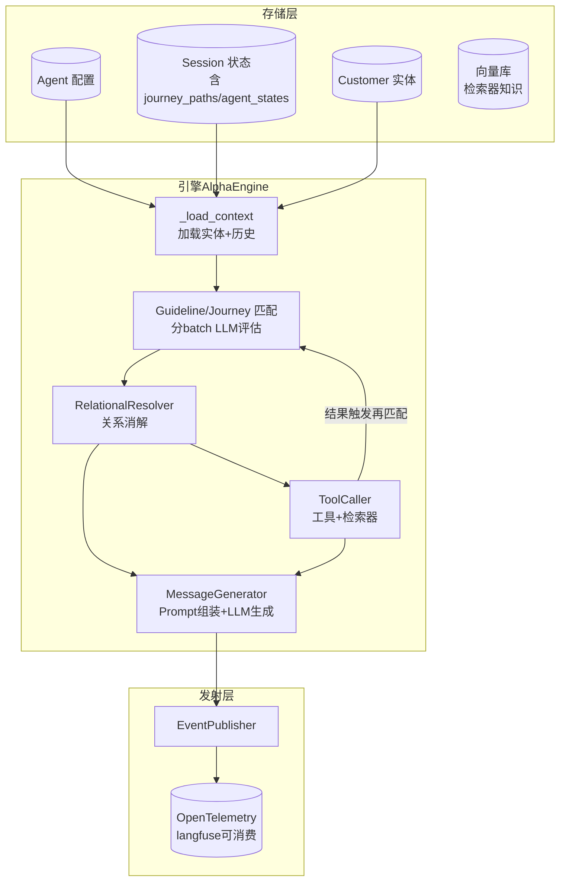

> 分析对象：Parlant 源码 v3.3.1（/Users/zhaoshan/workspace/parlant）。本文基于对 `src/parlant/` 实际源码的阅读整理，所有文件路径、类名、方法名均可直接对照源码验证。

# Parlant 业务执行链路总览

本文回答一个核心问题：**用户发起一次提问后，Parlant 内部按什么顺序执行，上下文工程（Context Engineering）的各个组件如何协作，最终产出一个可控、可追溯的回复。**

---

## 一、30 秒看懂全链路

```
用户消息
  │  ① HTTP API 创建事件
  ▼
Session.process() 触发引擎
  │  ② 引擎加载上下文（agent/session/customer/历史事件）
  ▼
┌─ 准备阶段（Preparation Loop，可迭代多轮）─────────────┐
│  ③ 匹配 Guidelines + Journeys（LLM 分 batch 评估）     │
│  ④ 关系解析（蕴含/优先级/依赖/消歧）                    │
│  ⑤ 工具调用 + 检索器检索（结果可能触发新一轮迭代）        │
│  ⑥ 判定是否"已准备好回复"（否则回到 ③）                │
└──────────────────────────────────────────────────┘
  │  ⑦ 组装最终 Prompt（identity+guidelines+变量+术语+工具结果+shots）
  ▼
  ⑧ LLM 生成消息（含 revision 自我修订机制）
  │  ⑨ 事件发射（status/message/tool，均带 trace_id）
  ▼
前端流式收到回复
```

---

## 二、全链路时序图



---

## 三、阶段详解

### 阶段 ①：API 接入与事件创建

**入口**：`src/parlant/api/sessions.py` → `create_event()`（约 1689 行）

- 按事件来源分发：`CUSTOMER` / `AI_AGENT` / `HUMAN_AGENT` / `HUMAN_AGENT_ON_BEHALF_OF_AI_AGENT` / `CUSTOM` / `STATUS`。
- 客户消息走 `_add_customer_message(..., trigger_processing=True)`（约 1792 行）。
- 触发点在约 1834 行：`event = await app.sessions.process(session_id)`。
- 此处同时完成**鉴权**（`authorization_policy.authorize`）与**输入审核**（`moderation` 参数）。

> 人工转交（human handoff）的能力也在这里体现：当 session 的 `mode` 被工具改为 `manual` 时，引擎在 `process()` 开头直接 `return`（engine.py 约 200 行），不再自动生成回复，等待人工接管。

### 阶段 ②：引擎加载上下文

**方法**：`AlphaEngine._load_context()`（engine.py 约 448 行）

从存储中加载并组装 `EngineContext`：

| 加载内容 | 来源 | 作用 |
|---|---|---|
| `agent` | `read_agent(agent_id)` | 当前智能体配置（preamble/指南/边界等） |
| `session` | `read_session(session_id)` | 会话状态（mode、journey_paths 等） |
| `customer` | `read_customer(...)` | 客户实体（元数据/标签/变量） |
| `interaction` | `find_events(session_id)` | 完整对话历史 |
| `ResponseState` | 内存初始化 | 本次响应的累积状态（匹配结果/工具事件/journeys…） |

其中 `journey_paths` 取自 `session.agent_states[-1]`，即**旅程进度被持久化在会话里**，跨轮延续。

### 阶段 ③④⑤：准备迭代循环（核心）

**主循环**：`AlphaEngine._do_process()`（engine.py 约 298 行）的 `while not context.state.prepared_to_respond` 循环。

每轮调用 `_run_preparation_iteration()`：
- 第 0 轮 → `_run_initial_preparation_iteration()`（约 579 行）
- 后续轮 → `_run_additional_preparation_iteration()`（约 718 行）

#### ③④ 指南与旅程匹配（`_load_matched_guidelines_and_journeys`，约 1238 行，共 9 步）



**指南匹配的 LLM 评估机制**（`guideline_matching/guideline_matcher.py`）：
- 采用**分 batch（分批）**评估：把指南按类型分组，分别交给 LLM 判断是否满足 condition。
- `generic/` 目录下的 batch 类型包括：可行动作评估、观察性（observational）评估、低严重级别评估、消歧（disambiguation）、响应分析，以及 journey 专属 batch（节点选择 / 下一步选择 / 回溯检查 / 回溯节点选择）。
- 每个 span 带 `phase` 属性：`initial`（首轮）或 `reevaluation`（工具结果触发的再评估）。

**关系解析**（`relational_resolver.py`）：对同时命中的多条指南应用四种关系——蕴含（entailment）、优先级（priority）、依赖（dependency）、消歧（disambiguation），消解冲突，得到最终要遵守的指南集合。

#### ⑤ 工具调用与检索器执行

**方法**：`_tool_event_generator.infer_tool_calls()` → `plan.on_tools_inferred()`（可过滤/重排）→ `execute_tool_calls()`（engine.py 约 672-697 行）

- **工具（Tool）**：LLM 推断需要调用哪些工具，执行后结果写入 `tool_events`，并可能**更新变量**（内置 `variable_update`）、**更新旅程计数**（内置 `journey_node_counter`）、**改变 session mode**（支持人工转交）。
- **检索器（Retriever）**：本质上以工具形式接入，在需要时检索知识库，结果注入上下文（详见检索器文档；检索结果**仅对当前响应生效**，不跨轮持久，降低 token 消耗）。

**迭代判定**（`_check_if_prepared`，约 557 行）：若本轮执行了工具、或命中了"带工具的旅程节点"、或 `plan.needs_additional_iteration`，则**再迭代一轮**重新匹配指南；否则视为"已准备好"。达到 `agent.max_engine_iterations` 上限后强制收尾。

> 这个"工具结果 → 触发新指南 → 再匹配"的**反馈闭环**，是 Parlant 区别于简单 RAG/Function-Calling 的关键：它让上下文随工具产出动态演化。

### 阶段 ⑦⑧：消息生成（上下文组装 + LLM）

**入口**：`_generate_messages()` → `_get_message_composer(agent).generate_response()`（engine.py 约 908 行）

**Prompt 组装**（`message_generator.py` 的 `_build_prompt()`，约 329 行）按顺序拼接：

```mermaid
flowchart LR
    A["通用指令<br/>(GENERAL INSTRUCTIONS)"] --> B["Agent 身份<br/>add_agent_identity"]
    B --> C["Customer 身份<br/>add_customer_identity"]
    C --> D["任务描述<br/>(TASK DESCRIPTION)"]
    D --> E["首轮/进行中 分支指令"]
    E --> F["修订机制<br/>(REVISION MECHANISM)"]
    F --> G["命中的 Guidelines"]
    G --> H["上下文变量取值"]
    H --> I["Glossary 术语"]
    I --> J["Capabilities 能力"]
    J --> K["工具执行结果 + 工具洞察"]
    K --> L["Shots 少样本示例"]
    L --> M["对话历史"]
    M --> N["LLM 生成"]
```



**生成机制亮点**：
- **Revision 自我修订**：LLM 先生成草稿，再依据"事实是否都源自提示词、是否违反指南"等标准自我检查并修订，提升事实一致性与合规性。
- **生成保密原则**：提示词明确要求 LLM 不得暴露工具/变量/指南等内部机制——这正是"可控且不泄露实现"的体现。

若配置了**预设话术（Canned Response）**，`canned_response_generator.py` 会先生成草稿话术，再由 LLM 决定采用/改写，兼顾确定性与自然度。

### 阶段 ⑨：事件发射与可追溯

**核心数据结构**（`core/emissions.py`）：

```python
@dataclass(frozen=True)
class EmittedEvent:
    source: EventSource      # 谁发的 (CUSTOMER/AI_AGENT/HUMAN_AGENT/SYSTEM...)
    kind: EventKind          # 事件类型 (STATUS/MESSAGE/TOOL/CUSTOM)
    trace_id: str            # ← 可追溯的关键：贯穿所有事件与 OTel span
    data: JSONSerializable   # 事件载荷
    metadata: Mapping | None
```

**发射器**（`core/emission/event_publisher.py` 的 `EventPublisher`）：把 `EmittedEvent` 发布到会话事件流；响应内的事件先经 `EventBuffer` 缓冲，再统一发布，支持消息事件增量更新（流式打字效果）。

**与 OpenTelemetry 打通**（对应 `docs/03-production/06-可观测性.md`）：每个事件都带 `trace_id`，与 OTel 的 trace 一一对应。引擎内置 span：`process`、`utter`、`message_generation`、`guideline_matcher`(phase)、`tool_caller`、`response_analysis` 等。

---

## 四、上下文工程组件协作总图



---

## 五、"可控、可追溯"是如何落地的

| 目标 | 实现机制 | 源码位置 |
|---|---|---|
| **可控（说什么/何时说/为什么）** | 指南 condition→action；旅程状态机；关系消解；plan 钩子可介入每一步 | `engine.py`、`guidelines.py`、`journeys.py` |
| **上下文精准注入** | 工具/检索器只在关联 condition 命中时进入上下文，避免误触发 | `engines/alpha/tool_calling/*` |
| **反馈闭环** | 工具结果触发指南再评估，上下文动态演化 | `_do_process` 迭代循环 |
| **可追溯** | 每个事件带 `trace_id`，全链路 span 可查询 | `emissions.py`、`tracer.py` |
| **可审计** | 消息/工具/状态事件全部持久化，可回放 | `sessions.py` 事件存储 |

---

## 六、延伸阅读

- 核心模块源码地图：见 [02-核心模块源码地图.md](02-核心模块源码地图.md)
- 可观测性与 langfuse 对接：见 [03-可观测性与追踪对接.md](03-可观测性与追踪对接.md)
- 引擎内部 API 参考：`src/parlant/core/engines/alpha/engine.py` 的 `AlphaEngine` 类方法清单本身就是最好的执行顺序说明。
