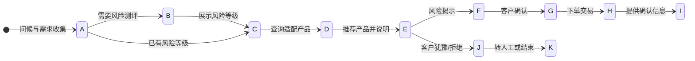

# 智能投顾 Agent 需求文档

**交付对象**：Claude Code  
**目标**：基于现有 Parlant Agent 平台，构建一个用于客户演示的智能投顾 Demo Agent。支持可视化构建或加载 schema，三方服务独立部署。

---

## 1. 项目概述

构建一个“智能投顾演示 Agent”，向客户展示：
- 基于 Parlant 的合规对话流程控制
- Journey 引导下的自适应投顾服务
- Observations 与 Relationships 驱动的行为精确控制
- 通过 Tools 调用独立三方服务完成风险测评、产品推荐、交易等操作
- 通过 Context Variables 和 Glossary 实现动态链路管控与专业术语理解

**Demo 原则**：数据全部模拟，不涉及真实交易；强调合规、可控、可解释。

---

## 2. 系统架构

```
客户 ↔ Parlant Agent（投顾 Demo） ↔ 三方服务应用（FastAPI）
```

- **Parlant Agent 平台**：已存在，支持可视化构建或加载 schema。
- **投顾 Demo Agent**：通过 schema/配置定义，包含 Journey、Guidelines、Tools、Observations、Relationships、Context Variables、Glossary、Canned Responses。
- **三方服务应用**：独立 FastAPI 应用，提供模拟后端 API。

---

## 3. 三方服务应用需求

使用 FastAPI 实现，内存模拟数据，提供以下接口：

| 接口 | 方法 | 说明 |
|------|------|------|
| `/customer/{id}` | GET | 返回客户标签（VIP、专业、风险等级等） |
| `/risk/assess` | POST | 提交风险测评答案，返回风险等级（保守/稳健/平衡/成长/进取） |
| `/products` | GET | 根据 `risk_level` 返回适配产品列表 |
| `/market/data` | GET | 根据 `symbol` 返回模拟行情 |
| `/trade/order` | POST | 提交交易订单，返回确认号 |
| `/human/transfer` | POST | 转人工，返回工单号 |

**要求**：可独立启动，提供 OpenAPI 文档，CORS 允许本地调用。

---

## 4. Parlant Agent Schema 需求

生成 Parlant 可加载的 schema/配置（格式遵循现有平台约定，如 Python SDK 脚本或 JSON）。包含以下组件：

### 4.1 Agent 基础信息
- 名称：智能投顾 Demo
- 描述：引导客户完成风险测评、产品推荐、风险揭示与交易确认的演示 Agent。

### 4.2 核心 Journey：标准投顾流程

**标题**：标准投顾流程  
**条件**：客户请求投资建议、理财咨询或产品推荐  
**描述**：引导客户完成合规投顾流程。

**状态图**：



**状态说明**：
- A：Chat State，问候并询问投资目标。
- B：Tool State，调用风险测评。
- C：Chat State，展示风险等级。
- D：Tool State，查询适配产品。
- E：Chat State，推荐产品并说明。
- F：Chat State，风险揭示（使用预设回复）。
- G：Chat State，确认交易。
- H：Tool State，下单。
- I：Chat State，提供确认信息。
- J：Chat State，处理犹豫。
- K：Chat State，转人工或结束。

**要求**：Journey 允许自适应跳转、回退，不强制线性执行。Tool State 后可接 Chat State 或 Fork State，用于分支处理。

### 4.3 Guidelines（行为准则）

| 优先级 | 条件 | 动作 | 说明 |
|--------|------|------|------|
| critical (100) | 客户请求投资建议 | 必须先完成风险测评 | 未测评不得推荐 |
| critical (90) | 推荐产品时 | 不得推荐超出风险等级的产品 | 使用 STRICT 模式 + 预设回复 |
| high (80) | 提供投资建议 | 必须使用预设话术 | 合规措辞 |
| normal (70) | 客户表达焦虑 | 先安抚情绪 | 与推荐行为建立优先级关系 |
| normal (50) | 客户询问个股涨跌预测 | 拒绝并引导至资产配置 | 话题边界 |
| normal (50) | 客户说“太贵了” | 解释费用结构 | Journey 作用域指南 |
| low (30) | 推荐高收益产品 | 默认推荐行为 | 受合规门控约束 |

### 4.4 Observations（观察）

定义以下观察，用于感知对话状态：

| 观察名称 | 触发条件 | 管控作用 |
|----------|----------|----------|
| `risk_assessed` | 客户已完成风险测评 | 激活“推荐产品”Guideline |
| `senior_customer` | 客户使用专业术语或提及大额资产 | 开放深度分析工具 |
| `vip_customer` | 客户标签为 VIP | 开放 VIP 专享产品 |
| `customer_anxious` | 客户表达焦虑、担忧 | 排除“推荐高风险产品” |
| `customer_hesitant` | 客户表达犹豫、说“再想想” | 激活“提供更多说明”或“转人工” |
| `customer_wants_deals` | 客户询问折扣、优惠 | 排除“推荐高端产品” |
| `customer_asks_specific_stock` | 客户询问个股涨跌预测 | 触发合规拦截 |
| `risk_assessed_now` | 客户刚刚完成风险测评 | 推进 Journey 到展示等级 |

### 4.5 Relationships（关系）

| 源 | 关系 | 目标 | 说明 |
|----|------|------|------|
| 推荐高风险产品 Guideline | depend_on | `risk_assessed` + `senior_customer` | 合规门控 |
| 推荐 VIP 专享产品 Guideline | depend_on | `vip_customer` | 个性化 |
| 安抚情绪 Guideline | prioritize_over | 推荐产品 Guideline | 当 `customer_anxious` 触发时 |
| 投资建议 Guideline | disambiguate | [推荐基金, 推荐保险] | 意图不明确时主动澄清 |
| `customer_wants_deals` | exclude | 推荐高端产品 Guideline | 避免矛盾推荐 |
| `customer_hesitant` | prioritize_over | 直接推荐 Guideline | 先处理犹豫 |

### 4.6 Tools（工具）

将三方服务映射为 Parlant Tools：

| 工具名 | 对应接口 | 说明 |
|--------|----------|------|
| `assess_risk` | POST `/risk/assess` | 风险测评 |
| `get_products` | GET `/products` | 查询适配产品 |
| `get_market_data` | GET `/market/data` | 获取行情 |
| `place_order` | POST `/trade/order` | 下单交易 |
| `transfer_to_human` | POST `/human/transfer` | 转人工 |
| `get_customer_profile` | GET `/customer/{id}` | 获取客户画像 |

### 4.7 Canned Responses（预设回复）

- **风险揭示**：“投资有风险，过往业绩不代表未来表现，请根据自身风险承受能力谨慎决策。”
- **拒绝推荐**：“根据您的风险等级（{risk_level}），该产品不适合您。我可以为您推荐更匹配的产品。”
- **未测评拦截**：“在为您推荐产品之前，需要先完成风险测评。请问现在方便吗？”
- **个股预测拒绝**：“我无法预测具体个股的涨跌。但我可以帮您分析资产配置是否合理。”
- **转人工**：“正在为您转接人工顾问，请稍候。”

### 4.8 Context Variables（上下文变量）

用于动态管控链路执行，随客户身份自动加载，每次响应前刷新。

| 变量名 | 类型 | 示例值 | 管控作用 | 关联工具 |
|--------|------|--------|----------|----------|
| `customer_tier` | string | `"VIP"` / `"普通"` | 控制 VIP 专享产品与深度分析工具 | `get_customer_profile` |
| `risk_level` | string | `"保守"` / `"稳健"` / `"平衡"` / `"成长"` / `"进取"` | **核心合规门控**：决定可推荐产品范围 | `get_customer_profile` |
| `risk_assessed` | boolean | `true` / `false` | 控制“推荐产品”Guideline 是否可激活 | `get_customer_profile` |
| `is_professional` | boolean | `true` / `false` | 控制是否启用专业术语和深度分析 | `get_customer_profile` |
| `preferred_contact` | string | `"电话"` / `"邮件"` | 控制转人工后的跟进方式 | `get_customer_profile` |

**实现示例**：

```python
customer_tier = await agent.create_variable(
    name="customer_tier",
    description="客户等级，用于控制服务权限和产品推荐范围",
    tool=get_customer_profile,
    freshness_rules="0 * * * *",  # 每小时刷新
)
```

### 4.9 Glossary（术语表）

帮助 Agent 正确理解专业术语，并在对话中使用恰当措辞。不控制链路，仅提供知识层支持。

**投资产品与策略术语**：

| 术语 | 解释 | 使用场景 |
|------|------|----------|
| 风险测评 | 评估客户风险承受能力的标准化流程，结果分为 C1（保守）至 C5（进取）五个等级 | 客户问“为什么要做测评”时解释 |
| 适当性管理 | 监管要求：投资产品的风险等级不得高于客户的风险承受等级 | 拒绝超风险产品时的依据 |
| 资产配置 | 将资金分散投资于不同资产类别以平衡风险与收益 | 客户问“怎么投”时的核心框架 |
| 定投 | 定期定额投资，平滑市场波动影响 | 客户担心“追高”时的替代方案 |
| 最大回撤 | 投资组合从最高点到最低点的最大亏损幅度 | 客户问“最坏能亏多少”时的量化指标 |
| 基金投顾 | 持牌机构接受客户委托，代客户作出基金投资决策的服务 | 客户询问服务性质时的合规定义 |

**风险等级术语**：

| 等级 | 术语 | 解释 | 适配产品类型 |
|------|------|------|-------------|
| C1 | 保守型 | 不愿承担本金损失，追求本金安全 | 货币基金、国债 |
| C2 | 稳健型 | 愿意承担较小波动，追求稳定收益 | 纯债基金、银行理财 |
| C3 | 平衡型 | 可接受一定波动，追求风险收益平衡 | 混合型基金、二级债基 |
| C4 | 成长型 | 可接受较大波动，追求较高收益 | 股票型基金、偏股混合 |
| C5 | 进取型 | 可接受大幅波动，追求高收益 | 行业主题基金、杠杆产品 |

**实现示例**：

```python
await agent.create_glossary(
    terms={
        "风险测评": "评估客户风险承受能力的标准化流程，结果分为C1（保守）至C5（进取）五个等级",
        "适当性管理": "监管要求：投资产品的风险等级不得高于客户的风险承受等级",
        "最大回撤": "投资组合从历史最高点到后续最低点的最大亏损百分比",
        "定投": "定期定额投资策略，通过分批买入平滑市场波动",
        "基金投顾": "持牌机构接受客户委托，代客户作出基金投资品种、数量和买卖时机决策的服务",
    }
)
```

---

## 5. 演示场景脚本

### 场景 1：普通客户新咨询
1. 客户：我想投资理财。
2. Agent：问候，询问目标，引导风险测评。
3. Agent：测评完成，风险等级“稳健型”。
4. Agent：推荐债券基金，揭示风险。
5. 客户：确认购买。
6. Agent：下单成功，提供确认号。

### 场景 2：VIP 专业客户
1. 客户：我是 VIP，想配置一些高收益产品。
2. 触发 `vip_customer`、`senior_customer`。
3. Agent：快速测评后推荐混合型产品，提供深度分析。
4. 客户：犹豫。
5. 触发消歧关系，Agent 询问偏好。

### 场景 3：合规拦截
1. 客户：直接推荐个高收益股票。
2. Agent：根据合规指南拒绝，引导风险测评。

### 场景 4：术语解释与变量协同
1. 客户：给我推荐一个收益高的产品。
2. 触发 `customer_asks_high_return`，加载 `risk_level="稳健型"`。
3. 合规拦截 Guideline（优先级 100）激活，`recommend_high_risk_guideline` 不激活。
4. Agent 使用预设回复：“根据您的风险等级（稳健型），高收益产品通常伴随较高波动，可能超出您的风险承受范围。我可以为您展示几款适合稳健型投资者的产品，您看可以吗？”

---

## 6. 验收标准

- [ ] 三方服务可独立启动，所有 API 可正常调用。
- [ ] Parlant Agent 加载 schema 后，Journey 可正常触发。
- [ ] 未完成风险测评时，Agent 不推荐任何产品。
- [ ] Agent 不推荐超出客户风险等级的产品。
- [ ] Observations 和 Relationships 按预期触发。
- [ ] Context Variables 正确加载并影响 Guideline 激活。
- [ ] Glossary 术语在对话中被正确理解和使用。
- [ ] 四个演示场景可完整跑通。
- [ ] 可视化平台可展示 Journey、Guidelines、Variables 与 Glossary。

---

## 7. 交付物

1. 三方服务 FastAPI 应用代码（含 README）。
2. Parlant Agent schema 文件（格式适配现有平台），包含：
   - Journey 定义
   - Guidelines
   - Observations
   - Relationships
   - Tools
   - Canned Responses
   - Context Variables
   - Glossary
3. 演示脚本说明文档。
4. 测试用例（覆盖四个场景）。

---

**备注**：本需求文档聚焦 Demo 演示，所有数据均为模拟。实际实现时，请根据现有 Parlant 平台的 schema 格式和加载方式进行调整。变量和术语表应作为独立配置项纳入 schema。

---

## 8. 实现偏差与平台约束（落地对照 · 2026-09-29）

> 本节记录「需求写法」与「平台实际能力」的差异，均在实现与 E2E 实测中确认。
> 完整实现说明见 `智能投顾Agent-实现说明.md`；引擎约束的源码依据见项目记忆
> `engine-priority-and-strict-footgun`。

### 8.1 与需求有出入的配置（实现已调整）

| 项 | 需求/初稿写法 | 实际落地 | 原因 |
|---|---|---|---|
| 旅程数值优先级 | 未提及 | `jny_advisor priority=100` | 引擎只保留数值优先级最高的实体（RelationalResolver），旅程 priority < 匹配的高优先级指南时整个旅程+trigger 被丢弃、永不激活；须与最高合规指南（100）**持平** |
| 合规指南 composition_mode | 原设计 STRICT | **全部 fluid** | strict 在多迭代引擎下 draft 与 canned response 不匹配即丢弃 draft → 兜底 "Not sure I understand"；fluid 靠 action 指令 + canned 检索渲染（匹配用话术、不匹配用 draft，永不兜底） |
| gdl_risk_first 条件 | "客户请求投资建议"（宽） | 收窄为「…且客户尚未完成风险测评」 | 宽条件在测评后仍触发；配合 fluid 消除误拦截 |
| gdl_risk_match 条件 | "推荐产品时，客户有明确风险等级"（宽） | 收窄为「客户要求或暗示推荐超出风险等级的产品」 | 只在越级请求时激活（拒绝门控），合规推荐不误触发 |
| 风险测评 | 问卷式（可选） | 客户自报 C1~C5 | 需求 §3 允许简化 |
| 行情 | 实时（可选 Brave Search） | 随机微调 | 需求允许，后续可接 |

### 8.2 没法配 / 引擎不消费（schema 字段仅落库、不生效）

- **state 级**：`canned_responses`、`retrievers`、`priority`、`variable_updates_on_enter/exit`
- **transition 级**：`response_mode`、`timeout_branch`、`keywords`；**转移级 canned_responses 经 `create_transition` 不生效**
- **journey 级**：`business_goal`、`sop_type`、`retrievers`、`dependencies`、`status`

> 生效的构成：journey `priority/composition_mode`、state `type/action/tool_state→tools/composition_mode`、
> transition `condition/to`。

### 8.3 `{var}` 引用变量：节点文本不可行，condition 可行

- **journey 节点 `chat_state` 文本里的 `{var}` 不可用**：节点指南的 action 就是该静态文本，
  引擎不做模板插值；含 `{var}` 的节点文本还曾导致旅程评估失败（已从节点文本移除）。
  变量值只能靠 **Context Variables 全量注入 LLM 上下文**生效（`{变量名:{value,description}}`
  JSON），不插值进话术。因此产品名/风险等级等动态值由 message generator 依上下文自然生成，
  不要写死在节点话术里。
- **指南 condition 里的 `{var}` 可用**（best-effort）：变量值进入匹配上下文，LLM 可见，
  实测 `gdl_risk_match` 条件 `{risk_level}` 正常驱动判断。

### 8.4 其他引擎约束（schema 设计与运维注意）

1. **实体 id 归属**：agent/journey/state/guideline/observation 的 id **由定义层提供**并进引擎
   全局存储，**不同 agent 间必须全局唯一**（journey id 重复会报错、state id 重复静默覆盖）；
   @draft/版本实例由 loader 自动加后缀隔离。variable/glossary/canned response 的 id 由
   SDK 随机生成；tool 按名注册（同名视为复用）。**server 定义层已在 save/导入时做跨 Agent
   冲突预检**（journey/state/guideline/observation 四类，撞号即 422 列出冲突 id 与占用
   Agent），把报错提前到导入而非发布。
2. **demo 数据文件**（`invest-advisor-demo/data/`）不入库，缺失时 app 按 SEED 自动重建；
   演示后若要复位客户状态（如已测评），删该目录重启即可。
3. **引擎两大约束**（详细源码依据见 `实现说明.md` §四·附）：数值优先级只保留最高层；
   composition_mode=strict 是兜底坑（合规指南一律 fluid）。
4. **客户档案校验**（实现新增，需求未覆盖）：journey 入口为 tool 节点 `sta_profile_check`
   （调 `get_customer_profile`）。未知客户（demo 后端 404）→ 路由终止态 `sta_notfound`，
   Agent 告知"未找到客户档案、无法服务、请确认身份"并结束会话；已知客户 → 正常流程。
   契合"管理后台以任意新用户发起会话"的运维场景。