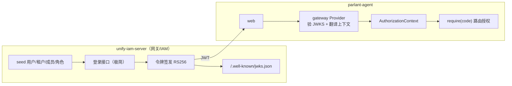

# 17. 网关接入 · 首阶段最小实现范围（E2E-1）

> 状态：**方案定稿，待排期实施**（2026-10-08）。
> 定位：跨两套系统（**unify-iam-server ↔ parlant-agent**）的最小端到端闭环，验证《Gateway 权限体系
> 架构设计》中"**网关统一装配上下文、业务应用只消费已授权上下文**"的核心主张是否成立。
> 依据：《Gateway 权限体系架构设计》§12 第一阶段（身份/租户/RBAC）；parlant-agent `docs/06-dev-process/09-M1-API加固与输入审核实施方案.md`。
> **范围原则：令牌管线走真表结构（薄而不废）；登录入口可以最简甚至后置。E2E-2 只换认证来源，不重写。**

---

## 1. 目标（一句话）

**IAM 侧做一个极简登录 → 产出可由 parlant-agent 验签的 JWT → parlant-agent 的 `gateway` Provider 翻译成 `AuthorizationContext` → 全链路授权生效（401/403/200 正确）。**

## 2. 范围边界

### 2.1 做（E2E-1 范围）

| 域 | 内容 |
|---|---|
| IAM | phase-1 表结构 + seed 数据；本地账号令牌签发（RS256）；JWKS 端点；RBAC 解析（membership→roles→permissions→claims） |
| parlant-agent | M1 鉴权接缝（`app/authz/`）+ **最小 `gateway` Provider**（JWKS 验签 + 翻译上下文）+ 权限点目录对齐 |
| 契约 | JWT claims schema · JWKS · 权限点目录 —— 三样锁死 |

### 2.2 不做（延后 E2E-2 / 后置）

- **SSO/OIDC/SAML**（企业 IdP、claim/group 映射、JIT 入租户）→ E2E-2
- **数据策略（Data Policy）**（数据范围过滤/字段脱敏）→ 有真实数据敏感诉求再做
- **外部数据资产平台**（数据源/资产/模板/授权）→ 有客户数据受控接入诉求再做
- **登录 UI 完整化**（注册、密码找回、邀请、域名验证）→ 先 dev 登录接口即可
- **refresh token / 多因素 / 用户管理台** → 后置
- **租户数据隔离在 parlant-agent 业务层激活**（agent 定义/会话按 tenantId 过滤）→ 有真实多租户再做

---

## 3. 总体架构（E2E-1 形态）



---

## 4. 三方契约（最关键，先锁死）

### 4.1 JWT claims schema

```jsonc
// 网关签发；RS256 签名；exp 短时（如 2h）
{
  "iss": "https://unify-iam.example.com",        // 网关 issuer（parlant-agent 配置指向它）
  "aud": "parlant-agent-server",
  "sub": "u-1001",                                // userId
  "tenantId": "tenant-org-a",
  "membershipId": "ms-2001",
  "roles": ["AgentOperator"],                     // 来自 membership_role
  "permissions": ["agent:read","agent:build","agent:publish","agent:delete",
                  "session:read","session:send","customer:manage","trace:read","settings:read"],
  "attrs": { }                                    // dataAttributes 预留（数据策略用）
}
```

### 4.2 权限点目录（gateway_permission 与 parlant-agent permissions.py 同套 code）

| permission code | parlant-agent 路由 |
|---|---|
| `agent:read` | GET /api/agents、/versions |
| `agent:build` | POST /api/agents（建/存草稿）、journeys/layout |
| `agent:publish` | POST /api/agents/{id}/publish |
| `agent:delete` | DELETE /api/agents/{id}/delete、/{id}、rollback |
| `session:read` | GET /api/sessions、/sessions/{id} |
| `session:send` | POST /api/sessions/{id}/events |
| `customer:manage` | POST /api/customers |
| `trace:read` | GET /api/traces/* |
| `settings:read` | GET /api/settings |
| （公开） | /health |

> **这是 E2E-1 的硬性验收前置**：IAM 的 `gateway_permission` 里必须预置以上 code；E2E-2 的 SSO group→role 映射最终也落到这些 code 上。

### 4.3 JWKS

- IAM 暴露 `GET /.well-known/jwks.json`（RS256 公钥，kid 标识）。
- parlant-agent 配置 `JWT_JWKS_URL`，`gateway` Provider 启动拉取/按 kid 缓存。

---

## 5. IAM 侧最小交付（unify-iam-server）

### 5.1 表结构与 seed（真表，最少数据）

| 表 | 最少 seed |
|---|---|
| `gateway_user` | 2 个（u-1001 普通运营、u-1000 管理员） |
| `gateway_tenant` | 1 个（tenant-org-a，ORGANIZATION） |
| `gateway_membership` | 每人 1 条（member 状态 ACTIVE，default 成员） |
| `gateway_role` | 2 个（`AgentOperator`、`TenantAdmin`） |
| `gateway_permission` | 上面 §4.2 全部 code |
| `gateway_role_permission` | AgentOperator→agent:*、session:*、customer:*、settings:*；TenantAdmin→全量+user:* |
| `gateway_membership_role` | 每人绑定对应角色 |
| `gateway_user_identity` | 本地账号 1 条（用户名/密码哈希，可极简） |

> 结论：8 张表、种子数据可硬编码 INSERT；令牌签发必须走"查 membership→算 roles/permissions→签发"的真实链路（**薄而不废**）。

### 5.2 端点

| 端点 | 说明 |
|---|---|
| `POST /api/v1/auth/token` | 极简登录：username/password → 校验 → 签发 JWT（可先用 dev 凭据） |
| `GET /.well-known/jwks.json` | RS256 公钥（kid 固定） |
| （可选）`POST /api/v1/auth/dev-token` | 直接按 seed 用户/角色发令牌，联调加速用（Postman 友好） |

---

## 6. parlant-agent 侧最小交付

> 完整 M1（dev/jwt Provider、CORS、runtime internal token、输入审核、审计）见 doc09；此处只列 **E2E-1 必需**。

| 交付 | 文件 |
|---|---|
| 鉴权包骨架 | 新增 `app/authz/`（context.py / provider.py / permissions.py / deps.py） |
| `AuthorizationContext` | `app/authz/context.py`（对齐 IAM §8.2） |
| `gateway` Provider | `app/authz/providers/gateway.py`：按 `JWT_JWKS_URL` 验签 + claims→context 翻译 |
| 路由权限点 | 各 router 目标函数挂 `Depends(require("agent:publish"))` 等 |
| 配置 | `auth_mode=gateway`、`jwt_jwks_url`、`jwt_issuer`、`jwt_audience` |
| 内部 token（并行） | runtime `/internal/*` 加 `X-Internal-Token`（服务间信任，与用户鉴权正交，见 doc09 §4.4） |

---

## 7. 端到端验收（E2E-1）

| # | 用例 | 期望 |
|---|---|---|
| 1 | 无令牌访问 `/api/agents` | 401 |
| 2 | 有令牌（AgentOperator）访问 `GET /api/agents` | 200 |
| 3 | 有令牌访问 `POST /api/agents/{id}/publish`（缺 `agent:publish` 的用户） | 403 |
| 4 | TenantAdmin 访问全部管理端点 | 200 |
| 5 | JWT 过期/篡改签名 | 401 |
| 6 | 全链路：登录→拿 JWT→建 Agent→发布→建会话→发消息→观测 | 走通 |
| 7 | 令牌 claims 里 roles/permissions 变化（换角色 seed） | 授权立即变化 |

> 判定：**路由代码零改动**的前提下，仅通过换 Provider / 换令牌内容即可通过 1-7 —— 这是"接缝成立"的证明。

---

## 8. 延后到 E2E-2（不重写的部分）

| 项 | 形态 |
|---|---|
| SSO（OIDC/SAML） | 企业 IdP 接入；claim/group 映射；JIT 入租户 → **只换认证来源，令牌管线不动** |
| refresh token | 补充签发/刷新端点 |
| 数据策略 | `context.attrs` 消费 + 过滤/脱敏（parlant-agent 按需） |
| 租户隔离激活 | parlant-agent 业务查询按 `tenantId` 过滤 |
| 审计统一 | IAM 侧统一审计，parlant-agent 业务侧 `audit_log` 上缴/同步 |

---

## 9. 风险与注意

- **权限点目录是共同底座**：IAM 与 parlant-agent 的 code 必须同套，改一处同步另一处（建议 IAM 侧为权威、parlant-agent `permissions.py` 声明 + 启动校验比对）。
- **JWKS 拉取与缓存**：gateway Provider 要处理 kid 轮换与启动时 IAM 不可达（降级 503 而非崩）。
- **dev/gateway 双模式切换**：用全局依赖 + 显式白名单（`/health`、`/docs`），别逐路由加，防漏保护。
- **SSE 事件流**：EventSource 带不了 header → token 走短时 query（JWT 是 ASCII，符合既有"query 传 ASCII"约定）；生产可切 HttpOnly cookie。
- **IAM 令牌在 parlant-agent 的租户字段**：E2E-1 里 `tenantId` 进上下文即可，业务层暂不按租户过滤（避免过度设计）。

---

## 10. 相关文档

- 本范围依据：《Gateway 权限体系架构设计》`/Users/zhaoshan/workspace/unify-iam-server/20260825-Gateway-权限体系架构设计.md`
- parlant-agent 完整加固方案：`docs/06-dev-process/09-M1-API加固与输入审核实施方案.md`
- 决策记录：E2E-1 不包含 SSO（只换认证来源，接缝证明后再叠）；不并行实现完整 IAM（等真实消费者/触发条件）
