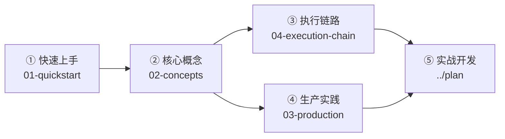

# Parlant 技术参考手册

> Parlant v3.3.1 官方文档中文翻译 + 源码执行链路分析 + 实战开发计划。
> 本目录是**技术参考入口**：概念与语法 → 生产实践 → 源码链路；实施路径见同级 `plan/` 目录。

---

## Parlant 是什么（一句话）

Parlant 是一个面向客户交互的**对话编排框架（conversational harness）**：它用"上下文工程"把智能体的行为变成**可预测、一致、可追溯、可安全上线**——你通过指南（Guideline）、旅程（Journey）、工具（Tool）、检索器（Retriever）等声明式组件精确控制智能体"看到什么、说什么、何时说、为什么说"。

---

## 推荐阅读路线

1. **快速上手**：装起来、跑通示例、理解设计动机。
2. **核心概念**：会话、Agent、客户 + 8 大上下文工程组件（这是重点，逐篇精读）。
3. **执行链路**：回到源码，理解"一次提问如何被处理"（把概念串成线）。
4. **生产实践**：上线要考虑的审核、转交、加固、观测、扩展。
5. **实战开发**：按 `plan/` 分阶段搭 admin / server / web。

---

## 文档索引

### 01-quickstart 快速上手
| 文档 | 内容 |
|---|---|
| [01-安装.md](01-quickstart/01-安装.md) | 安装、首个 Agent、首个指南、React 组件 |
| [02-快速入门示例.md](01-quickstart/02-快速入门示例.md) | 医疗示例：指南/旅程/工具/边界情况（带状态图） |
| [03-设计动机.md](01-quickstart/03-设计动机.md) | 为什么需要 Parlant、ABM 行为建模 |

### 02-concepts 核心概念（上下文工程组件）
| 文档 | 组件 | 一句话 |
|---|---|---|
| [01-会话Session.md](02-concepts/01-会话Session.md) | Session | 事件驱动交互单元，offset/trace_id 机制 |
| [02-Agent实体.md](02-concepts/02-Agent实体.md) | Agent | 智能体身份与单/多智能体设计 |
| [03-客户实体Customer.md](02-concepts/03-客户实体Customer.md) | Customer | 客户实体、认证、元数据/标签/变量 |
| [04-指南Guidelines.md](02-concepts/04-指南Guidelines.md) | Guideline | condition→action 行为规则（含 Observation） |
| [05-工具Tools.md](02-concepts/05-工具Tools.md) | Tool | 挂接外部 API/服务，按需进入上下文 |
| [06-检索器Retrievers.md](02-concepts/06-检索器Retrievers.md) | Retriever | 知识库检索，结果仅当前响应生效 |
| [07-旅程Journeys.md](02-concepts/07-旅程Journeys.md) | Journey | 多轮 SOP 状态机（chat/tool/fork） |
| [08-关系Relationships.md](02-concepts/08-关系Relationships.md) | Relationship | 指南间 蕴含/优先级/依赖/消歧 |
| [09-术语表Glossary.md](02-concepts/09-术语表Glossary.md) | Glossary | 业务术语统一口径 |
| [10-变量Variables.md](02-concepts/10-变量Variables.md) | Variable | 上下文变量读写与新鲜度规则 |
| [11-预设话术CannedResponses.md](02-concepts/11-预设话术CannedResponses.md) | Canned Response | 高确定性的模板回复 |

### 03-production 生产实践
| 文档 | 内容 |
|---|---|
| [01-Agentic设计方法论.md](03-production/01-Agentic设计方法论.md) | 行为建模方法论、设计原则 |
| [02-用户输入审核.md](03-production/02-用户输入审核.md) | Lakera/Llama Guard 审核 |
| [03-人工转交.md](03-production/03-人工转交.md) | Human Handoff 模式 |
| [04-API增强.md](03-production/04-API增强.md) | 授权策略、JWT、限流、CORS |
| [05-官方前端参考.md](03-production/05-官方前端参考.md) | parlant-chat-react 与自定义前端 |
| [06-可观测性.md](03-production/06-可观测性.md) | OpenTelemetry 接入（traces/metrics/logs） |
| [07-FastAPI扩展.md](03-production/07-FastAPI扩展.md) | configure_api / configure_container 扩展 |
| [08-内置ChatUI与HTTP接口分析.md](03-production/08-内置ChatUI与HTTP接口分析.md) | 自研：/chat 交互逻辑 + 框架 REST 接口清单 + BFF 代理映射 |
| [09-客户信息与Variables覆盖机制.md](03-production/09-客户信息与Variables覆盖机制.md) | 自研：客户信息用法 + 变量解析优先级 + 客户级覆盖 Agent 默认（自动仿真依据） |
| [10-草稿试跑与会话版本隔离.md](03-production/10-草稿试跑与会话版本隔离.md) | 自研：草稿 @draft 独立实例试跑、session 记录 Agent 版本/状态、不影响线上 |
| [11-工具实现与配置指南.md](03-production/11-工具实现与配置指南.md) | 自研：内置工具（journey_node_counter / variable_update / tavily_search）+ remote 自定义 HTTP 工具、变量 freshness 联动、前端配置、踩坑清单 |
| [12-观测插桩去hack化改造.md](03-production/12-观测插桩去hack化改造.md) | 技术债：用 litellm OTel + EngineHooks 替代 parlant 源码插桩（LLM I/O + 旅程日志） |
| [13-发布与渠道部署设计.md](03-production/13-发布与渠道部署设计.md) | 发布流程与渠道接入设计 |
| [14-评估机制与evaluation-cache.md](03-production/14-评估机制与evaluation-cache.md) | 自研：旅程/指南评估原理、内容寻址缓存、热加载补评估、残缺评估故障模式与运维 SOP |
| [15-guideline匹配性能优化评估.md](03-production/15-guideline匹配性能优化评估.md) | 方案评估（未开发）：单轮 23~28 次 LLM 调用 / 29.7K+ 字符 prompt 的量与根因，批大小策略 + prompt 裁剪分层方案与 A/B 验证 |
| [16-M1-API加固与输入审核实施方案.md](03-production/16-M1-API加固与输入审核实施方案.md) | M1 实施方案：server JWT + 权限点目录 + runtime 内部 token + 输入审核 + 审计；**兼容未来统一接入层（Gateway+IAM 权限体系）的可插拔 AuthProvider 接缝设计** |
| [17-网关接入首阶段最小实现-E2E-1范围.md](03-production/17-网关接入首阶段最小实现-E2E-1范围.md) | 跨 unify-iam-server ↔ parlant-agent 的 E2E-1 最小闭环范围：IAM 极简登录签 JWT（RS256+JWKS）+ parlant-agent gateway Provider 翻译上下文；三契约锁死；SSO/数据策略延后 E2E-2 |

### 待跟进问题（to-follow-up）
| 文档 | 状态 |
|---|---|
| [挽留计数与工具职责.md](to-follow-up/挽留计数与工具职责.md) | 已解决：journey_node_counter 差 1 排查实录 + tool→fork 走通（loader 补 REEVALUATION 关系）+ 变量泄漏幻觉 + 插桩 parlant-agent |

### 04-execution-chain 源码执行链路（基于 v3.3.1 源码）
| 文档 | 内容 |
|---|---|
| [01-业务执行链路总览.md](04-execution-chain/01-业务执行链路总览.md) | 一次提问的完整流程 + 时序图/协作图 |
| [02-核心模块源码地图.md](04-execution-chain/02-核心模块源码地图.md) | 组件 → 源码文件 → 类/函数 对照 |
| [03-可观测性与追踪对接.md](04-execution-chain/03-可观测性与追踪对接.md) | trace_id/span 如何对接 langfuse |

### 05-sample-agents 示例 Agent（平台能力落地示范）
| 文档 | 内容 |
|---|---|
| [智能投顾Agent需求.md](05-sample-agents/智能投顾Agent需求.md) | 需求文档：三方服务 6 API + Journey + 合规门控 + 四演示场景 |
| [智能投顾Agent-实现说明.md](05-sample-agents/智能投顾Agent-实现说明.md) | 实现落地 + E2E 实测 + 两个引擎级设计约束（旅程 priority / strict footgun） |
| [remote-http-tools.md](05-sample-agents/remote-http-tools.md) | 平台能力：remote 远程服务工具（通用 HTTP 工具内核）实现说明 |

---

## 术语对照表（中英）

| English | 中文 | 说明 |
|---|---|---|
| Agent | 智能体 | 对话实体 |
| Customer | 客户 | 交互对象实体 |
| Session | 会话 | 事件驱动的交互单元 |
| Context Engineering | 上下文工程 | Parlant 的核心方法论 |
| Observation | 观察 | 最底层原语，监视对话并在条件满足时触发 |
| Guideline | 指南 | condition→action 行为规则 |
| Condition | 条件 | 指南的触发条件 |
| Action | 动作 | 指南命中后的行为 |
| Criticality | 严重级别 | 指南优先级维度 |
| Tool | 工具 | 挂接外部能力的组件 |
| Retriever | 检索器 | 知识库检索组件 |
| Journey | 旅程 | 多轮 SOP 状态机 |
| State | 状态 | 旅程节点（chat/tool/fork） |
| Transition | 转移 | 状态间跳转（含条件） |
| Relationship | 关系 | 指南间蕴含/优先级/依赖/消歧 |
| Glossary | 术语表 | 业务术语 |
| Variable | 变量 | 上下文变量 |
| Canned Response | 预设话术 | 模板回复 |
| Utterance | 话术 | 智能体表达 |
| Preamble | 开场白 | 对话初始话术 |
| Boundary | 边界 | 智能体能力边界 |
| Composition Mode | 组合模式 | fluid/composited/strict |
| Emission | 产出/事件 | 引擎产出的会话事件（带 trace_id） |
| Trace | 追踪 | 贯穿事件与 OTel 的 trace_id |
| Handoff | 人工转交 | 切换人工接管 |

---

## 与 plan/ 的关系

- 本 `docs/` 解决"**懂**"：概念、语法、原理、源码。
- `../plan/` 解决"**做**"：从环境到 admin/server/web 的分阶段实施。
- 建议边学边做：每读完一个概念组件，去 `plan/` 对应阶段动手验证。

## 来源与版本

- 概念/生产文档：译自 Parlant 官方英文文档（本地源码 `docs/`，v3.3.1）；`06-可观测性`、`07-FastAPI扩展` 译自官网最新版（本地仓库尚未收录）。
- 执行链路：基于本地源码 `/Users/zhaoshan/workspace/parlant`（v3.3.1）实际阅读整理。
