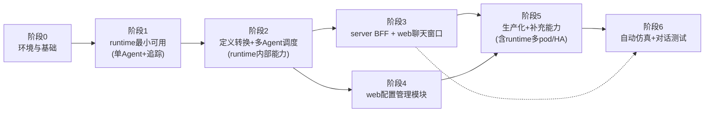

# Parlant 体系化学习 · 总体实施计划

> 本文是整个学习/开发工程的**总纲**。目标、架构、技术选型、依赖组件、阶段路线都在这里；各阶段细节见对应阶段文档。
>
> **2026-09-22 架构调整**：原三应用（admin/server/web）重新划分为 **runtime / server / web**——执行引擎与 BFF 分离，前端收敛为一个应用的两个模块。详见下文「应用划分」。

---

## 一、最终目标

围绕 Parlant（v3.3.1）搭建一套"**可配置、可调度、可观测**"的客服智能体系统，拆成三个可独立交付的项目：

| 项目 | 定位 | 技术形态 |
|---|---|---|
| **parlant-agent-runtime** | **执行引擎服务**：加载 Parlant 的 Agent，调度 Agent 引擎执行业务逻辑（问答/旅程/工具）。有状态，远期考虑会话状态管理、多 pod 部署、Agent 实例高可用与用户问答故障转移（见阶段5） | Python + FastAPI 包装 `p.Server()` |
| **parlant-agent-server** | **BFF / 元数据服务**：支撑配置 Agent 元数据的前端服务——Agent 定义 CRUD/版本/发布编排（定义层唯一写方）；通过异步交互调用 runtime 获取 session、加载 Agent、发起 Agent 问答（REST + SSE 透传）。无状态，易水平扩展 | Python + FastAPI（独立进程，非 p.Server） |
| **parlant-agent-web** | **统一前端**：聊天问答窗口 + Agent 配置管理（原 parlant-agent-admin 全部界面并入本应用的两个模块） | Web 前端（React/Vue + Tailwind），用 `frontend-design` / `ui-ux-pro-max` 做设计 |

> 原 `parlant-agent-admin` 应用已取消：配置管理界面并入 `parlant-agent-web`；其所需后端接口由 `parlant-agent-server` 提供。

贯穿目标：
- 以 **`agent-definition.json`** 作为 Agent 配置的 schema（单一事实源）。
- 用 **langfuse**（或兼容 OTLP 的工具）展示 Parlant 整体执行链路。

---

## 二、系统总体架构

```mermaid
flowchart TB
    subgraph 前端层
        WEB[parlant-agent-web<br/>模块A：聊天问答窗口<br/>模块B：Agent配置管理]
    end

    subgraph 服务层
        SERVER[parlant-agent-server<br/>BFF/元数据服务<br/>Agent定义CRUD/版本/发布编排<br/>会话代理 + SSE透传]
        RUNTIME[parlant-agent-runtime<br/>p.Server() 执行引擎<br/>AgentLoader/Registry 热加载]
        subgraph Parlant引擎
            ENGINE[AlphaEngine]
            STORE[(Agent/Session/Customer<br/>文档存储)]
            VDB[(向量库<br/>检索器知识)]
        end
        DEFDB[(MongoDB<br/>agent_definitions<br/>定义层：server独占写)]
    end

    subgraph 外部
        LLM[LLM / Embedder<br/>OpenAI/Azure/Ollama…]
        LF[langfuse<br/>OTLP traces]
    end

    WEB -->|REST / SSE| SERVER
    SERVER -->|发布: 定义推送<br/>问答: 会话转发| RUNTIME
    SERVER --> DEFDB
    RUNTIME --> ENGINE
    ENGINE --> STORE
    ENGINE --> VDB
    ENGINE --> LLM
    RUNTIME -->|OTLP| LF
    SERVER -->|OTLP| LF
    WEB -.按trace_id跳转.-> LF
```

**关键设计决策：**

1. **执行与元数据分离（runtime / server）**：
   - `parlant-agent-runtime` 只负责"装载定义 → 执行引擎"。它**不直接面向前端**，Parlant REST/SSE 端口仅绑内网；对外只暴露少量 `/internal/*` 端点（load/unload/list/health）。
   - `parlant-agent-server` 是前端唯一入口（BFF）：Agent 定义层 **MongoDB 由 server 独占写**；发布时 server 把定义推送给 runtime，runtime 热加载；runtime 启动时经 internal API 向 server 拉取 published 定义。
2. **问答全链路经 server 代理**：web 不直连 runtime。server 转发会话事件并**透传 SSE** 回前端；鉴权/限流/CORS 集中在 server。
3. **配置与运行分离**：`agent-definition.json` 是"定义层"（Source of Truth）；runtime 内置**加载器**把它**分解转换为 Parlant 实体**（Agent/Guideline/Journey/Variable/Glossary/CannedResponse/Tool/Retriever）并装载进运行中的 `p.Server()`。支持版本化、灰度、热更新。
4. **runtime 扩展点**：内部 API 用 `configure_api` 挂载（不动 Parlant 源码，见 `docs/03-production/07-FastAPI扩展.md`）；鉴权/CORS 用 `configure_container` + 自定义 `AuthorizationPolicy`（见 `docs/03-production/04-API增强.md`）。
5. **可观测性纯配置接入**：注入 `OTEL_EXPORTER_OTLP_*` 环境变量 → langfuse（见 `docs/03-production/06-可观测性.md`）。
6. **server ↔ runtime 交互**：现阶段用**同步 HTTP + SSE 透传**（httpx 异步客户端）；消息队列（削峰/解耦/故障转移）推迟到阶段5多 pod 时引入。

### 端口规划

| 应用 | 端口 | 说明 |
|---|---|---|
| parlant-agent-runtime | 8000（REST/SSE，仅内网）+ 8818（tool service） | p.Server 承载 |
| parlant-agent-server | 8081 | 独立 FastAPI，对外（8080 常被本机 Docker 进程占用，故取 8081） |
| parlant-agent-web | 5173 | Vite dev；生产走 nginx |

---

## 三、技术选型

| 层次 | 选型 | 说明 / 备选 |
|---|---|---|
| 引擎 | **Parlant 3.3.1** | `p.Server()` 嵌入；本地源码 editable 安装（见阶段0排障结论） |
| 后端框架 | **FastAPI** | runtime 由 `p.Server(configure_api=...)` 承载；server 独立 FastAPI |
| Agent 定义存储 | **MongoDB**（生产）/ SQLite（开发） | `agent_definitions` 集合由 server 独占写；Parlant 实体文档存储在 runtime 侧 |
| 向量库 | **Qdrant** | 检索器知识库（`adapters/vector_db/qdrant.md`）；小场景可先用 Parlant 自带 |
| LLM | **OpenAI 兼容 API**（经 litellm 适配） | 备选：Azure / Vertex / Ollama(本地) / OpenRouter |
| Embedder | 随 LLM 提供 | 检索器与术语匹配需要 |
| 追踪 | **langfuse**（自托管 docker 或 Cloud） | 经 OTLP 接入；备选 Jaeger/Grafana |
| web 前端 | **React 18 + Vite + Tailwind(+shadcn/ui)** | 备选 Vue3+Nuxt；设计用 `frontend-design`/`ui-ux-pro-max` |
| 聊天流式 | **SSE**（server 透传 Parlant 事件流） | 参考 `docs/03-production/05-官方前端参考.md` |
| 部署 | **docker compose** | runtime + server + web + mongo + qdrant + langfuse |
| server↔runtime 异步 | **HTTP + SSE 透传**（阶段3）；Redis/RabbitMQ（阶段5） | 渐进引入 |

---

## 四、依赖组件清单（环境准备）

| 组件 | 用途 | 必需性 | 提供方 |
|---|---|---|---|
| Python 3.11+ & venv | 运行 runtime / server | 必需 | 本机 |
| LLM API Key | 引擎推理 | 必需 | OpenAI/Azure/Ollama… |
| Embedder | 检索/术语 | 必需 | 随 LLM |
| MongoDB | 定义层 + Parlant 实体/会话持久化 | 生产必需，开发可 SQLite | docker / 云 |
| Qdrant | 检索器向量库 | 用到检索器时必需 | docker |
| langfuse | 追踪展示 | 强烈建议 | docker / Cloud |
| Tavily API Key | 示例内置联网搜索工具 | 可选 | 仅当用 `tavily_search` |
| RAGFlow / HTTP 检索端点 | `ragflow_http` 检索器 | 可选 | 你的检索后端 |
| Lakera Key | 输入审核(paranoid) | 可选(阶段5) | 生产加固 |
| Redis / RabbitMQ | server↔runtime 消息队列 | 可选(阶段5) | 多 pod / 故障转移 |

---

## 五、阶段路线图

> 每个阶段都可独立验收；箭头表示主要依赖。详细任务、验收标准见各阶段文档。
> **2026-09-22 调整**：阶段3 合并"server BFF + web 聊天"；阶段4 改为 web 配置管理模块（原 admin 并入）；runtime 生产化（多 pod/HA/故障转移）进入阶段5；**自动仿真（原 3.11）优先级放后，归并新增阶段6**。



| 阶段 | 主题 | 核心交付物 | 主要依赖组件 |
|---|---|---|---|
| **阶段0** | 环境与基础 | 装好 parlant、跑通官方 quickstart、起 langfuse/mongo/qdrant | LLM Key、docker |
| **阶段1** | runtime 最小可用 | `p.Server()` 包装服务；加载示例"提前结清"agent；OTLP→langfuse 可见 trace | LLM、langfuse |
| **阶段2** | 定义转换 + 多 Agent（runtime 内部能力） | `agent-definition.json → parlant 实体` 加载器；Agent 注册表；动态加载/热更新；runtime `/internal/*` API | MongoDB、(Qdrant) |
| **阶段3** | server BFF + web 聊天窗口 | `parlant-agent-server` 骨架与分包；runtime client（boundary）；会话代理 + SSE 透传；web 聊天页（选 Agent+传 customer、SSE 流式、trace 跳转） | runtime(阶段2) |
| **阶段4** | web 配置管理模块（原 admin 并入） | Agent CRUD + 各上下文组件配置页 + JSON 导入导出 + 版本发布/回滚；后端走 server `/api/agents/*` | server(阶段3) |
| **阶段5** | 生产化 + 补充 | 输入审核、人工转交、API 加固、看板、版本/审计、docker 部署；**runtime 生产化：会话状态外置、多 pod、Agent 实例高可用、问答故障转移、消息队列** | 全部 + 可选服务 |
| **阶段6** | 自动仿真 + 对话测试 | 仿真脚本（名称/客户配置/variables/执行说明）+ 多次执行 + 执行记录；**客户级 Variables 覆盖机制**驱动不同身份走向；产物进追踪与观测 | 阶段3 server + 阶段5 全部 |

**建议里程碑**：阶段1 结束即可"端到端跑通一次带追踪的问答"；阶段2 是整个体系的枢纽，值得投入最多精力；阶段3 完成即形成"web → server → runtime"完整链路。

---

## 六、你未提及但我建议补充的能力

1. **Agent 版本管理与发布/回滚**：定义层加 `version`，支持草稿→发布→回滚，避免改崩线上。
2. **配置审计日志**：谁在何时改了哪个指南/旅程，便于排查"智能体为什么变了"。
3. **对话仿真/回归测试**：web 配置模块中对某 Agent 跑预置用例，改配置后自动回归。
4. **Customer 管理**：客户实体/标签/变量维护界面（web 聊天要传 customer 信息）。
5. **运营看板**：会话量、指南命中率、工具调用分布、转人工率。
6. **工具/检索器连接管理**：OpenAPI/MCP 工具与向量库连接的集中配置与连通性测试。

> 这些已纳入阶段4/5，可按需裁剪。

---

## 七、与 docs/ 学习资料的对应关系

- 概念与语法 → `docs/02-concepts/*`（配置管理界面逐组件对照）
- 生产实践 → `docs/03-production/*`（阶段1/5 直接落地）
- 执行链路 → `docs/04-execution-chain/*`（理解追踪数据、排查问题）
- 快速上手 → `docs/01-quickstart/*`（阶段0/1）

各阶段文档：
- [阶段0-环境搭建与Parlant初体验.md](阶段0-环境搭建与Parlant初体验.md)
- [阶段1-runtime最小可用-单Agent对话与追踪.md](阶段1-runtime最小可用-单Agent对话与追踪.md)
- [阶段2-定义驱动加载与多Agent热更新.md](阶段2-定义驱动加载与多Agent热更新.md)
- [阶段3-BFF服务与web聊天窗口.md](阶段3-BFF服务与web聊天窗口.md)
- [阶段4-web配置管理模块.md](阶段4-web配置管理模块.md)
- [阶段5-生产化-高可用与补充能力.md](阶段5-生产化-高可用与补充能力.md)
